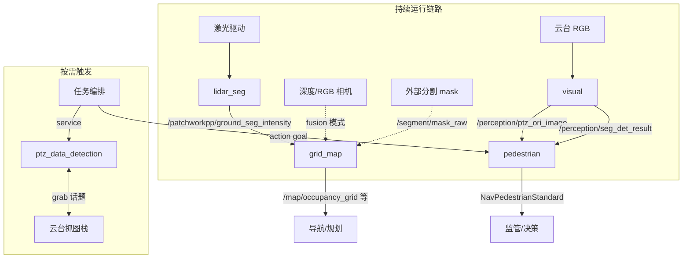

# 感知节点详细分析

> 基于 `perception_combo_ros/node_src/` 源码与 install 配置整理。  
> 运行时配置根目录由环境变量 `SERES_PERCEPTION_INSTALL_DIR` 指定（开发机为 `install/`，机载为 `/opt/seres/nav_perception`）。

## 总览

生产环境由 `cfg/start_nav_perception_bg.sh` 同时拉起五个节点。节点之间**无直接函数调用**，通过 ROS 2 话题 / 服务 / Action 松耦合串联。

| 节点 | ROS 包名 | 可执行文件 | ROS 节点名 | 运行模式 |
|------|----------|------------|------------|----------|
| 激光地面分割 | `lidar_seg` | `lidar_seg` | `lidar_seg_module` | 持续运行 |
| 栅格地图 | `grid_map_memory_node` | `grid_map_memory_node` | `grid_map_memory_node` | 持续运行 |
| 视觉检测分割 | `visual_perception` | `visual_perception_2d` | `visual_perception_2d` | 持续运行 |
| 云台按需检测 | `ptz_data_detection` | `ptz_data_detection_2d` | `ptz_data_detection` | **按需**（Service） |
| 行人行为规范 | `pedestrian_code_conduct` | `pedestrian_code_conduct_2d` | `pedestrian_code_conduct_2d` | **门控**（Action） |

### 数据流关系



**当前默认配置下的活跃数据链：**

1. **导航栅格链：** 激光驱动 → `lidar_seg` → `grid_map_memory_node`（yaml 中 `mode: lidar_only`）
2. **行人合规链：** 云台相机 → `visual_perception` → `pedestrian_code_conduct`（须 Action goal 开启）
3. **巡检抓图链：** 任务编排器 → `ptz_data_detection` service → 云台抓图栈回传图像

---

## 1. lidar_seg — 激光地面分割

### 功能

基于 **PatchWork++（Wild PatchWork++）** 算法，将 3D 激光点云分割为地面点与非地面点。支持：

- 多激光雷达融合（可配置，当前默认关闭）
- 半径滤波 / 统计滤波
- 车体 ROI 剔除
- 调试可视化（MarkerArray）

### 配置文件

`$SERES_PERCEPTION_INSTALL_DIR/lidar_seg/config/lidar_seg.yaml`

### 输入

| 话题 | 消息类型 | 配置键 | 状态 |
|------|----------|--------|------|
| `/robot/topic/rdap/top_point_cloud2` | `sensor_msgs/PointCloud2` | `lidar_subscribe` | **活跃**（顶激光） |
| `/FrontBlindSpotLidar` | `sensor_msgs/PointCloud2` | `lidar_subscribe_front` | **活跃** |
| `/BackBlindSpotLidar` | `sensor_msgs/PointCloud2` | `lidar_subscribe_back` | **活跃** |
| `/LeftBlindSpotLidar` | `sensor_msgs/PointCloud2` | `lidar_subscribe_left_front` | 代码中订阅已注释 |
| `/RightBlindSpotLidar` | `sensor_msgs/PointCloud2` | `lidar_subscribe_right_front` | 代码中订阅已注释 |
| `/seres/insmodule/devpvt` | — | `loc_subscribe` | 定位订阅已注释（`use_loc_trans: false`） |

### 输出

| 话题 | 消息类型 | 说明 |
|------|----------|------|
| `/patchworkpp/ground_seg` | `sensor_msgs/PointCloud2` | 地面点云 |
| `patchworkpp/ground_seg_intensity` | `sensor_msgs/PointCloud2` | 带强度地面点云（**下游 grid_map 订阅**，注意 yaml 中无 leading `/`） |
| `patchworkpp/ground_revert` | `sensor_msgs/PointCloud2` | 反转地面点云 |
| `patchworkpp/patch` | `sensor_msgs/PointCloud2` | 分 patch 点云 |
| `patchworkpp/patch_txt` | `visualization_msgs/MarkerArray` | 调试 marker |
| `patchworkpp/patch_txt_init` | `visualization_msgs/MarkerArray` | 初始化 marker |
| `patchworkpp/patch_init` | `visualization_msgs/MarkerArray` | patch 初始化 marker |
| `patchworkpp/ground_convert` | `sensor_msgs/PointCloud2` | 硬编码话题名 |
| `/patchworkpp/ncr` | `sensor_msgs/PointCloud2` | 硬编码话题名 |

无 Service / Action。

### 触发方式

1. **订阅回调**：`LidarCallback` / `LidarFrontCallback` / `LidarBackCallback` 将点云写入内部缓存
2. **主循环轮询**：`main()` 中 `while (rclcpp::ok()) { node->Process(); }` 持续从缓存取数据、执行 PatchWork++、发布结果

**不是** timer 驱动，也**不是** service 触发。

### 关键配置参数

| 参数 | 默认值 | 含义 |
|------|--------|------|
| `use_multi_lidar` | `false` | 是否多激光融合 |
| `use_filter` | `true` | 是否启用滤波 |
| `use_loc_trans` | `false` | 是否使用定位变换 |
| `sensor_height` | — | 传感器安装高度 |
| `th_seeds` / `th_dist` | — | PatchWork++ 地面估计阈值 |
| `min_x_range_` ~ `max_z_range_` | — | 点云处理 ROI |
| `car_front/back/left/right` | — | 车体排除区域 |
| `filter_nb_num` / `filter_nb_radius` | — | 邻域滤波参数 |

### 依赖

- **上游：** 激光雷达驱动发布 `PointCloud2`
- **下游：** `grid_map_memory_node` 订阅 `ground_seg_intensity`
- **库：** PCL、YAML-cpp、glog

---

## 2. grid_map_memory_node — 栅格地图 + OctoMap

### 功能

单节点集成三个子模块：

1. **深度–激光融合（depth_lidar_fusion）** — 深度图投影为 3D 点云，可选与激光融合，变换到 `base_link`
2. **视觉可通行栅格（vision_freespace_process）** — 同步 RGB + 深度 + 语义 mask，生成 2D `OccupancyGrid`
3. **OctoMap** — 由地面/非地面点云构建局部/全局 3D 八叉树地图

### 配置文件

`$SERES_PERCEPTION_INSTALL_DIR/grid_map_memory_node/cfg/grid_map_memory_node.yaml`

### 输入

#### 融合模块（mode 决定活跃输入）

| 话题 | 消息类型 | 配置键 | 当前状态 |
|------|----------|--------|----------|
| `/patchworkpp/ground_seg_intensity` | `sensor_msgs/PointCloud2` | `lidar_pointcloud_topic` | **活跃**（`mode: lidar_only`） |
| `/omstuns_99f9_353e_208c_4c44/depth` | `sensor_msgs/Image` | `depth_image_topic` | fusion/depth_only 时活跃 |
| `/omstuns_99f9_353e_208c_4c44/depth_info` | `sensor_msgs/CameraInfo` | `camera_info_topic` | fusion/depth_only 时活跃 |

#### 栅格模块

| 话题 | 消息类型 | 配置键 | 说明 |
|------|----------|--------|------|
| `/omstuns_99f9_353e_208c_4c44/rgb_rect_vga` | `sensor_msgs/Image` | `rgb_topic` | RGB 输入 |
| `/segment/mask_raw` | `sensor_msgs/Image` | `mask_topic` | 语义 mask（MONO8 类别 ID） |
| （深度来自融合缓存） | — | `depth_topic` | 非独立订阅 |

> **注意：** yaml 中 `freespace_topic: /perception/det_seg_results` **在代码中未订阅**。栅格模块实际依赖 `mask_topic`，而非 `visual_perception` 的 `DetSegResults`。

#### OctoMap 模块

| 话题 | 消息类型 | 配置键 | 说明 |
|------|----------|--------|------|
| `/grid/source_ground_points` | `sensor_msgs/PointCloud2` | 自发布再订阅 | message_filters 同步 |
| `/grid/source_non_ground_points` | `sensor_msgs/PointCloud2` | 自发布再订阅 | message_filters 同步 |
| `/Odometry` | `nav_msgs/Odometry` | `odom_topic` | 仅 `enable_accumulation: true` 时需要 |

### 输出

| 话题 | 消息类型 | 配置键 |
|------|----------|--------|
| `/fused_point_cloud` | `sensor_msgs/PointCloud2` | `fused_pointcloud_topic` |
| `/fused_point_cloud_raw` | `sensor_msgs/PointCloud2` | `filter.raw_topic`（滤波开启时） |
| `/grid/source_point_cloud` | `sensor_msgs/PointCloud2` | `pointcloud_topic` |
| `/map/occupancy_grid` | `nav_msgs/OccupancyGrid` | `occupancy_grid_topic` |
| `/camera/vis_freespace_seg` | `sensor_msgs/Image` | `visualization_topic` |
| `/grid/source_ground_points` | `sensor_msgs/PointCloud2` | `ground_pointcloud_topic` |
| `/grid/source_non_ground_points` | `sensor_msgs/PointCloud2` | `non_ground_pointcloud_topic` |
| `/grid/projected_points_vis` | `sensor_msgs/Image` | `projected_points_vis_topic` |
| `/octomap/local_markers` | `visualization_msgs/MarkerArray` | `octomap_local_markers_topic` |
| `/octomap/local_binary` | `octomap_msgs/Octomap` | `octomap_local_binary_topic` |
| `/octomap/global_markers` | `visualization_msgs/MarkerArray` | `octomap_global_markers_topic` |
| `/octomap/global_binary` | `octomap_msgs/Octomap` | `octomap_global_binary_topic` |

无 Service / Action。

### 触发方式

| 子模块 | 触发机制 |
|--------|----------|
| 融合 | 深度/激光**订阅回调**；`lidar_only` 模式下激光回调触发变换、滤波、发布 `/fused_point_cloud` 并调用 `generateGrid()` |
| 栅格 | RGB/mask 回调仅缓存；**由融合或激光回调调用 `generateGrid()`** 时同步缓存的 RGB/mask/depth |
| OctoMap | `message_filters` 对 ground + non-ground 点云做近似时间同步 |
| 主循环 | 50 Hz `executor.spin_some()` |

**当前默认：** `depth_lidar_fusion.mode: "lidar_only"` — 栅格主要由 `lidar_seg` 输出驱动。

### 关键配置参数

| 模块 | 参数 | 当前值 | 含义 |
|------|------|--------|------|
| 融合 | `mode` | `lidar_only` | `depth_only` / `lidar_only` / `fusion` |
| 融合 | `time_sync_threshold` | `0.30` | 深度与激光时间同步阈值（秒） |
| 融合 | `output_body_frame` | `base_link` | 输出点云目标坐标系 |
| 栅格 | `resolution` | `0.05` | 栅格分辨率（米/像素） |
| 栅格 | `size` | `200` | 栅格边长（像素） |
| 栅格 | `freespace_classes` | `["freespace", "stair"]` | 可通行语义类别 |
| OctoMap | `enable_accumulation` | `false` | 是否多帧累积建图 |
| OctoMap | `resolution` | `0.05` | 体素分辨率（米） |

### 依赖

- **上游：** `lidar_seg`（`/patchworkpp/ground_seg_intensity`）、深度/RGB 相机驱动、外部分割 mask 发布者（`/segment/mask_raw`）
- **下游：** 导航/规划消费 `/map/occupancy_grid`、`/fused_point_cloud`、OctoMap 话题
- **库：** PCL、OpenCV、OctoMap、yaml-cpp、`nav_interface`

---

## 3. visual_perception — 2D 检测 + 分割

### 功能

GPU **TensorRT** 推理管线，包含两个模型：

- **YOLOv8-seg（2 类）：** `zebra_crossing`（斑马线）、`drivabel_area`（可行驶区）
- **YOLOv8-det（5 类）：** 机动车、行人、障碍物、非机动车、行人正面

默认从云台 RGB 相机取流；支持离线图片目录模式。

### 配置文件

`$SERES_PERCEPTION_INSTALL_DIR/visual_perception/config/visualperception.json`

### 输入

| 话题 | 消息类型 | 配置键 | 状态 |
|------|----------|--------|------|
| `/robot/topic/PtzControl/PtzRGBCamera` | `nav_interface/NavSensorCamera` | `img_topic` | **活跃**（`use_ptz_camera: true`） |
| `/robot/topic/PtzControl/PtzInfraredCamera` | `nav_interface/NavSensorCamera` | `infrared_topic` | 订阅在代码中注释 |

离线模式从 `offline_img_file_path` 目录读图。

### 输出

| 话题 | 消息类型 | 说明 |
|------|----------|------|
| `/perception/ptz_ori_image` | `sensor_msgs/Image` | 转发原始 RGB（PTZ 模式） |
| `/perception/ptz_infrared_image` | `sensor_msgs/Image` | 红外图（发布器存在，输入未启用） |
| `/perception/offline_image` | `sensor_msgs/Image` | 离线模式 |
| `/camera/seg_det_result` | `sensor_msgs/Image` | 检测+分割可视化图 |
| `/perception/seg_det_result` | `nav_interface/DetSegResults` | **结构化检测结果**（下游 pedestrian 使用） |
| `/robot/topic/VP/VisualPerceptionStatus` | — | IPC 状态（`pub_state_ipc: true`，代码中可能注释） |

> **注意：** 本节点**不发布** `/segment/mask_raw`。`grid_map` yaml 若依赖该话题，需其他节点提供 mask。

无 Service / Action。

### 触发方式

1. **图像订阅回调** — 解码帧，`frame_process_interval` 抽帧（当前每 5 帧处理 1 帧）后入缓存；PTZ 模式同时转发 `/perception/ptz_ori_image`
2. **30 Hz 主循环** — `Run()` 启动线程持续调用 `Process()`
3. **`Process()`** — 从缓存取图 → TensorRT seg + det → 发布可视化 → `RetsPub()` 发布 `DetSegResults` → `spin_some()`

### 关键配置参数

| 参数 | 当前值 | 含义 |
|------|--------|------|
| `gpu_id` | `0` | GPU 设备号 |
| `use_ptz_camera` | `true` | 使用云台相机消息格式 |
| `frame_process_interval` | `5` | 每 N 帧处理 1 帧 |
| `seg_model_path` / `det_model_path` | `.engine` 绝对路径 | TensorRT 模型（**不在 git 中**） |
| `seg_conf_thresh` | `0.6` | 分割置信度阈值 |
| `seg_num_cls` | `2` | 分割类别数 |

### 依赖

- **上游：** 云台 RGB 相机驱动
- **下游：** `pedestrian_code_conduct`（`/perception/ptz_ori_image`、`/perception/seg_det_result`）
- **库：** CUDA、TensorRT、OpenCV、`nav_interface`

---

## 4. ptz_data_detection — 云台按需巡检

### 功能

面向巡检任务的**按需感知服务**：

1. 收到 service 请求后向云台栈发布 `GrabImage` 抓图命令
2. 轮询等待压缩 RGB / 红外图 + 温度矩阵回传
3. 对 RGB 图运行 YOLOv8 **遮挡检测**（检查画面中心 ROI 是否被物体遮挡）
4. 遮挡则重新抓图；超时则返回最新数据
5. 将 JPEG 图像（红外任务附最高温 bounding box）填入 service 响应

> 历史上存在连续 `Process()` 循环（云台微调 + 规划交互），**当前已禁用**，仅 service 驱动路径活跃。

### 配置文件

`$SERES_PERCEPTION_INSTALL_DIR/ptz_data_detection/config/ptz_data_detection.json`

### 输入

| 话题 | 消息类型 | 配置键 | 状态 |
|------|----------|--------|------|
| `/robot/topic/ptz/rgb_img_data` | `sensor_msgs/CompressedImage` | `grab_rgb_topic` | **活跃** |
| `/robot/topic/ptz/infrared_img_data` | `sensor_msgs/CompressedImage` | `grab_infrared_topic` | **活跃** |
| `/robot/topic/ptz/cam_tem_matrix` | `rte_interface/CamTemMatrix` | `cam_tem_matrix_topic` | **活跃** |
| `/robot/topic/PtzControl/PtzRGBImgData` | — | `img_topic` | 代码中注释 |
| `/perception/seg_det_result` | — | `det_seg_ret_topic` | 代码中注释 |
| `/robot/topic/PLAN/TargetPTZ` | — | `target_ptz_topic` | 代码中注释 |

### 输出

| 话题 | 消息类型 | 配置键 | 状态 |
|------|----------|--------|------|
| `/robot/topic/ptz/grab_image` | `rte_interface/GrabImage` | `grab_image_topic` | **活跃**（抓图命令） |
| `/robot/topic/PtzControl/FineTuningPTZ` | — | `to_planning_topic` | 代码中注释 |
| `/robot/topic/PtzDataDetection/FineTuningPTZ` | — | `to_ptz_control_topic` | 代码中注释 |

### 服务

| 服务名 | 类型 | 配置键 |
|--------|------|--------|
| `/perception/perception_detect` | `perception_interface/srv/PerceptionEvent` | `perception_detect_srv` |

**支持的 `event_id`：**

| event_id | 任务类型 | 返回内容 |
|----------|----------|----------|
| `13` | 红外高温检测 | 红外 JPEG + 最高温 `BoundingBox2D` |
| `14` | 建筑外观变化 | RGB JPEG |
| `15` | 路灯工作状态 | RGB JPEG |

**响应字段：** `stamp`、`object`（JPEG 字节）、`box[]`（红外任务）

无 Action。

### 触发方式

**仅 Service 调用** `HandlePerceptionDetect`：

```
service 请求
  → 发布 GrabImage（task_type = BGR 或 INFRARED_BGR）
  → 100ms 间隔轮询 grab 订阅缓存（最多 wait_count=50 次）
  → YOLO 遮挡检测（中心 ROI: center_img_x1~y4）
  → 遮挡则清空缓存重抓；超时则返回当前数据
  → 填充 response
```

`Run()` 使用 `MultiThreadedExecutor`（2 线程），使 service 阻塞等待与 grab 订阅回调可并发。

### 关键配置参数

| 参数 | 当前值 | 含义 |
|------|--------|------|
| `wait_count` | `50` | 抓图轮询最大次数 |
| `use_detection` | `true` | 是否启用遮挡 YOLO 检测 |
| `det_model_path` | `.engine` 路径 | 遮挡检测模型 |
| `center_img_x1` ~ `center_img_y4` | 475/350/1500/750 | 遮挡检测中心 ROI 四顶点 |

### 依赖

- **上游：** 云台抓图栈（须订阅 `GrabImage` 并回传 RGB/红外/温度）
- **下游：** 任务编排器调用 `/perception/perception_detect`
- **库：** `perception_interface`、`rte_interface`、`nav_interface`、TensorRT

---

## 5. pedestrian_code_conduct — 行人行为规范

### 功能

基于上游 2D 检测+分割结果的**规则判定**（本节点不做 ML 推理）：

1. 从分割 mask 提取道路（label 0）和斑马线（label 1）多边形
2. 筛选行人检测框（label 1、4），按宽高比/尺寸过滤
3. 取 bbox 底边中心为「脚点」，判断是否在道路或斑马线区域内
4. **违规判定：** 脚点既不在道路也不在斑马线内
5. 连续 `report_internal` 帧违规后才发布 `is_specification=true`（去抖）

### 配置文件

`$SERES_PERCEPTION_INSTALL_DIR/pedestrian_code_conduct/config/behaviordetection.json`

### 输入

| 话题 | 消息类型 | 配置键 | 门控 |
|------|----------|--------|------|
| `/perception/ptz_ori_image` | `sensor_msgs/Image` | `img_topic` | 始终缓存 |
| `/perception/seg_det_result` | `nav_interface/DetSegResults` | `det_seg_ret_topic` | **仅 Action 开启后缓存** |

### 输出

| 话题 | 消息类型 | 说明 |
|------|----------|------|
| `/behavior/vis_img` | `sensor_msgs/Image` | 行为判定可视化 |
| `/robot/topic/Pedestrian/PedestrianStandard` | `nav_interface/NavPedestrianStandard` | 规范判定结果 |

### Action（服务端）

| Action 名 | 类型 | 配置键 |
|-----------|------|--------|
| `/perception/perception_detect_cycle` | `perception_interface/action/PerceptionDetect` | `perception_detect_action` |

**Goal 要求：** 须包含 `PERSONNEL_BEHAVIOR_STANDARD_DETECTION` 事件且 `detect_cycle > 0`

| 回调 | 行为 |
|------|------|
| Goal accept | `cycle_detect_enabled_ = true`，开始处理 det/seg |
| Cancel | `cycle_detect_enabled_ = false`，停止处理 |
| Feedback | 去抖违规时发布 JPEG 图像 |

无 Service。

### 触发方式

1. **图像回调** — 始终缓存 RGB（resize 到 `seg_src_h/w`）
2. **DetSeg 回调** — 仅 `cycle_detect_enabled_ == true` 时缓存
3. **30 Hz 主循环 `Process()`**
   - Action 未开启：仅 `spin_some()`
   - Action 已开启：按时间戳同步 image + det/seg → 规则判定 → 发布结果/feedback
4. **Action server** — goal/cancel 回调控制门控开关

> `detect_cycle` 从 goal 中读取但**未用作定时器**；实际处理速率取决于 `visual_perception` 发布频率和 30 Hz 轮询。

### 关键配置参数

| 参数 | 当前值 | 含义 |
|------|--------|------|
| `det_width_min/max` | 80 / 500 | 行人框宽度范围 |
| `det_height_min/max` | 180 / 800 | 行人框高度范围 |
| `wh_ratio` | 0.2 | 宽高比过滤 |
| `min_road_area` | 6000 | 道路多边形最小面积 |
| `min_zebra_area` | 500 | 斑马线多边形最小面积 |
| `report_internal` | 40 | 连续违规帧数阈值（去抖） |

### 依赖

- **上游：** `visual_perception`（必须同时有 `/perception/ptz_ori_image` 和 `/perception/seg_det_result`）
- **下游：** 导航/监管消费 `NavPedestrianStandard`；任务编排器作为 Action client
- **库：** `nav_interface`、`perception_interface`、OpenCV

---

## 联调检查清单

### 导航栅格无输出

```bash
ros2 topic hz /robot/topic/rdap/top_point_cloud2          # 激光是否有数据
ros2 topic hz /patchworkpp/ground_seg_intensity              # lidar_seg 是否发布
ros2 topic hz /fused_point_cloud                             # grid_map 融合输出
ros2 topic hz /map/occupancy_grid                            # 栅格是否生成
```

### 行人合规无反应

```bash
ros2 action list | grep perception_detect_cycle              # Action 是否存在
# 确认 Action goal 已 accept（未 accept 时 det/seg 回调被忽略）
ros2 topic hz /perception/seg_det_result                     # visual 是否在发布
ros2 topic echo /robot/topic/Pedestrian/PedestrianStandard   # 判定结果
```

### 巡检抓图超时

```bash
ros2 service list | grep perception_detect                   # Service 是否存在
ros2 topic echo /robot/topic/ptz/grab_image                  # 是否发出抓图命令
ros2 topic hz /robot/topic/ptz/rgb_img_data                  # 云台栈是否回传
```

---

## 源码索引

| 节点 | 入口 | 主实现 |
|------|------|--------|
| lidar_seg | `node_src/lidar_seg_module/src/main.cpp` | `Wildpatchworkpp.cpp` |
| grid_map | `node_src/GridMapTask/src/grid_map_memory_node.cpp` | 同文件 |
| visual_perception | `node_src/visual_perception/src/main.cpp` | `visualperception.cpp` |
| ptz_data_detection | `node_src/ptz_data_detection/src/main.cpp` | `ptz_data_detection.cpp` |
| pedestrian | `node_src/pedestrian_code_conduct/src/main.cpp` | `behaviordetection.cpp` |

启动脚本：`cfg/start_nav_perception_bg.sh`（生产）/ `run_perception.sh`（开发 tmux）
