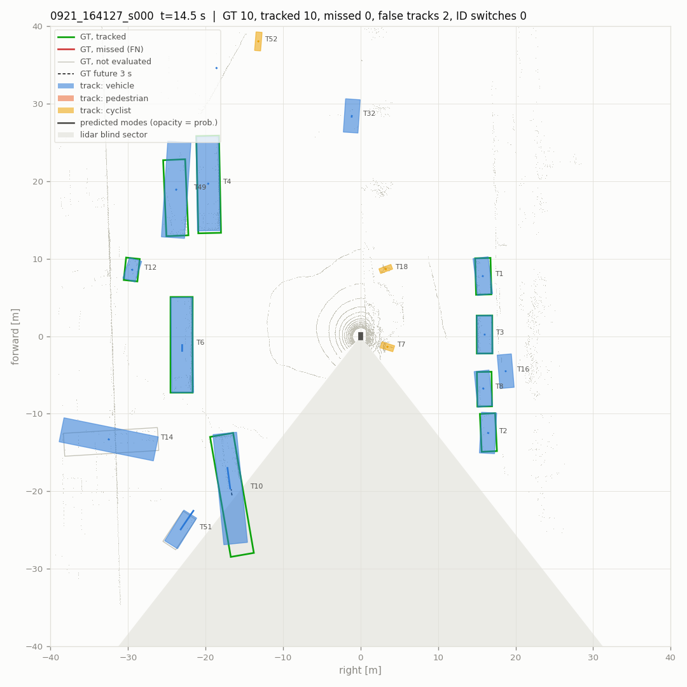
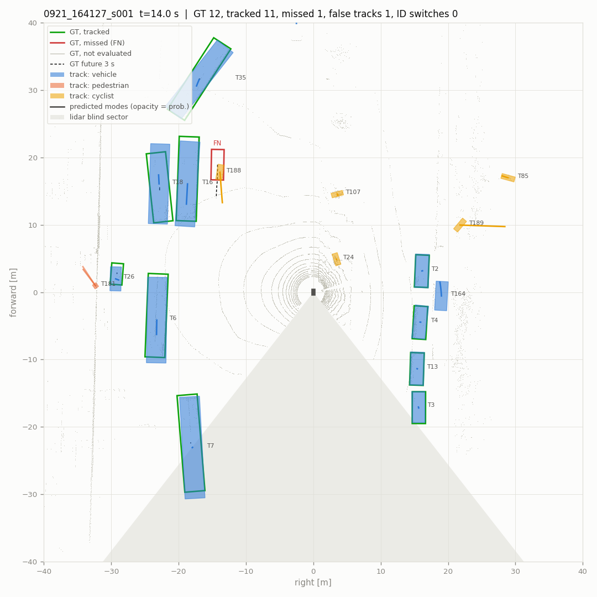
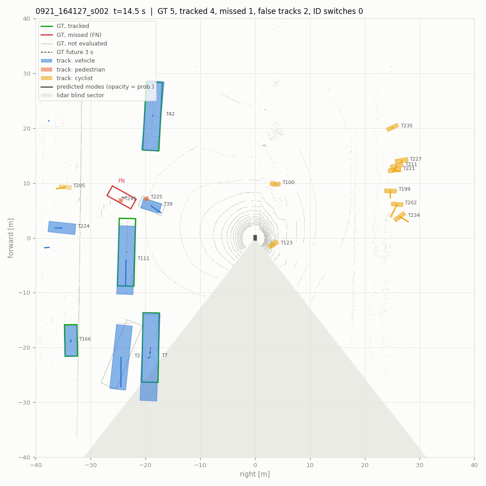
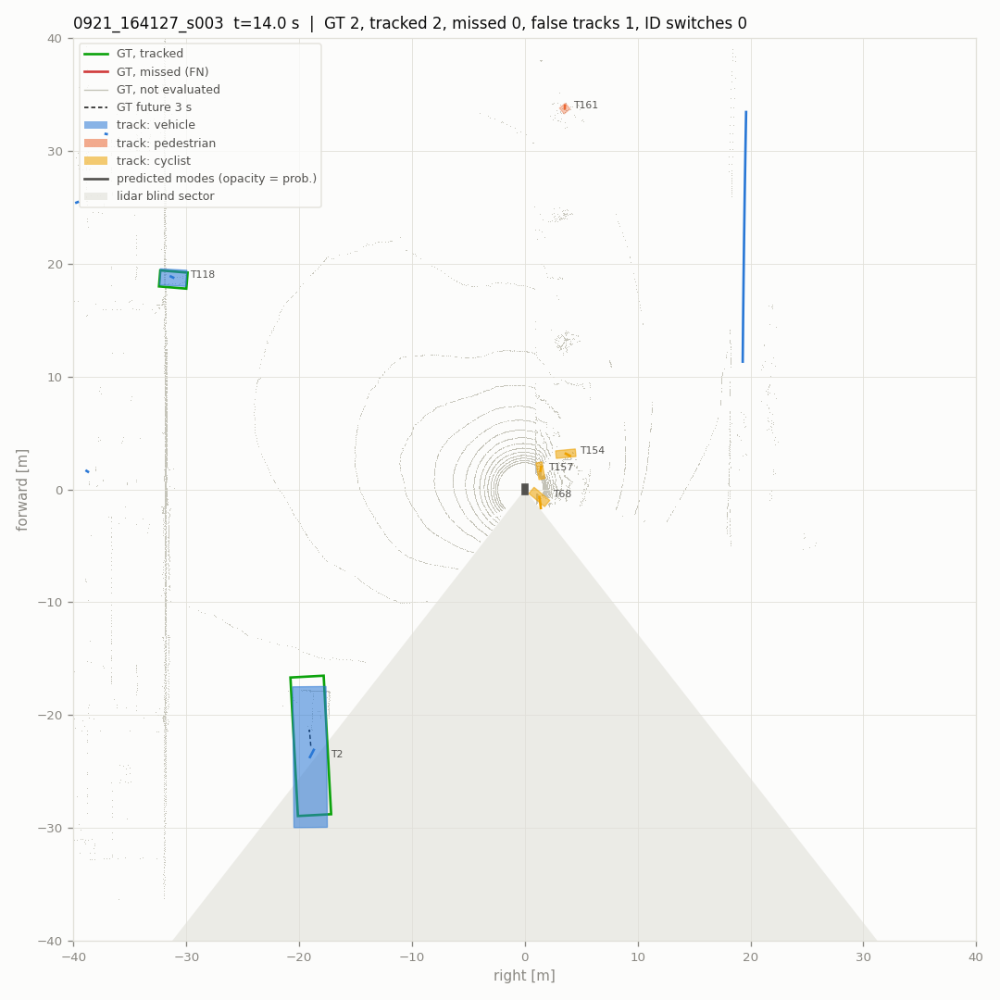
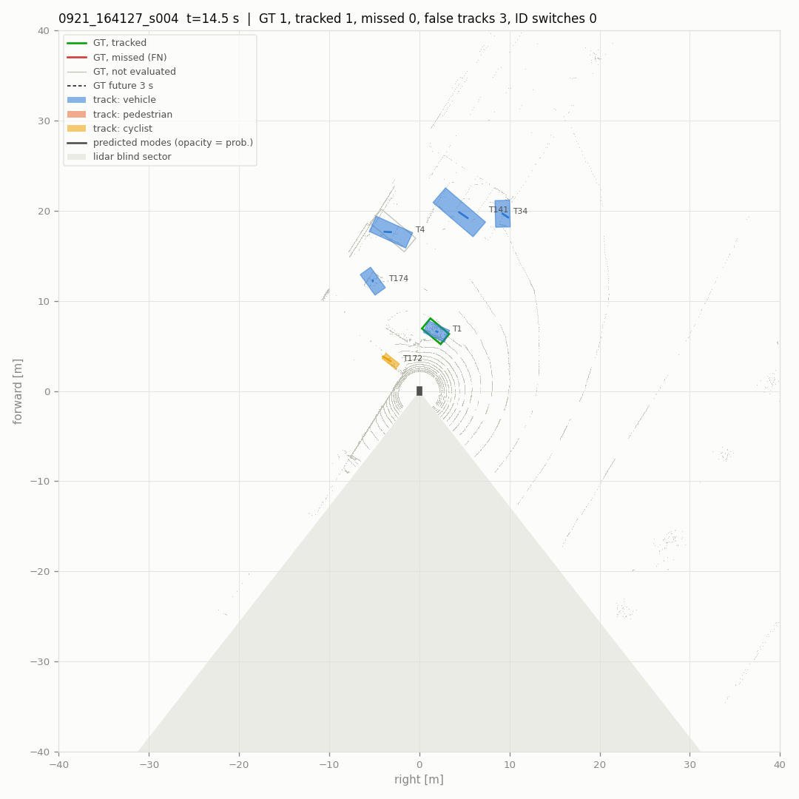
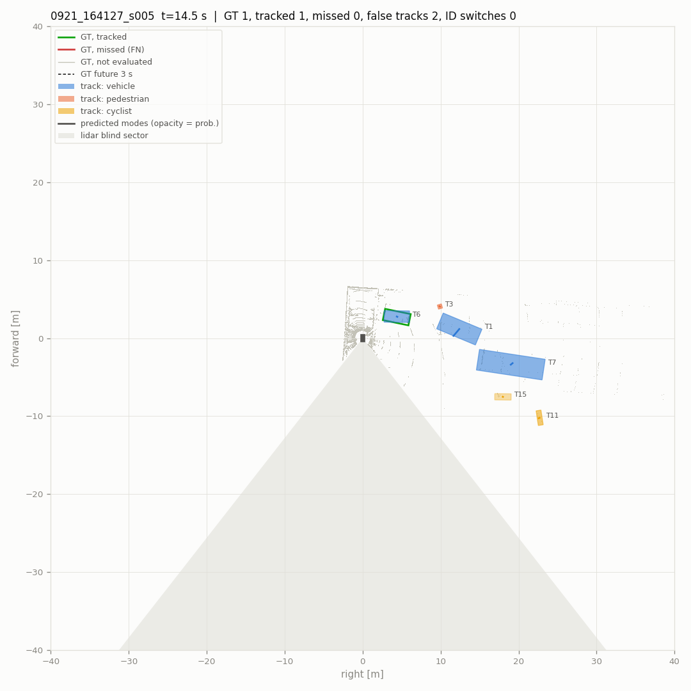
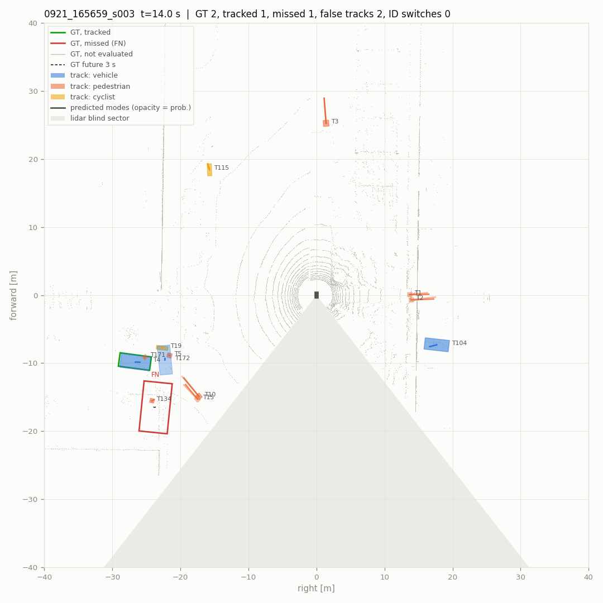
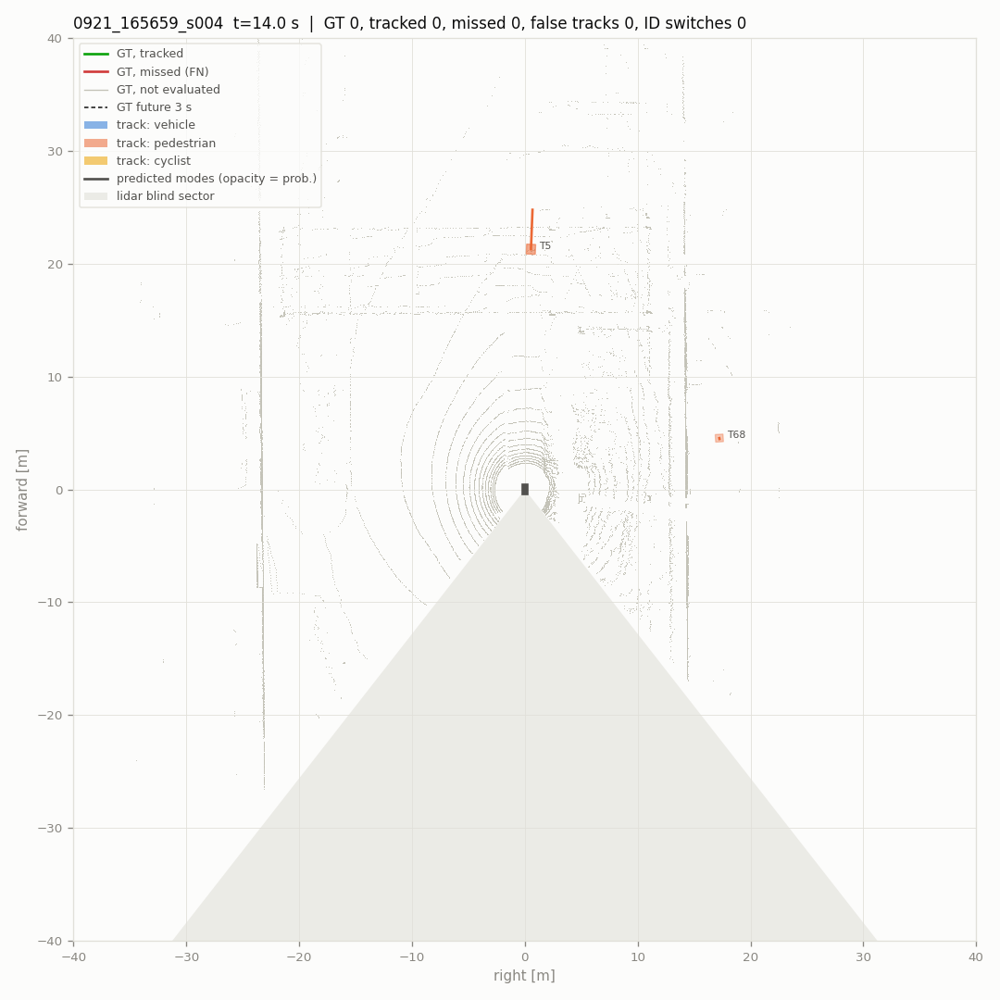
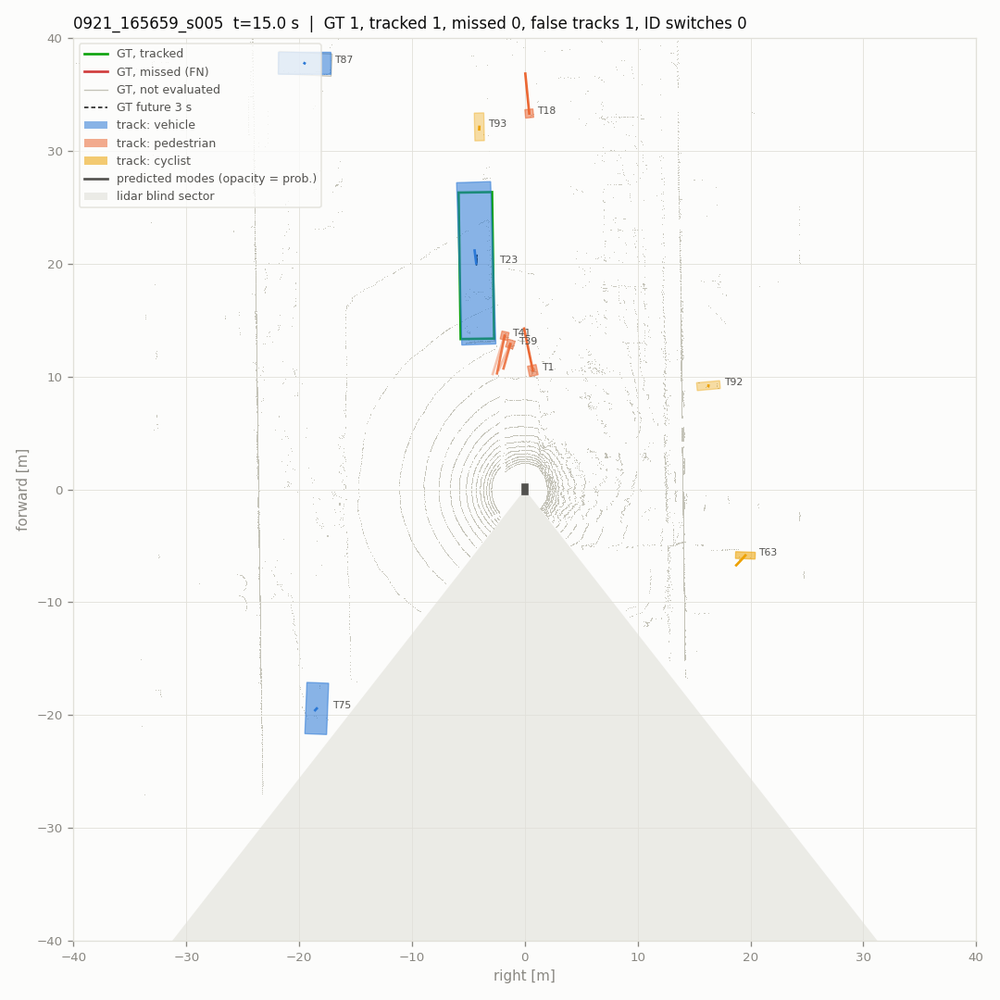
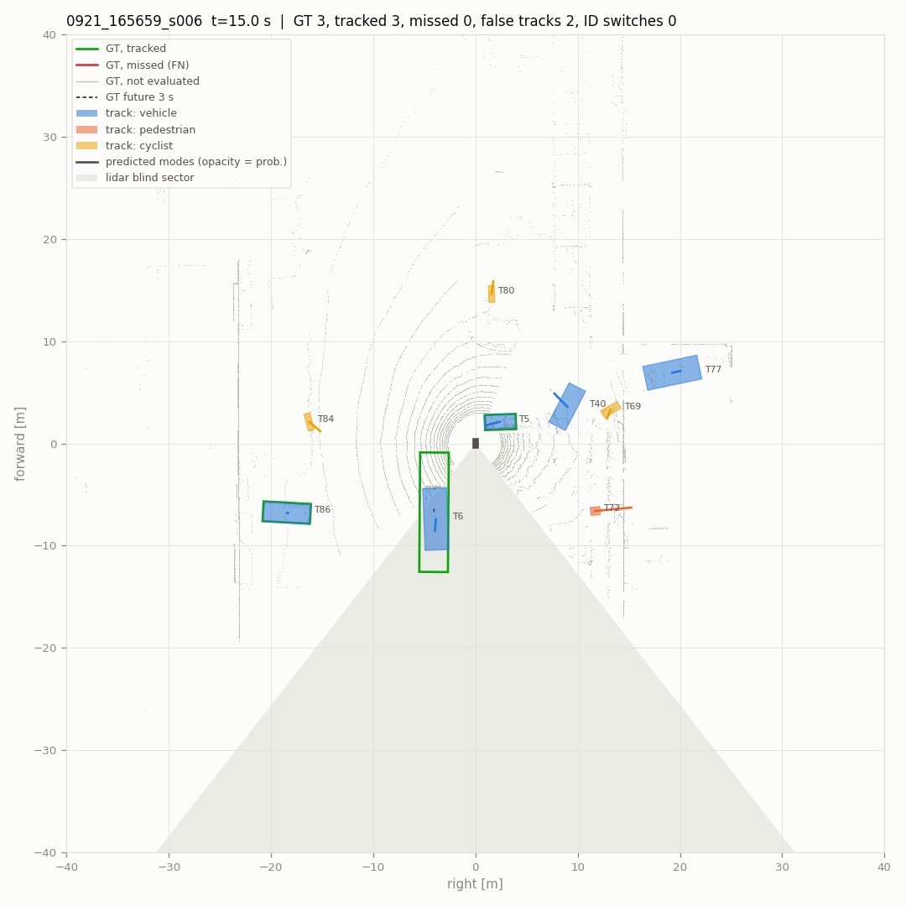

# Pipeline evaluation

- scenes (10): 0921_164127_s000, 0921_164127_s001, 0921_164127_s002, 0921_164127_s003, 0921_164127_s004, 0921_164127_s005, 0921_165659_s003, 0921_165659_s004, 0921_165659_s005, 0921_165659_s006
- 2884 frames, 580 keyframes scored (4.8 min)
- detections: `raw` from `data/tune/deploy/{scene}/pillar/results.pkl`
- parameters: defaults
- scored: vehicles that are not ignore boxes, within 40 m and with current-sweep points; a detection or track on any other labelled box is not counted. Label tracks stitched into one vehicle: 20.
- intervals: 90 % over 500 resamples of the scenes

## Main metrics

| metric | value | interval |
|---|---|---|
| detections: recall within near range | **0.867** | 0.833 – 0.886 |
| detections: precision within near range | **0.781** | 0.628 – 0.860 |
| detections: F1 within near range | **0.822** | 0.726 – 0.866 |
| detections: false per keyframe | **1.047** | 0.814 – 1.268 |
| tracks: MOTA | **0.518** | 0.244 – 0.636 |
| tracks: IDF1 | **0.750** | 0.659 – 0.797 |
| tracks: ID switches / min | **2.689** | 0.835 – 5.240 |
| tracks: false tracks / min | **59.789** | 42.915 – 76.228 |
| tracks: confirm delay p90 [s] | **0.950** | 0.500 – 2.300 |
| motion: relevant moving stretches missed | **2** | 0.000 – 4.000 |
| motion: parked reported moving / h | **148.956** | 62.053 – 238.366 |
| prediction: FDE 3 s, moving [m] | **2.818** | 2.221 – 3.725 |
| prediction: miss rate 3 s, moving | **0.519** | 0.399 – 0.718 |

## Detections at the reporting threshold

Vehicle threshold 0.35 (`tracker.high_score`), 2 m match, keyframes. Near: within 30 m.

| range | precision | recall | TP | FP | FN |
|---|---|---|---|---|---|
| 0-30 m | 0.781 | 0.867 | 1361 | 382 | 209 |
| 30-40 m | 0.581 | 0.687 | 312 | 225 | 142 |

False detections per keyframe 1.047. AP over all scores: AP@2.0 0.846, AP@4.0 0.864, AP@2.0 0-20 m 0.932, 20-40 m 0.801.

## Tracking

Reported tracks (confirmed, coasting included) against the scored vehicles, keyframes, 2 m.

| MOTA | MOTP m | IDF1 | recall | precision | IDSW | IDSW / min | FRAG | MT | ML | vehicles | TP | FP | FN |
|---|---|---|---|---|---|---|---|---|---|---|---|---|---|
| **0.518** | 0.28 | **0.750** | 0.861 | 0.719 | 13 | 2.69 | 47 | 43 | 4 | 67 | 1742 | 681 | 282 |

- false tracks (a track false on consecutive keyframes counts once): 59.79 per minute
- a vehicle coming into 30 m waits for its first matched track: median 0.0 s, p90 0.9 s (22 vehicles; 1 never tracked; 0.5 s resolution)

### Where the errors are

| false tracks: cause | count |
|---|---|
| second track on a tracked vehicle | 4 |
| beside a vehicle (2-4 m off) | 51 |
| coasting after the vehicle was lost | 59 |
| nothing labelled nearby | 567 |

| missed vehicles (FN) | count |
|---|---|
| detected, not tracked | 58 |
| not detected | 224 |
| 0-10 m | 11 |
| 10-20 m | 27 |
| 20-30 m | 130 |
| 30-40 m | 114 |
| 1-9 pts | 13 |
| 10-49 pts | 63 |
| >=50 pts | 206 |

Blind sector (142-218 deg behind the robot) and the 20 deg bands beside it:

| zone | scored vehicles | missed | missed share | tracks | false | false share |
|---|---|---|---|---|---|---|
| elsewhere | 1597 | 202 | 0.126 | 2001 | 608 | 0.304 |
| edge | 408 | 73 | 0.179 | 390 | 62 | 0.159 |
| blind | 19 | 7 | 0.368 | 32 | 11 | 0.344 |

## Motion state

Online state against the labels' moving flags (tools/dog/motion_eval.py). Relevant: >= 1 m/s and within 30 m.

| moving recall | false moving | parked reported moving | false episodes (per h) | moving stretches missed | latency median / p90 s | relevant missed | relevant latency median / p90 s |
|---|---|---|---|---|---|---|---|
| 0.745 | 0.0229 | 7 / 46 | 12 (149.0) | 5 / 21 | 0.50 / 1.50 | **2 / 9** | 0.50 / 0.90 |

## Prediction

Tracks matched to a vehicle with 3 s of labelled future (keyframes every 0.5 s). Moving: >= 1.5 m in 3 s; turning: heading changes > 15 deg. ADE1 / FDE1: the most likely mode; minADE / minFDE: the best; MR: no mode ends within 2 m. IMM is what runs online, CV keeps the track's velocity.

**all matched** (1381 samples)

| predictor | horizon | ADE1 | FDE1 | minADE | minFDE | MR@2m |
|---|---|---|---|---|---|---|
| IMM | 1 s | 0.42 | 0.48 | 0.42 | 0.48 | 0.056 |
| IMM | 2 s | 0.54 | 0.71 | 0.54 | 0.71 | 0.095 |
| IMM | 3 s | 0.66 | 0.97 | 0.66 | 0.96 | 0.131 |
| CV | 1 s | 0.42 | 0.48 | 0.42 | 0.48 | 0.056 |
| CV | 2 s | 0.54 | 0.71 | 0.54 | 0.71 | 0.095 |
| CV | 3 s | 0.66 | 0.96 | 0.66 | 0.96 | 0.131 |

**moving** (129 samples)

| predictor | horizon | ADE1 | FDE1 | minADE | minFDE | MR@2m |
|---|---|---|---|---|---|---|
| IMM | 1 s | 0.95 | 1.14 | 0.95 | 1.13 | 0.194 |
| IMM | 2 s | 1.36 | 1.98 | 1.35 | 1.97 | 0.357 |
| IMM | 3 s | 1.78 | 2.82 | 1.76 | 2.79 | 0.519 |
| CV | 1 s | 0.95 | 1.14 | 0.95 | 1.14 | 0.194 |
| CV | 2 s | 1.36 | 1.97 | 1.36 | 1.97 | 0.357 |
| CV | 3 s | 1.77 | 2.80 | 1.77 | 2.80 | 0.519 |

**moving, straight** (108 samples)

| predictor | horizon | ADE1 | FDE1 | minADE | minFDE | MR@2m |
|---|---|---|---|---|---|---|
| IMM | 1 s | 0.95 | 1.13 | 0.95 | 1.13 | 0.194 |
| IMM | 2 s | 1.35 | 1.97 | 1.34 | 1.95 | 0.370 |
| IMM | 3 s | 1.77 | 2.81 | 1.75 | 2.77 | 0.528 |
| CV | 1 s | 0.95 | 1.13 | 0.95 | 1.13 | 0.194 |
| CV | 2 s | 1.35 | 1.96 | 1.35 | 1.96 | 0.370 |
| CV | 3 s | 1.76 | 2.78 | 1.76 | 2.78 | 0.528 |

**moving, turning** (21 samples)

| predictor | horizon | ADE1 | FDE1 | minADE | minFDE | MR@2m |
|---|---|---|---|---|---|---|
| IMM | 1 s | 0.94 | 1.16 | 0.94 | 1.16 | 0.190 |
| IMM | 2 s | 1.39 | 2.06 | 1.39 | 2.06 | 0.286 |
| IMM | 3 s | 1.82 | 2.87 | 1.82 | 2.86 | 0.476 |
| CV | 1 s | 0.94 | 1.16 | 0.94 | 1.16 | 0.190 |
| CV | 2 s | 1.39 | 2.06 | 1.39 | 2.06 | 0.286 |
| CV | 3 s | 1.82 | 2.86 | 1.82 | 2.86 | 0.476 |

**moving, < 3 m/s** (119 samples)

| predictor | horizon | ADE1 | FDE1 | minADE | minFDE | MR@2m |
|---|---|---|---|---|---|---|
| IMM | 1 s | 0.96 | 1.15 | 0.96 | 1.14 | 0.202 |
| IMM | 2 s | 1.37 | 2.01 | 1.37 | 1.99 | 0.378 |
| IMM | 3 s | 1.80 | 2.86 | 1.79 | 2.83 | 0.538 |
| CV | 1 s | 0.96 | 1.15 | 0.96 | 1.15 | 0.202 |
| CV | 2 s | 1.37 | 2.00 | 1.37 | 2.00 | 0.378 |
| CV | 3 s | 1.79 | 2.84 | 1.79 | 2.84 | 0.538 |

**moving, >= 6 m/s** (10 samples)

| predictor | horizon | ADE1 | FDE1 | minADE | minFDE | MR@2m |
|---|---|---|---|---|---|---|
| IMM | 1 s | 0.85 | 1.02 | 0.85 | 1.02 | 0.100 |
| IMM | 2 s | 1.18 | 1.67 | 1.18 | 1.67 | 0.100 |
| IMM | 3 s | 1.50 | 2.28 | 1.50 | 2.28 | 0.300 |
| CV | 1 s | 0.85 | 1.02 | 0.85 | 1.02 | 0.100 |
| CV | 2 s | 1.18 | 1.68 | 1.18 | 1.68 | 0.100 |
| CV | 3 s | 1.51 | 2.30 | 1.51 | 2.30 | 0.300 |

## Hazard proxy

A moving vehicle that comes within 5 m of the robot within 3 s (labelled future, the robot's own path) should raise an alarm: a moving track whose most likely predicted path, or its position now, comes that close. Few such vehicles in 0921; the numbers are for the controlled scenes to come (DATA_COLLECTION_PLAN.md 3.2).

- events 6, reported 3, lead before the closest approach: median 1.0 s, min 1.0 s
- alarms without such a vehicle: 1 (12.4 per hour)

## Timing (this machine, ms per frame: median / p90)

| stage | median | p90 |
|---|---|---|
| filter | 1.53 | 3.57 |
| track | 7.90 | 18.54 |
| predict | 3.48 | 7.04 |

## Issues (`issues.csv`)

| kind | count |
|---|---|
| ID switch | 13 |
| bad prediction | 47 |
| false moving | 12 |
| false track | 116 |
| hazard not reported | 3 |
| lost vehicle | 22 |
| missed moving vehicle | 2 |

## Snapshots

Middle keyframe of each scene, robot at the center heading up. Green / red outlines: scored vehicles tracked / missed; grey: not scored; filled: reported tracks; lines: the two most likely predicted modes; dashes: labelled 3 s future; shaded: the blind sector.

## Foxglove

- `data/tune/T18_mcap/0921_164127_s000.mcap`: 3632 messages, 91 MB
- `data/tune/T18_mcap/0921_164127_s001.mcap`: 3606 messages, 96 MB
- `data/tune/T18_mcap/0921_164127_s002.mcap`: 3610 messages, 93 MB
- `data/tune/T18_mcap/0921_164127_s003.mcap`: 3571 messages, 86 MB
- `data/tune/T18_mcap/0921_164127_s004.mcap`: 3593 messages, 94 MB
- `data/tune/T18_mcap/0921_164127_s005.mcap`: 3578 messages, 97 MB
- `data/tune/T18_mcap/0921_165659_s003.mcap`: 3433 messages, 102 MB
- `data/tune/T18_mcap/0921_165659_s004.mcap`: 3425 messages, 99 MB
- `data/tune/T18_mcap/0921_165659_s005.mcap`: 3771 messages, 111 MB
- `data/tune/T18_mcap/0921_165659_s006.mcap`: 3767 messages, 113 MB

Open a file in Foxglove, then Layout -> Import from file: `foxglove_layout.json` (3D following `ego`, Plot of `/metrics/frame`, Log of `/log`). Jump to the times in `issues.csv` (column t: seconds after the scene start).
