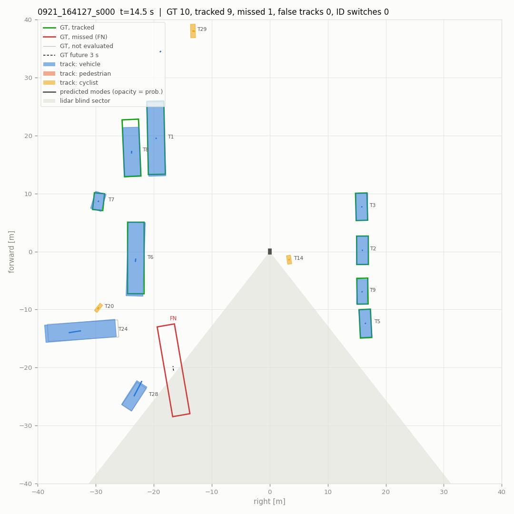
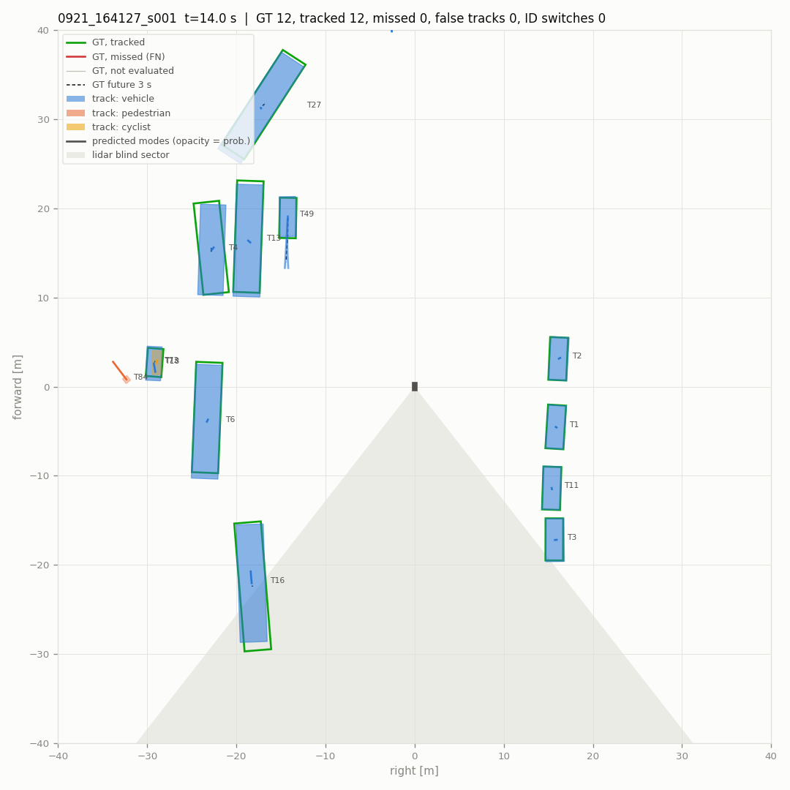
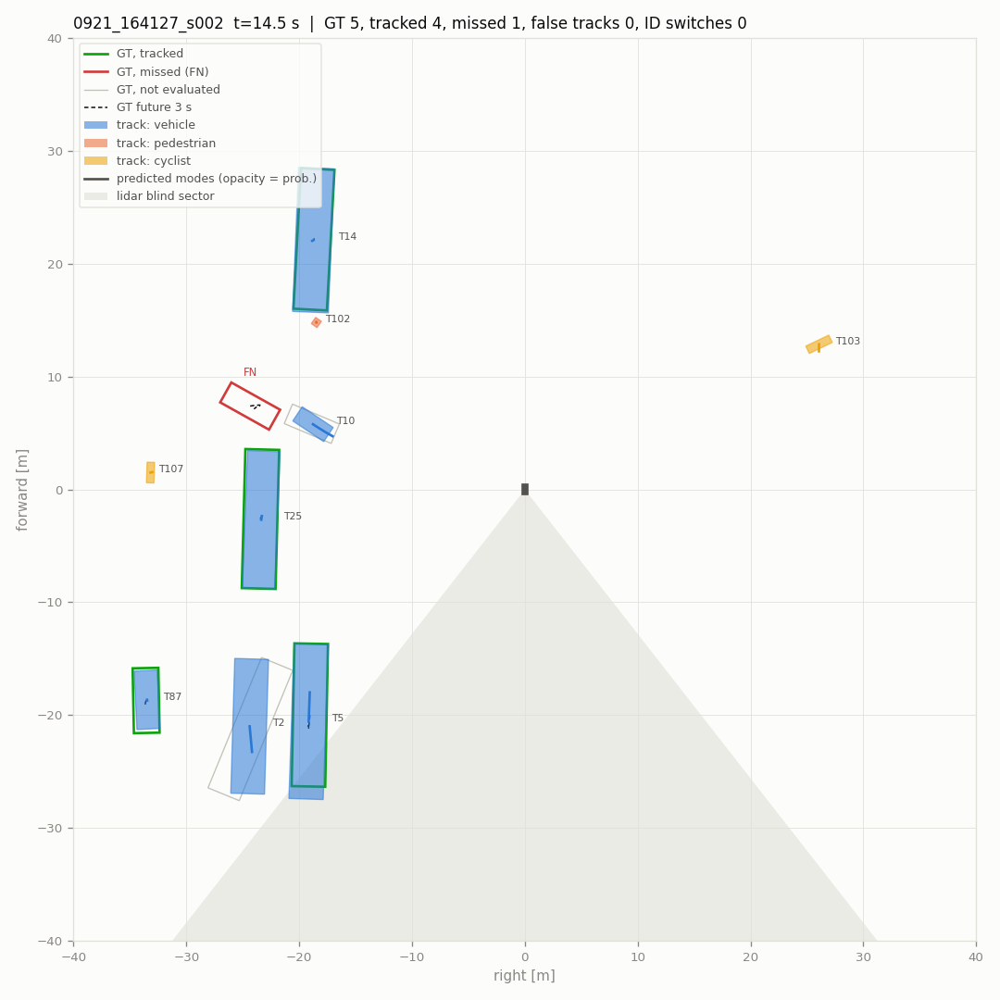
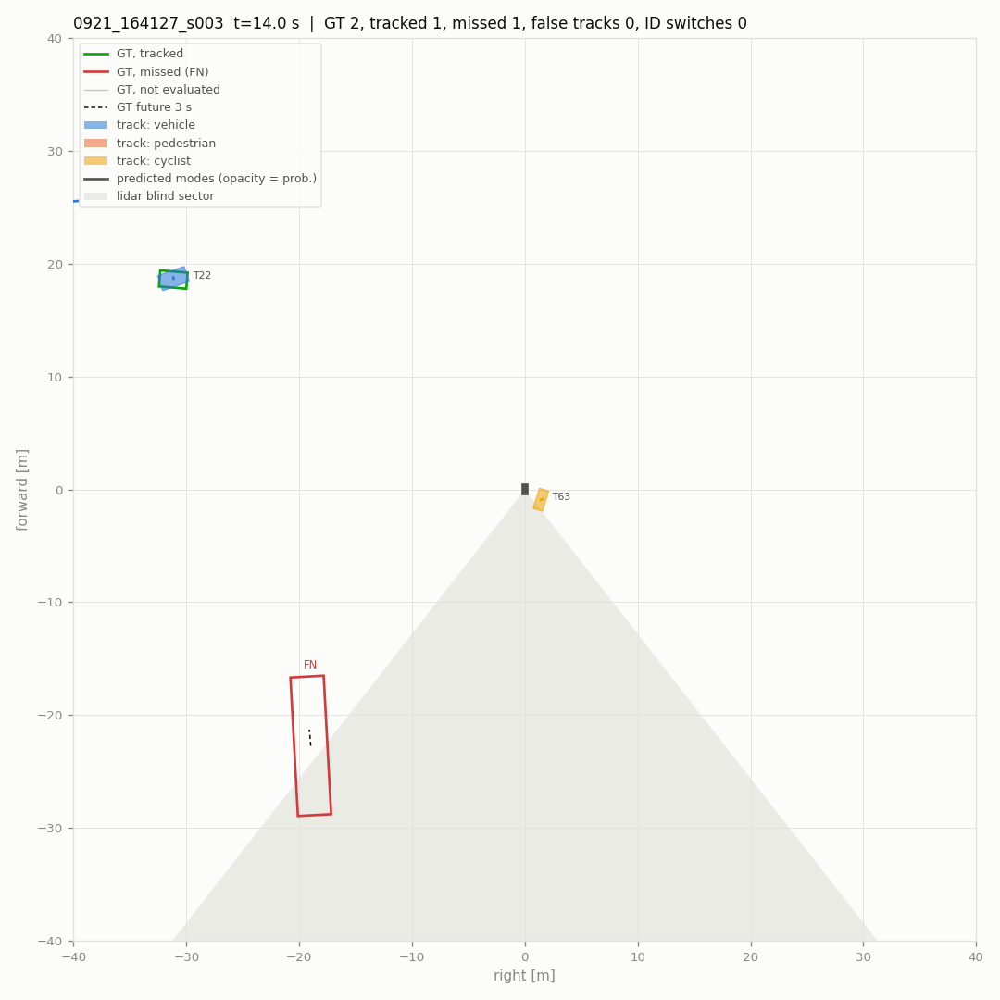
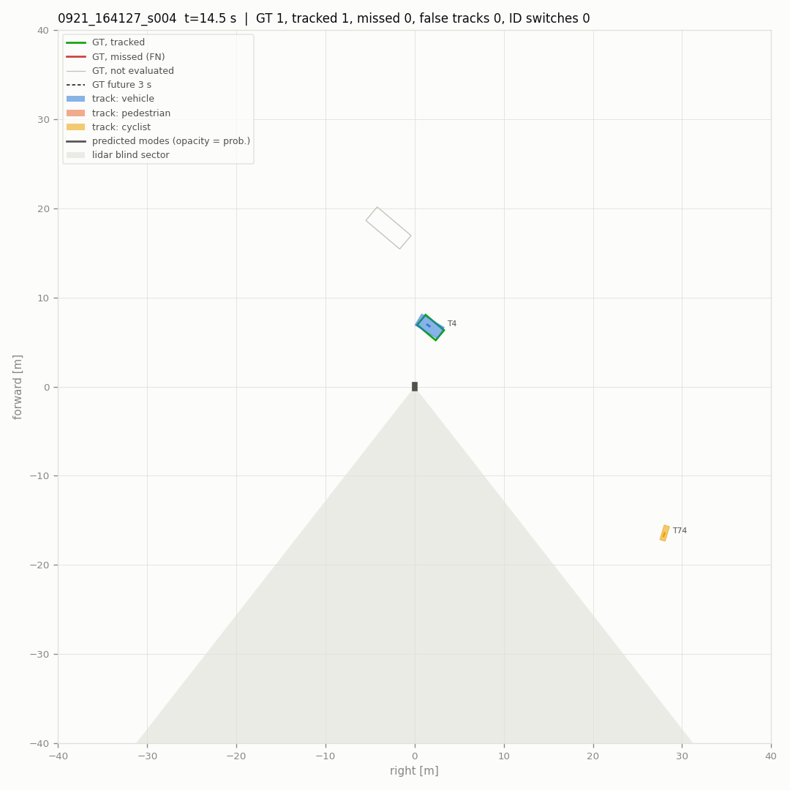
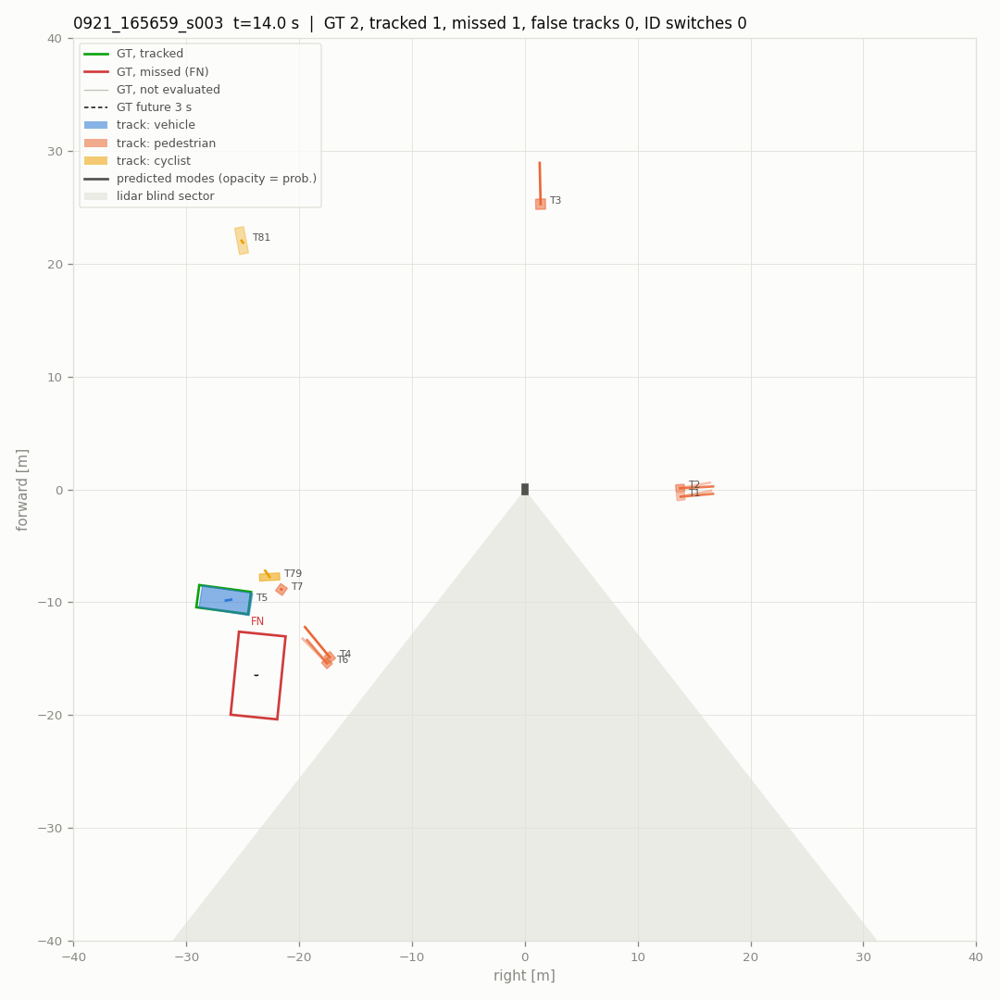
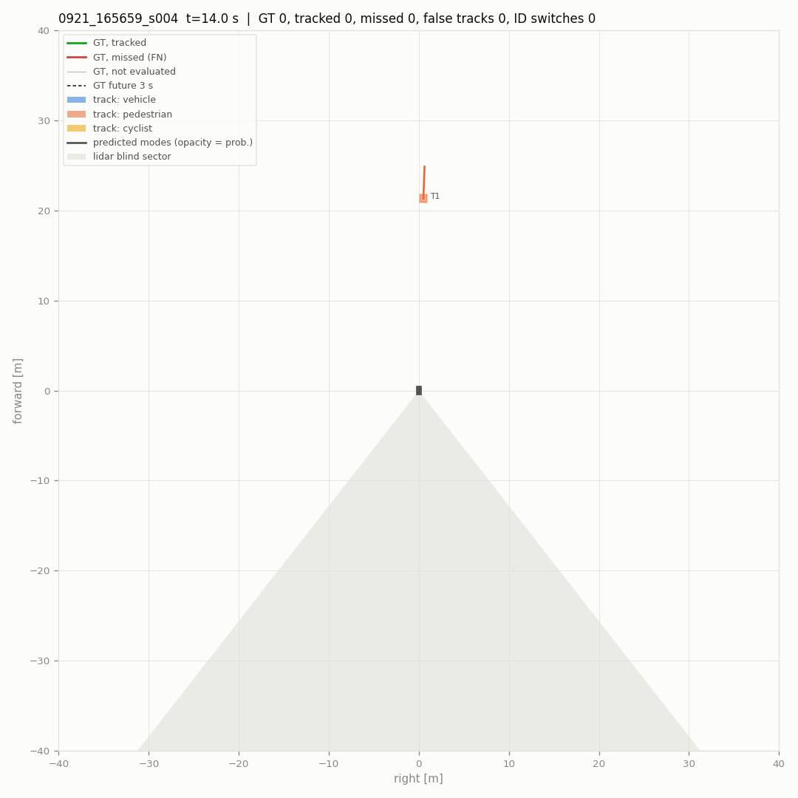
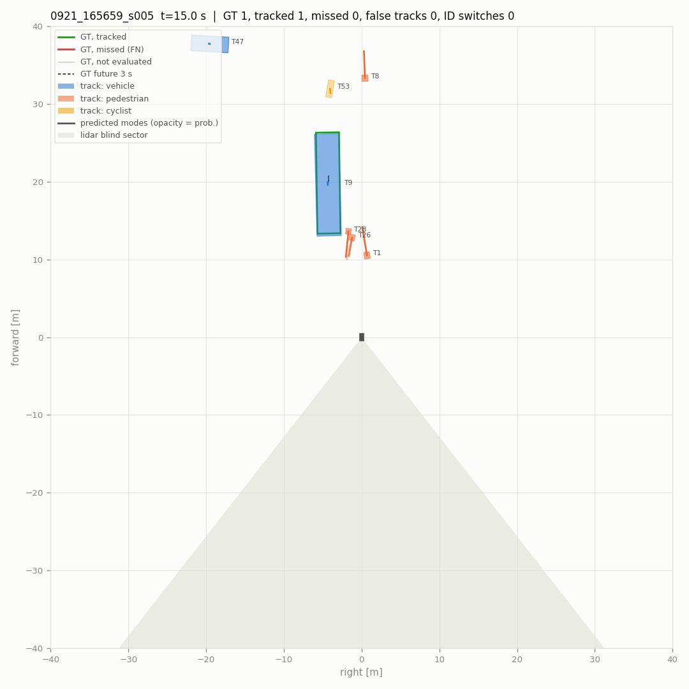
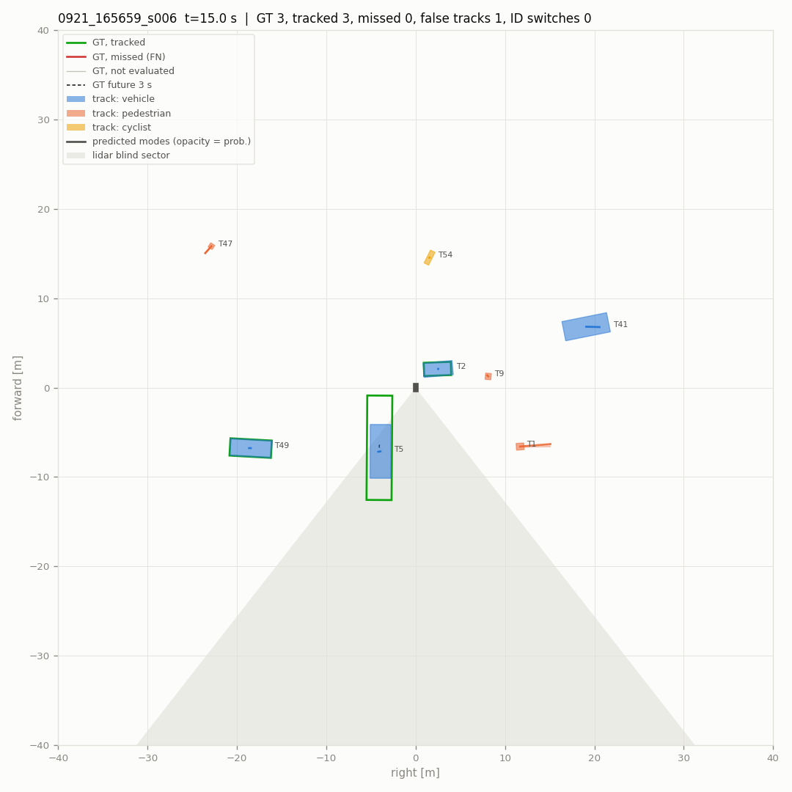

# Pipeline evaluation

- scenes (10): 0921_164127_s000, 0921_164127_s001, 0921_164127_s002, 0921_164127_s003, 0921_164127_s004, 0921_164127_s005, 0921_165659_s003, 0921_165659_s004, 0921_165659_s005, 0921_165659_s006
- 2884 frames, 580 keyframes scored (4.8 min)
- detections: `results` from `data/runs/{scene}/voxel/results.pkl`
- parameters: defaults
- scored: vehicles that are not ignore boxes, within 40 m and with current-sweep points; a detection or track on any other labelled box is not counted. Label tracks stitched into one vehicle: 20.
- intervals: 90 % over 500 resamples of the scenes

## Main metrics

| metric | value | interval |
|---|---|---|
| detections: recall within near range | **0.857** | 0.749 – 0.903 |
| detections: precision within near range | **0.952** | 0.900 – 0.971 |
| detections: F1 within near range | **0.902** | 0.822 – 0.933 |
| detections: false per keyframe | **0.219** | 0.161 – 0.280 |
| tracks: MOTA | **0.796** | 0.673 – 0.857 |
| tracks: IDF1 | **0.873** | 0.794 – 0.910 |
| tracks: ID switches / min | **1.655** | 0.620 – 3.125 |
| tracks: false tracks / min | **14.275** | 9.581 – 19.275 |
| tracks: confirm delay p90 [s] | **0.501** | 0.500 – 2.499 |
| motion: relevant moving stretches missed | **1** | 0.000 – 3.000 |
| motion: parked reported moving / h | **24.826** | 0.000 – 49.823 |
| prediction: FDE 3 s, moving [m] | **1.917** | 1.608 – 2.514 |
| prediction: miss rate 3 s, moving | **0.377** | 0.274 – 0.576 |

## Detections at the reporting threshold

Vehicle threshold 0.35 (`tracker.high_score`), 2 m match, keyframes. Near: within 30 m.

| range | precision | recall | TP | FP | FN |
|---|---|---|---|---|---|
| 0-30 m | 0.952 | 0.857 | 1362 | 68 | 227 |
| 30-40 m | 0.840 | 0.710 | 309 | 59 | 126 |

False detections per keyframe 0.219. AP over all scores: AP@2.0 0.925, AP@4.0 0.933, AP@2.0 0-20 m 0.959, 20-40 m 0.903.

## Tracking

Reported tracks (confirmed, coasting included) against the scored vehicles, keyframes, 2 m.

| MOTA | MOTP m | IDF1 | recall | precision | IDSW | IDSW / min | FRAG | MT | ML | vehicles | TP | FP | FN |
|---|---|---|---|---|---|---|---|---|---|---|---|---|---|
| **0.796** | 0.20 | **0.873** | 0.864 | 0.932 | 8 | 1.66 | 31 | 45 | 6 | 67 | 1748 | 128 | 276 |

- false tracks (a track false on consecutive keyframes counts once): 14.27 per minute
- a vehicle coming into 30 m waits for its first matched track: median 0.0 s, p90 0.5 s (21 vehicles; 2 never tracked; 0.5 s resolution)

### Where the errors are

| false tracks: cause | count |
|---|---|
| second track on a tracked vehicle | 2 |
| beside a vehicle (2-4 m off) | 6 |
| coasting after the vehicle was lost | 12 |
| nothing labelled nearby | 108 |

| missed vehicles (FN) | count |
|---|---|
| detected, not tracked | 47 |
| not detected | 229 |
| 0-10 m | 72 |
| 10-20 m | 19 |
| 20-30 m | 84 |
| 30-40 m | 101 |
| 1-9 pts | 15 |
| 10-49 pts | 55 |
| >=50 pts | 206 |

Blind sector (142-218 deg behind the robot) and the 20 deg bands beside it:

| zone | scored vehicles | missed | missed share | tracks | false | false share |
|---|---|---|---|---|---|---|
| elsewhere | 1597 | 206 | 0.129 | 1500 | 107 | 0.071 |
| edge | 408 | 67 | 0.164 | 355 | 14 | 0.039 |
| blind | 19 | 3 | 0.158 | 21 | 7 | 0.333 |

## Motion state

Online state against the labels' moving flags (tools/dog/motion_eval.py). Relevant: >= 1 m/s and within 30 m.

| moving recall | false moving | parked reported moving | false episodes (per h) | moving stretches missed | latency median / p90 s | relevant missed | relevant latency median / p90 s |
|---|---|---|---|---|---|---|---|
| 0.717 | 0.0046 | 2 / 46 | 2 (24.8) | 10 / 22 | 0.50 / 1.45 | **1 / 8** | 0.50 / 1.40 |

## Prediction

Tracks matched to a vehicle with 3 s of labelled future (keyframes every 0.5 s). Moving: >= 1.5 m in 3 s; turning: heading changes > 15 deg. ADE1 / FDE1: the most likely mode; minADE / minFDE: the best; MR: no mode ends within 2 m. IMM is what runs online, CV keeps the track's velocity.

**all matched** (1378 samples)

| predictor | horizon | ADE1 | FDE1 | minADE | minFDE | MR@2m |
|---|---|---|---|---|---|---|
| IMM | 1 s | 0.28 | 0.32 | 0.28 | 0.32 | 0.013 |
| IMM | 2 s | 0.36 | 0.47 | 0.36 | 0.47 | 0.045 |
| IMM | 3 s | 0.43 | 0.63 | 0.43 | 0.63 | 0.075 |
| CV | 1 s | 0.28 | 0.32 | 0.28 | 0.32 | 0.013 |
| CV | 2 s | 0.36 | 0.47 | 0.36 | 0.47 | 0.045 |
| CV | 3 s | 0.43 | 0.63 | 0.43 | 0.63 | 0.075 |

**moving** (146 samples)

| predictor | horizon | ADE1 | FDE1 | minADE | minFDE | MR@2m |
|---|---|---|---|---|---|---|
| IMM | 1 s | 0.62 | 0.75 | 0.62 | 0.75 | 0.034 |
| IMM | 2 s | 0.90 | 1.33 | 0.90 | 1.33 | 0.219 |
| IMM | 3 s | 1.19 | 1.92 | 1.19 | 1.92 | 0.377 |
| CV | 1 s | 0.62 | 0.75 | 0.62 | 0.75 | 0.034 |
| CV | 2 s | 0.90 | 1.33 | 0.90 | 1.33 | 0.219 |
| CV | 3 s | 1.19 | 1.92 | 1.19 | 1.92 | 0.377 |

**moving, straight** (124 samples)

| predictor | horizon | ADE1 | FDE1 | minADE | minFDE | MR@2m |
|---|---|---|---|---|---|---|
| IMM | 1 s | 0.63 | 0.76 | 0.63 | 0.76 | 0.032 |
| IMM | 2 s | 0.90 | 1.33 | 0.90 | 1.33 | 0.234 |
| IMM | 3 s | 1.20 | 1.93 | 1.20 | 1.93 | 0.379 |
| CV | 1 s | 0.63 | 0.76 | 0.63 | 0.76 | 0.032 |
| CV | 2 s | 0.90 | 1.33 | 0.90 | 1.33 | 0.234 |
| CV | 3 s | 1.20 | 1.93 | 1.20 | 1.93 | 0.379 |

**moving, turning** (22 samples)

| predictor | horizon | ADE1 | FDE1 | minADE | minFDE | MR@2m |
|---|---|---|---|---|---|---|
| IMM | 1 s | 0.55 | 0.68 | 0.55 | 0.68 | 0.045 |
| IMM | 2 s | 0.86 | 1.36 | 0.86 | 1.36 | 0.136 |
| IMM | 3 s | 1.16 | 1.84 | 1.16 | 1.84 | 0.364 |
| CV | 1 s | 0.55 | 0.68 | 0.55 | 0.68 | 0.045 |
| CV | 2 s | 0.86 | 1.36 | 0.86 | 1.36 | 0.136 |
| CV | 3 s | 1.16 | 1.85 | 1.16 | 1.85 | 0.364 |

**moving, < 3 m/s** (136 samples)

| predictor | horizon | ADE1 | FDE1 | minADE | minFDE | MR@2m |
|---|---|---|---|---|---|---|
| IMM | 1 s | 0.63 | 0.76 | 0.63 | 0.76 | 0.037 |
| IMM | 2 s | 0.92 | 1.36 | 0.92 | 1.36 | 0.235 |
| IMM | 3 s | 1.22 | 1.96 | 1.22 | 1.96 | 0.390 |
| CV | 1 s | 0.63 | 0.76 | 0.63 | 0.76 | 0.037 |
| CV | 2 s | 0.92 | 1.36 | 0.92 | 1.36 | 0.235 |
| CV | 3 s | 1.22 | 1.96 | 1.22 | 1.96 | 0.390 |

**moving, >= 6 m/s** (10 samples)

| predictor | horizon | ADE1 | FDE1 | minADE | minFDE | MR@2m |
|---|---|---|---|---|---|---|
| IMM | 1 s | 0.44 | 0.55 | 0.44 | 0.55 | 0.000 |
| IMM | 2 s | 0.65 | 0.95 | 0.65 | 0.95 | 0.000 |
| IMM | 3 s | 0.83 | 1.30 | 0.83 | 1.30 | 0.200 |
| CV | 1 s | 0.44 | 0.55 | 0.44 | 0.55 | 0.000 |
| CV | 2 s | 0.64 | 0.95 | 0.64 | 0.95 | 0.000 |
| CV | 3 s | 0.83 | 1.30 | 0.83 | 1.30 | 0.200 |

## Hazard proxy

A moving vehicle that comes within 5 m of the robot within 3 s (labelled future, the robot's own path) should raise an alarm: a moving track whose most likely predicted path, or its position now, comes that close. Few such vehicles in 0921; the numbers are for the controlled scenes to come (DATA_COLLECTION_PLAN.md 3.2).

- events 6, reported 2, lead before the closest approach: median 1.5 s, min 1.0 s
- alarms without such a vehicle: 0 (0.0 per hour)

## Timing (this machine, ms per frame: median / p90)

| stage | median | p90 |
|---|---|---|
| filter | 0.00 | 0.00 |
| track | 4.61 | 10.35 |
| predict | 2.25 | 4.99 |

## Issues (`issues.csv`)

| kind | count |
|---|---|
| ID switch | 8 |
| bad prediction | 25 |
| false moving | 2 |
| false track | 24 |
| hazard not reported | 4 |
| lost vehicle | 19 |
| missed moving vehicle | 1 |

## Snapshots

Middle keyframe of each scene, robot at the center heading up. Green / red outlines: scored vehicles tracked / missed; grey: not scored; filled: reported tracks; lines: the two most likely predicted modes; dashes: labelled 3 s future; shaded: the blind sector.

