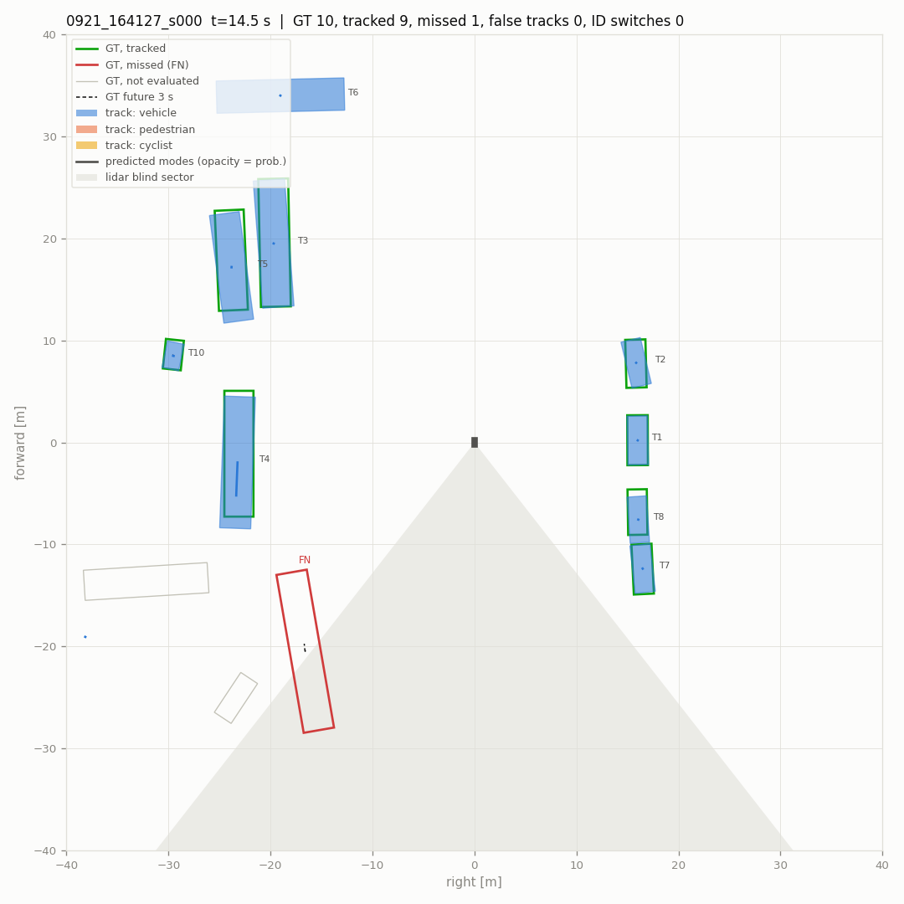
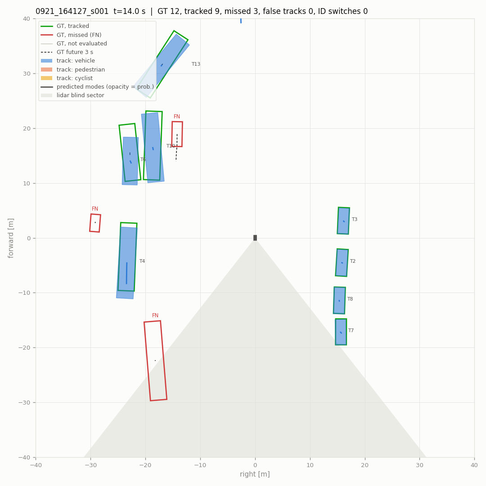
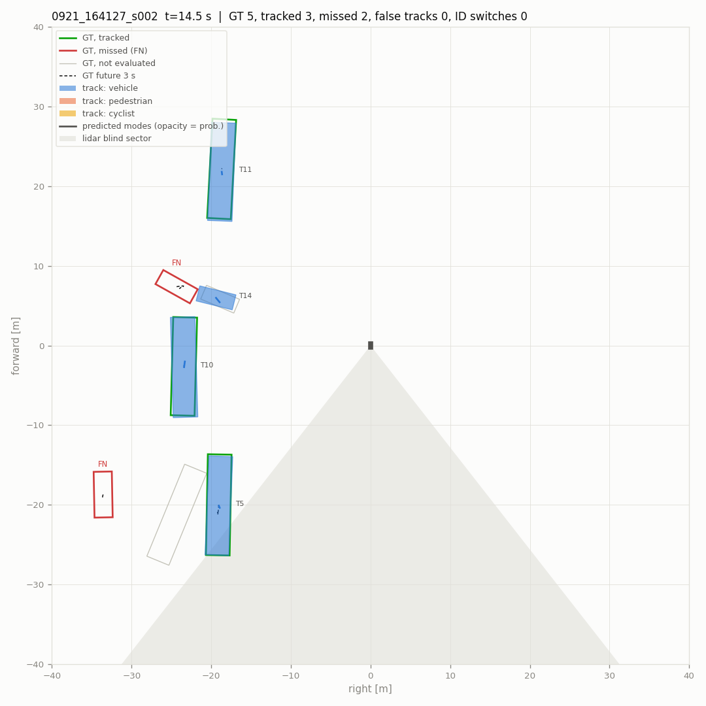
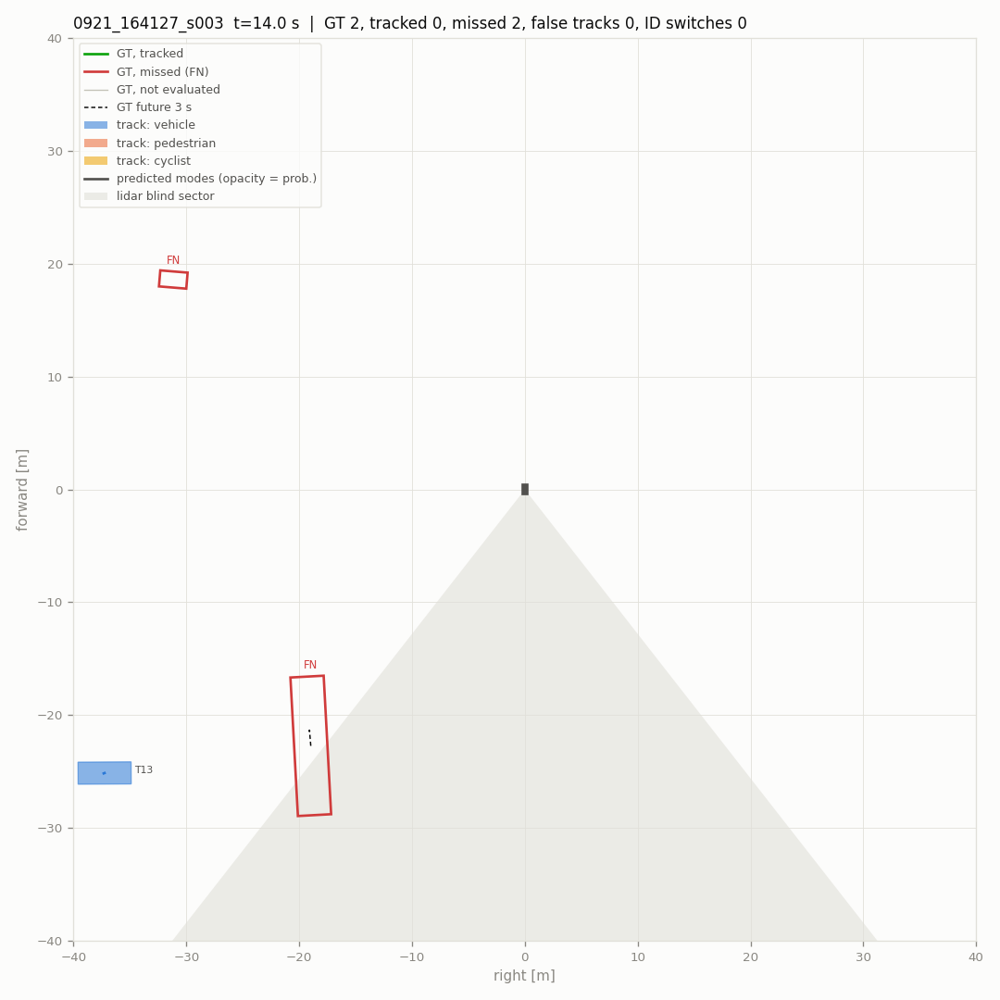
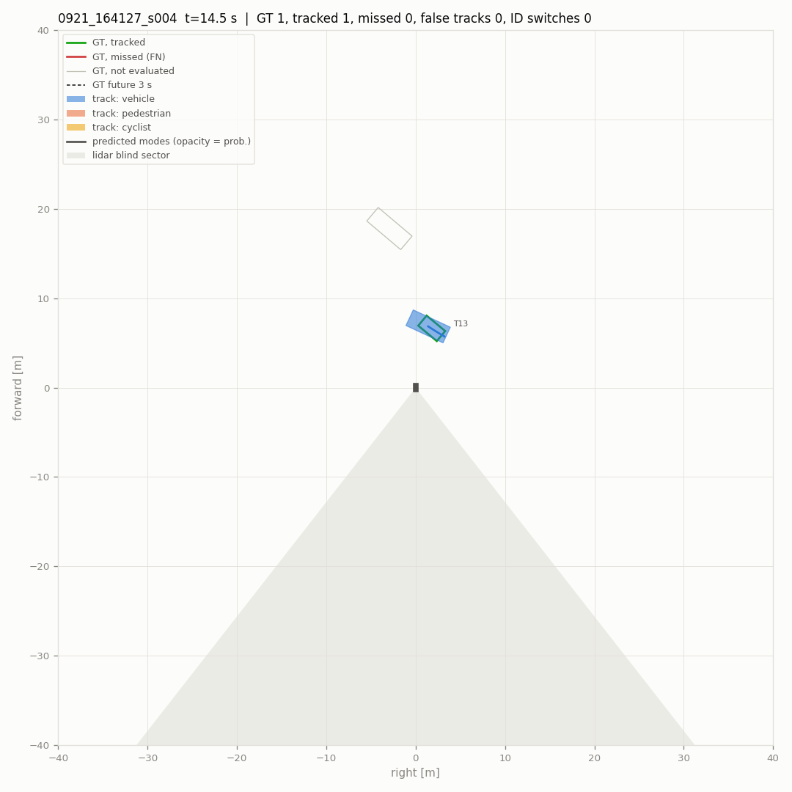
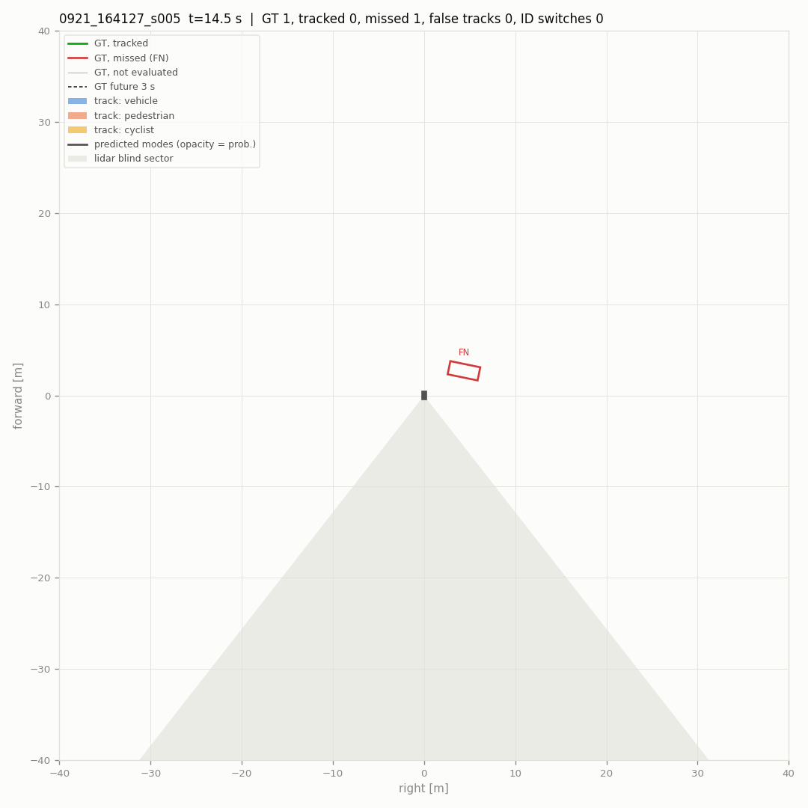
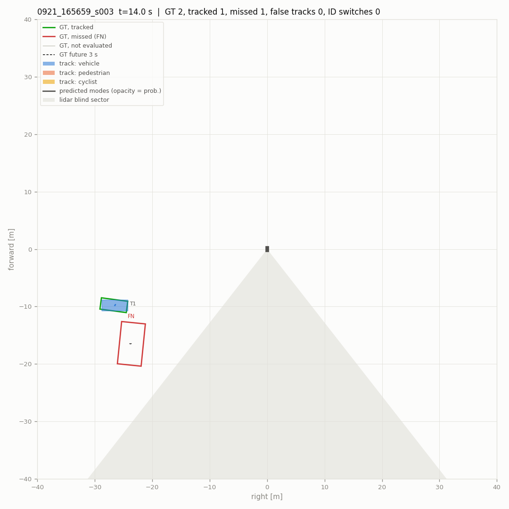
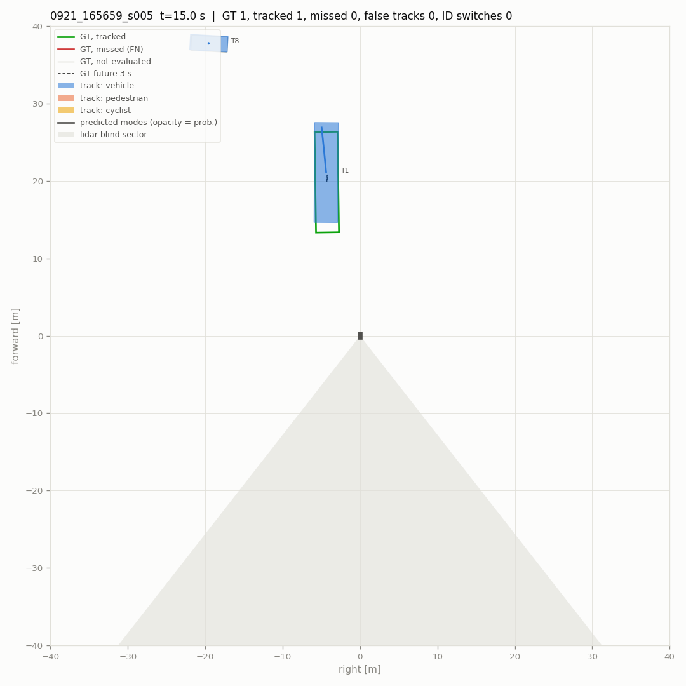
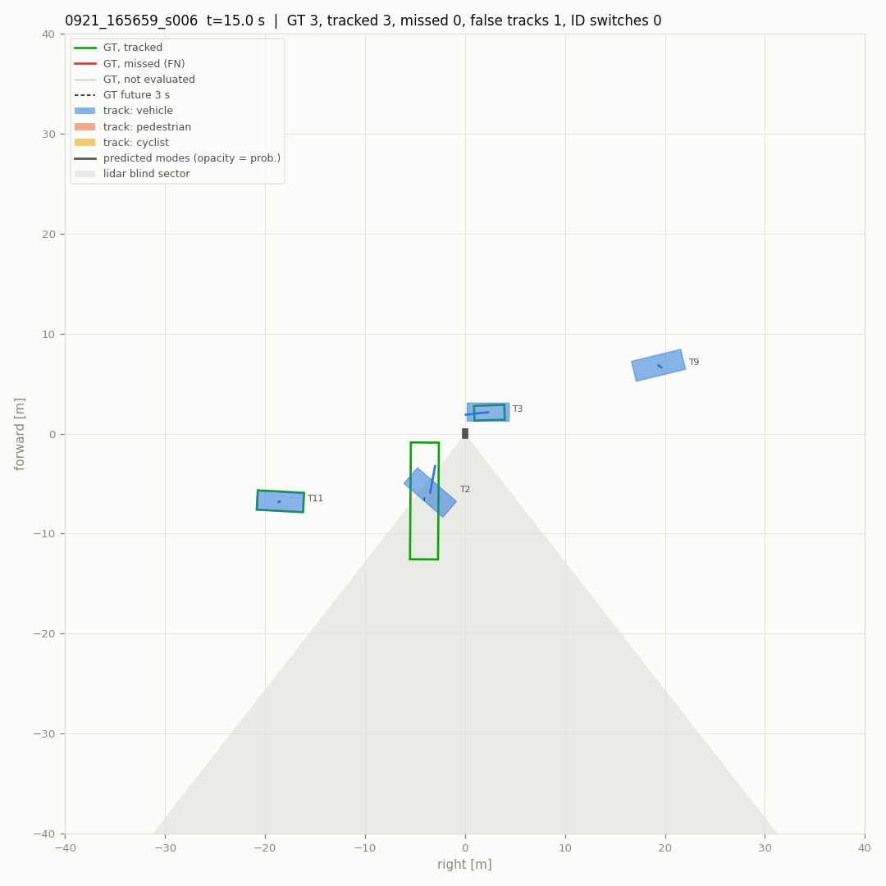

# Pipeline evaluation

- scenes (10): 0921_164127_s000, 0921_164127_s001, 0921_164127_s002, 0921_164127_s003, 0921_164127_s004, 0921_164127_s005, 0921_165659_s003, 0921_165659_s004, 0921_165659_s005, 0921_165659_s006
- 2884 frames, 580 keyframes scored (4.8 min)
- detections: `results` from `data/runs_veh_v1/{scene}/pillar/results.pkl`
- parameters: defaults
- scored: vehicles that are not ignore boxes, within 40 m and with current-sweep points; a detection or track on any other labelled box is not counted. Label tracks stitched into one vehicle: 20.
- intervals: 90 % over 500 resamples of the scenes

## Main metrics

| metric | value | interval |
|---|---|---|
| detections: recall within near range | **0.727** | 0.623 – 0.779 |
| detections: precision within near range | **0.949** | 0.872 – 0.978 |
| detections: F1 within near range | **0.823** | 0.738 – 0.858 |
| detections: false per keyframe | **0.172** | 0.101 – 0.264 |
| tracks: MOTA | **0.660** | 0.521 – 0.738 |
| tracks: IDF1 | **0.782** | 0.686 – 0.828 |
| tracks: ID switches / min | **1.655** | 0.619 – 3.109 |
| tracks: false tracks / min | **13.034** | 8.839 – 18.160 |
| tracks: confirm delay p90 [s] | **2.500** | 0.000 – 8.200 |
| motion: relevant moving stretches missed | **1** | 0.000 – 3.000 |
| motion: parked reported moving / h | **74.478** | 24.653 – 137.969 |
| prediction: FDE 3 s, moving [m] | **2.409** | 1.560 – 3.884 |
| prediction: miss rate 3 s, moving | **0.398** | 0.291 – 0.574 |

## Detections at the reporting threshold

Vehicle threshold 0.35 (`tracker.high_score`), 2 m match, keyframes. Near: within 30 m.

| range | precision | recall | TP | FP | FN |
|---|---|---|---|---|---|
| 0-30 m | 0.949 | 0.727 | 1158 | 62 | 435 |
| 30-40 m | 0.863 | 0.555 | 239 | 38 | 192 |

False detections per keyframe 0.172. AP over all scores: AP@2.0 0.785, AP@4.0 0.803, AP@2.0 0-20 m 0.827, 20-40 m 0.749.

## Tracking

Reported tracks (confirmed, coasting included) against the scored vehicles, keyframes, 2 m.

| MOTA | MOTP m | IDF1 | recall | precision | IDSW | IDSW / min | FRAG | MT | ML | vehicles | TP | FP | FN |
|---|---|---|---|---|---|---|---|---|---|---|---|---|---|
| **0.660** | 0.48 | **0.782** | 0.721 | 0.927 | 8 | 1.66 | 26 | 35 | 21 | 67 | 1459 | 115 | 565 |

- false tracks (a track false on consecutive keyframes counts once): 13.03 per minute
- a vehicle coming into 30 m waits for its first matched track: median 0.0 s, p90 2.5 s (18 vehicles; 5 never tracked; 0.5 s resolution)

### Where the errors are

| false tracks: cause | count |
|---|---|
| second track on a tracked vehicle | 3 |
| beside a vehicle (2-4 m off) | 8 |
| coasting after the vehicle was lost | 17 |
| nothing labelled nearby | 87 |

| missed vehicles (FN) | count |
|---|---|
| detected, not tracked | 35 |
| not detected | 530 |
| 0-10 m | 85 |
| 10-20 m | 49 |
| 20-30 m | 252 |
| 30-40 m | 179 |
| 1-9 pts | 30 |
| 10-49 pts | 119 |
| >=50 pts | 416 |

Blind sector (142-218 deg behind the robot) and the 20 deg bands beside it:

| zone | scored vehicles | missed | missed share | tracks | false | false share |
|---|---|---|---|---|---|---|
| elsewhere | 1597 | 395 | 0.247 | 1263 | 63 | 0.050 |
| edge | 408 | 164 | 0.402 | 279 | 33 | 0.118 |
| blind | 19 | 6 | 0.316 | 32 | 19 | 0.594 |

## Motion state

Online state against the labels' moving flags (tools/dog/motion_eval.py). Relevant: >= 1 m/s and within 30 m.

| moving recall | false moving | parked reported moving | false episodes (per h) | moving stretches missed | latency median / p90 s | relevant missed | relevant latency median / p90 s |
|---|---|---|---|---|---|---|---|
| 0.779 | 0.0194 | 5 / 38 | 6 (74.5) | 4 / 17 | 0.50 / 1.80 | **1 / 9** | 0.25 / 2.30 |

## Prediction

Tracks matched to a vehicle with 3 s of labelled future (keyframes every 0.5 s). Moving: >= 1.5 m in 3 s; turning: heading changes > 15 deg. ADE1 / FDE1: the most likely mode; minADE / minFDE: the best; MR: no mode ends within 2 m. IMM is what runs online, CV keeps the track's velocity.

**all matched** (1175 samples)

| predictor | horizon | ADE1 | FDE1 | minADE | minFDE | MR@2m |
|---|---|---|---|---|---|---|
| IMM | 1 s | 0.67 | 0.75 | 0.67 | 0.75 | 0.121 |
| IMM | 2 s | 0.83 | 1.07 | 0.83 | 1.07 | 0.180 |
| IMM | 3 s | 0.99 | 1.40 | 0.99 | 1.40 | 0.221 |
| CV | 1 s | 0.67 | 0.75 | 0.67 | 0.75 | 0.121 |
| CV | 2 s | 0.83 | 1.07 | 0.83 | 1.07 | 0.180 |
| CV | 3 s | 0.99 | 1.40 | 0.99 | 1.40 | 0.221 |

**moving** (108 samples)

| predictor | horizon | ADE1 | FDE1 | minADE | minFDE | MR@2m |
|---|---|---|---|---|---|---|
| IMM | 1 s | 0.98 | 1.13 | 0.98 | 1.13 | 0.167 |
| IMM | 2 s | 1.30 | 1.78 | 1.30 | 1.78 | 0.250 |
| IMM | 3 s | 1.62 | 2.41 | 1.61 | 2.40 | 0.398 |
| CV | 1 s | 0.98 | 1.13 | 0.98 | 1.13 | 0.167 |
| CV | 2 s | 1.30 | 1.78 | 1.30 | 1.78 | 0.250 |
| CV | 3 s | 1.62 | 2.41 | 1.62 | 2.41 | 0.398 |

**moving, straight** (96 samples)

| predictor | horizon | ADE1 | FDE1 | minADE | minFDE | MR@2m |
|---|---|---|---|---|---|---|
| IMM | 1 s | 1.04 | 1.20 | 1.04 | 1.20 | 0.188 |
| IMM | 2 s | 1.38 | 1.88 | 1.37 | 1.88 | 0.281 |
| IMM | 3 s | 1.71 | 2.55 | 1.71 | 2.54 | 0.448 |
| CV | 1 s | 1.04 | 1.20 | 1.04 | 1.20 | 0.188 |
| CV | 2 s | 1.38 | 1.88 | 1.38 | 1.88 | 0.281 |
| CV | 3 s | 1.71 | 2.54 | 1.71 | 2.54 | 0.448 |

**moving, turning** (12 samples)

| predictor | horizon | ADE1 | FDE1 | minADE | minFDE | MR@2m |
|---|---|---|---|---|---|---|
| IMM | 1 s | 0.48 | 0.56 | 0.48 | 0.56 | 0.000 |
| IMM | 2 s | 0.68 | 0.98 | 0.68 | 0.98 | 0.000 |
| IMM | 3 s | 0.86 | 1.31 | 0.86 | 1.31 | 0.000 |
| CV | 1 s | 0.48 | 0.56 | 0.48 | 0.56 | 0.000 |
| CV | 2 s | 0.68 | 0.98 | 0.68 | 0.98 | 0.000 |
| CV | 3 s | 0.86 | 1.31 | 0.86 | 1.31 | 0.000 |

**moving, < 3 m/s** (98 samples)

| predictor | horizon | ADE1 | FDE1 | minADE | minFDE | MR@2m |
|---|---|---|---|---|---|---|
| IMM | 1 s | 0.77 | 0.87 | 0.77 | 0.87 | 0.082 |
| IMM | 2 s | 1.00 | 1.35 | 1.00 | 1.34 | 0.173 |
| IMM | 3 s | 1.23 | 1.80 | 1.22 | 1.79 | 0.337 |
| CV | 1 s | 0.77 | 0.87 | 0.77 | 0.87 | 0.082 |
| CV | 2 s | 1.00 | 1.35 | 1.00 | 1.35 | 0.173 |
| CV | 3 s | 1.23 | 1.79 | 1.23 | 1.79 | 0.337 |

**moving, >= 6 m/s** (10 samples)

| predictor | horizon | ADE1 | FDE1 | minADE | minFDE | MR@2m |
|---|---|---|---|---|---|---|
| IMM | 1 s | 3.04 | 3.65 | 3.04 | 3.65 | 1.000 |
| IMM | 2 s | 4.25 | 6.06 | 4.25 | 6.06 | 1.000 |
| IMM | 3 s | 5.44 | 8.42 | 5.44 | 8.42 | 1.000 |
| CV | 1 s | 3.04 | 3.65 | 3.04 | 3.65 | 1.000 |
| CV | 2 s | 4.25 | 6.07 | 4.25 | 6.07 | 1.000 |
| CV | 3 s | 5.45 | 8.42 | 5.45 | 8.42 | 1.000 |

## Hazard proxy

A moving vehicle that comes within 5 m of the robot within 3 s (labelled future, the robot's own path) should raise an alarm: a moving track whose most likely predicted path, or its position now, comes that close. Few such vehicles in 0921; the numbers are for the controlled scenes to come (DATA_COLLECTION_PLAN.md 3.2).

- events 6, reported 4, lead before the closest approach: median 1.2 s, min 0.0 s
- alarms without such a vehicle: 1 (12.4 per hour)

## Timing (this machine, ms per frame: median / p90)

| stage | median | p90 |
|---|---|---|
| filter | 0.00 | 0.00 |
| track | 1.21 | 3.92 |
| predict | 0.73 | 3.30 |

## Issues (`issues.csv`)

| kind | count |
|---|---|
| ID switch | 8 |
| bad prediction | 25 |
| false moving | 6 |
| false track | 19 |
| hazard not reported | 2 |
| lost vehicle | 34 |
| missed moving vehicle | 1 |

## Snapshots

Middle keyframe of each scene, robot at the center heading up. Green / red outlines: scored vehicles tracked / missed; grey: not scored; filled: reported tracks; lines: the two most likely predicted modes; dashes: labelled 3 s future; shaded: the blind sector.

