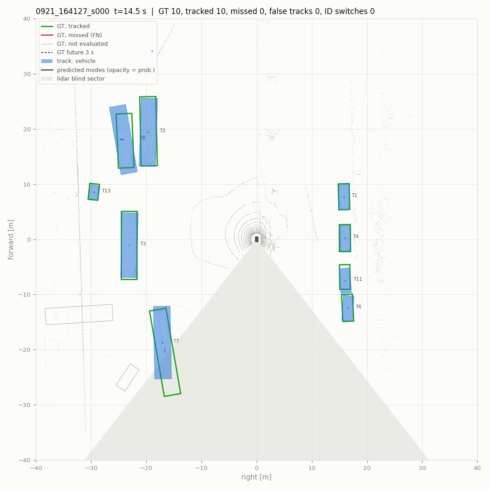
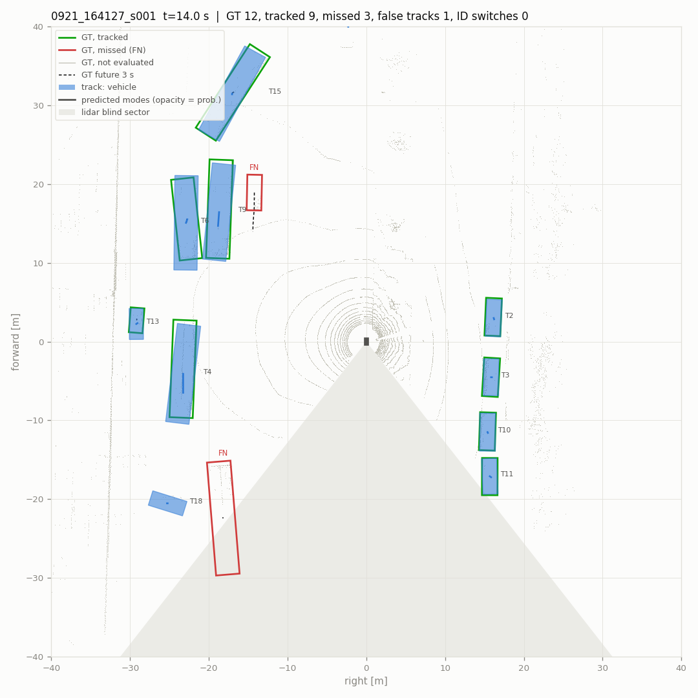
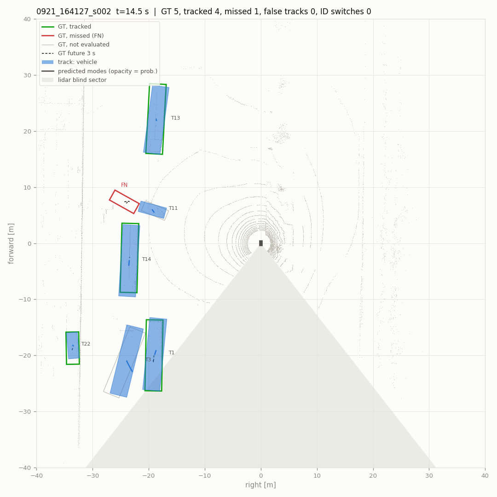
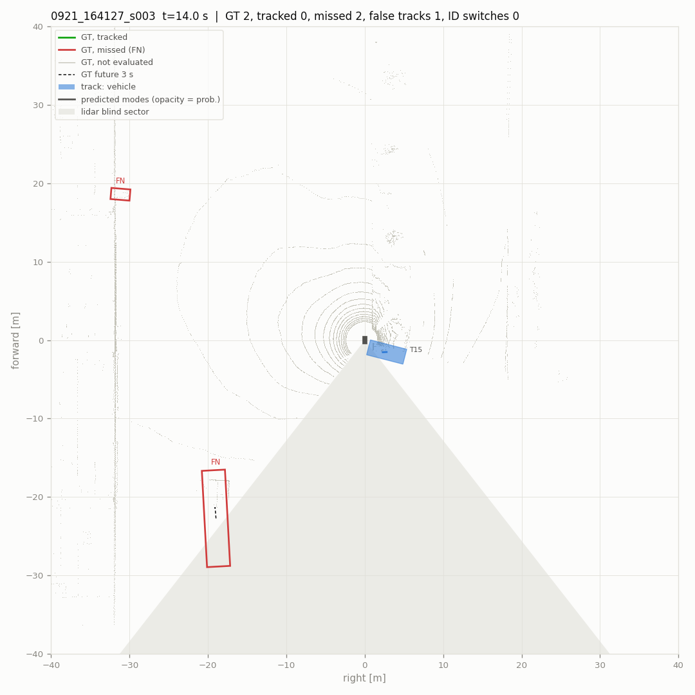
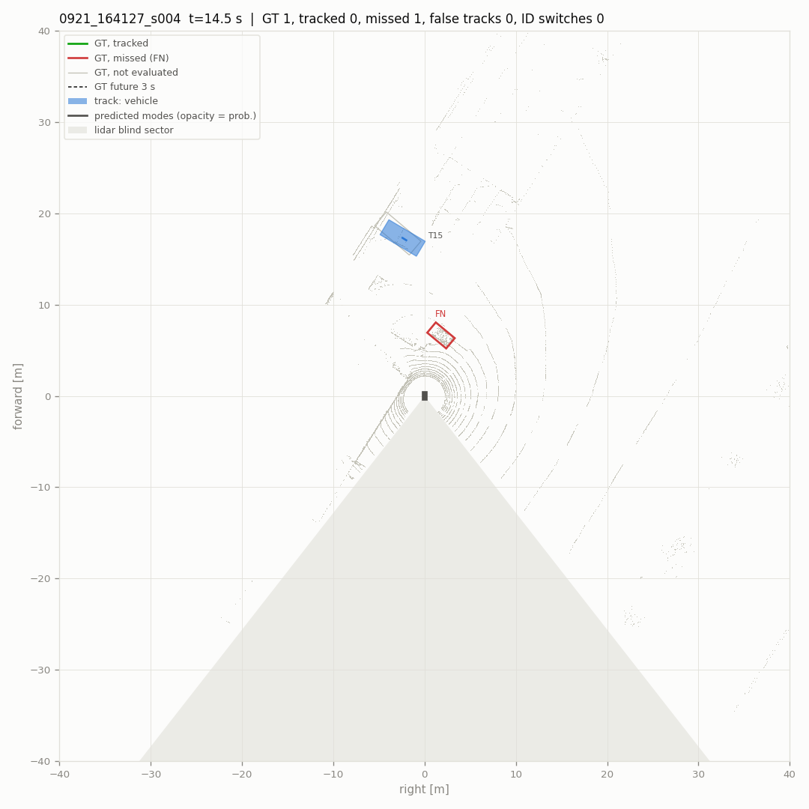
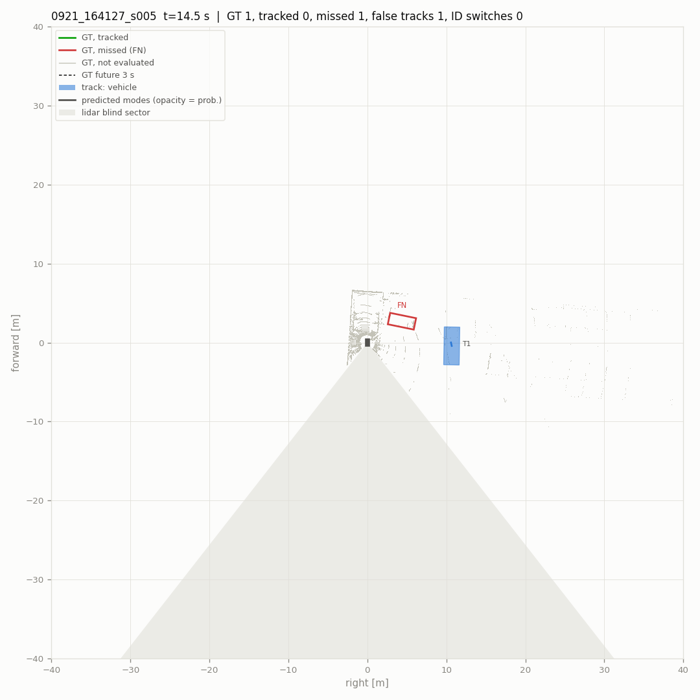
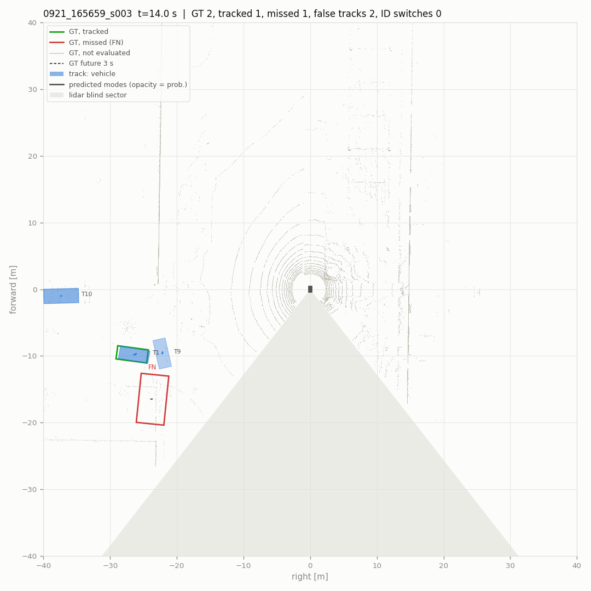
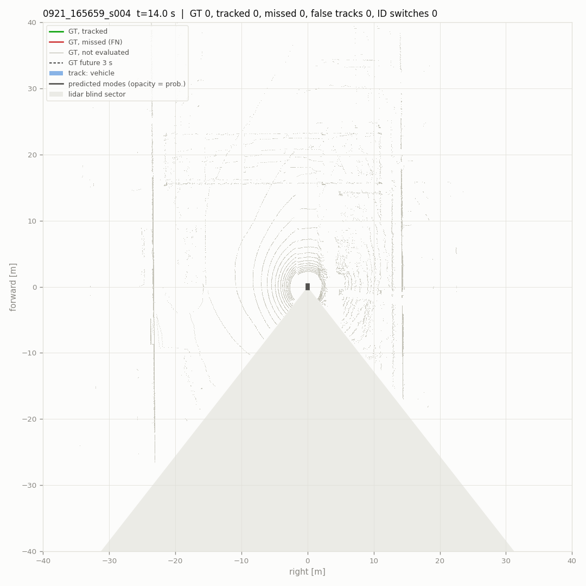
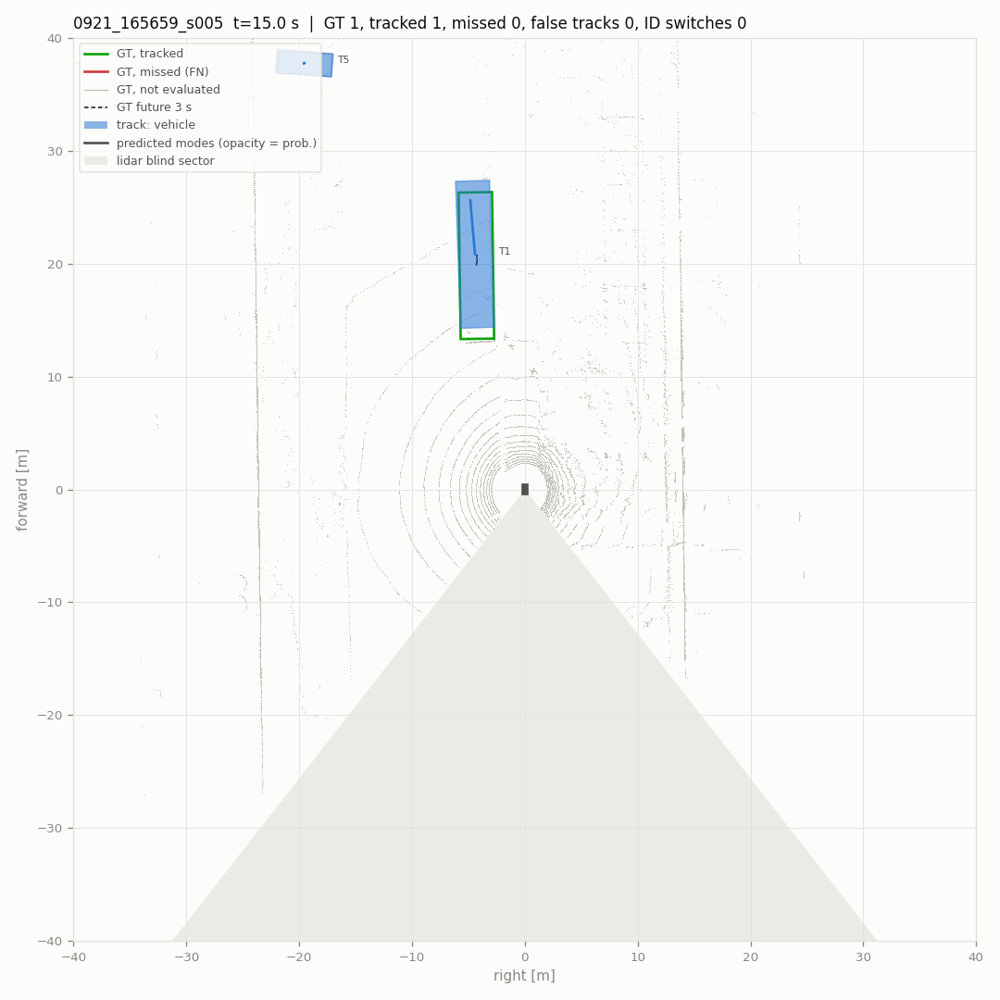
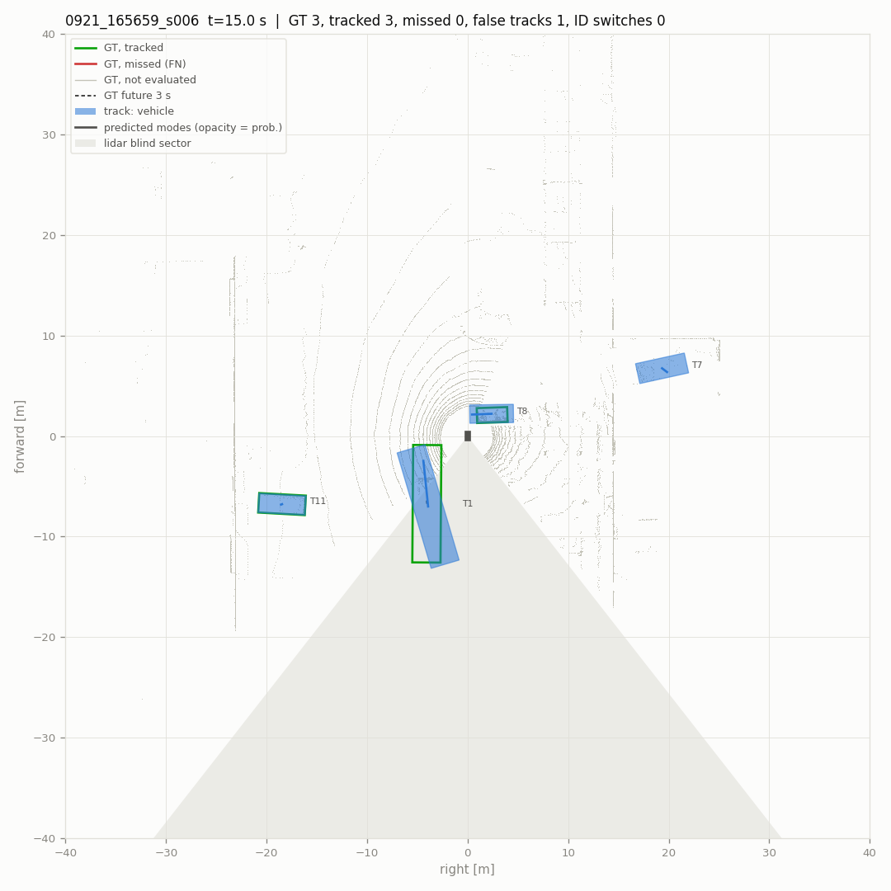

# Pipeline evaluation

- scenes (10): 0921_164127_s000, 0921_164127_s001, 0921_164127_s002, 0921_164127_s003, 0921_164127_s004, 0921_164127_s005, 0921_165659_s003, 0921_165659_s004, 0921_165659_s005, 0921_165659_s006
- 2884 frames, 580 keyframes scored (4.8 min)
- detections: `results` from `data/runs_veh_v2/{scene}/pillar/results.pkl`
- parameters: defaults
- scored: vehicles that are not ignore boxes, within 40 m and with current-sweep points; a detection or track on any other labelled box is not counted. Label tracks stitched into one vehicle: 20.
- intervals: 90 % over 500 resamples of the scenes

## Main metrics

| metric | value | interval |
|---|---|---|
| detections: recall within near range | **0.765** | 0.623 – 0.825 |
| detections: precision within near range | **0.894** | 0.725 – 0.966 |
| detections: F1 within near range | **0.824** | 0.677 – 0.885 |
| detections: false per keyframe | **0.309** | 0.168 – 0.497 |
| tracks: MOTA | **0.635** | 0.399 – 0.738 |
| tracks: IDF1 | **0.779** | 0.656 – 0.835 |
| tracks: ID switches / min | **1.862** | 0.414 – 4.167 |
| tracks: false tracks / min | **13.447** | 11.747 – 15.824 |
| tracks: confirm delay p90 [s] | **4.950** | 0.501 – 13.350 |
| motion: relevant moving stretches missed | **1** | 0.000 – 3.000 |
| motion: parked reported moving / h | **74.478** | 12.412 – 159.435 |
| prediction: FDE 3 s, moving [m] | **2.705** | 1.664 – 4.499 |
| prediction: miss rate 3 s, moving | **0.473** | 0.333 – 0.705 |

## Detections at the reporting threshold

Vehicle threshold 0.35 (`tracker.high_score`), 2 m match, keyframes. Near: within 30 m.

| range | precision | recall | TP | FP | FN |
|---|---|---|---|---|---|
| 0-30 m | 0.894 | 0.765 | 1212 | 144 | 373 |
| 30-40 m | 0.872 | 0.542 | 238 | 35 | 201 |

False detections per keyframe 0.309. AP over all scores: AP@2.0 0.836, AP@4.0 0.875, AP@2.0 0-20 m 0.861, 20-40 m 0.817.

## Tracking

Reported tracks (confirmed, coasting included) against the scored vehicles, keyframes, 2 m.

| MOTA | MOTP m | IDF1 | recall | precision | IDSW | IDSW / min | FRAG | MT | ML | vehicles | TP | FP | FN |
|---|---|---|---|---|---|---|---|---|---|---|---|---|---|
| **0.635** | 0.38 | **0.779** | 0.736 | 0.885 | 9 | 1.86 | 37 | 36 | 14 | 67 | 1489 | 194 | 535 |

- false tracks (a track false on consecutive keyframes counts once): 13.45 per minute
- a vehicle coming into 30 m waits for its first matched track: median 0.0 s, p90 4.9 s (18 vehicles; 5 never tracked; 0.5 s resolution)

### Where the errors are

| false tracks: cause | count |
|---|---|
| second track on a tracked vehicle | 0 |
| beside a vehicle (2-4 m off) | 48 |
| coasting after the vehicle was lost | 6 |
| nothing labelled nearby | 140 |

| missed vehicles (FN) | count |
|---|---|
| detected, not tracked | 42 |
| not detected | 493 |
| 0-10 m | 96 |
| 10-20 m | 60 |
| 20-30 m | 199 |
| 30-40 m | 180 |
| 1-9 pts | 23 |
| 10-49 pts | 113 |
| >=50 pts | 399 |

Blind sector (142-218 deg behind the robot) and the 20 deg bands beside it:

| zone | scored vehicles | missed | missed share | tracks | false | false share |
|---|---|---|---|---|---|---|
| elsewhere | 1597 | 421 | 0.264 | 1321 | 151 | 0.114 |
| edge | 408 | 106 | 0.260 | 339 | 33 | 0.097 |
| blind | 19 | 8 | 0.421 | 23 | 10 | 0.435 |

## Motion state

Online state against the labels' moving flags (tools/dog/motion_eval.py). Relevant: >= 1 m/s and within 30 m.

| moving recall | false moving | parked reported moving | false episodes (per h) | moving stretches missed | latency median / p90 s | relevant missed | relevant latency median / p90 s |
|---|---|---|---|---|---|---|---|
| 0.746 | 0.0229 | 3 / 42 | 6 (74.5) | 5 / 15 | 0.75 / 2.00 | **1 / 7** | 1.00 / 2.00 |

## Prediction

Tracks matched to a vehicle with 3 s of labelled future (keyframes every 0.5 s). Moving: >= 1.5 m in 3 s; turning: heading changes > 15 deg. ADE1 / FDE1: the most likely mode; minADE / minFDE: the best; MR: no mode ends within 2 m. IMM is what runs online, CV keeps the track's velocity.

**all matched** (1194 samples)

| predictor | horizon | ADE1 | FDE1 | minADE | minFDE | MR@2m |
|---|---|---|---|---|---|---|
| IMM | 1 s | 0.53 | 0.59 | 0.53 | 0.59 | 0.060 |
| IMM | 2 s | 0.65 | 0.83 | 0.65 | 0.83 | 0.121 |
| IMM | 3 s | 0.77 | 1.09 | 0.77 | 1.09 | 0.160 |
| CV | 1 s | 0.53 | 0.59 | 0.53 | 0.59 | 0.060 |
| CV | 2 s | 0.65 | 0.83 | 0.65 | 0.83 | 0.121 |
| CV | 3 s | 0.77 | 1.09 | 0.77 | 1.09 | 0.161 |

**moving** (110 samples)

| predictor | horizon | ADE1 | FDE1 | minADE | minFDE | MR@2m |
|---|---|---|---|---|---|---|
| IMM | 1 s | 0.97 | 1.15 | 0.97 | 1.15 | 0.155 |
| IMM | 2 s | 1.37 | 1.97 | 1.37 | 1.97 | 0.327 |
| IMM | 3 s | 1.75 | 2.71 | 1.75 | 2.70 | 0.473 |
| CV | 1 s | 0.97 | 1.15 | 0.97 | 1.15 | 0.155 |
| CV | 2 s | 1.37 | 1.97 | 1.37 | 1.97 | 0.327 |
| CV | 3 s | 1.75 | 2.71 | 1.75 | 2.71 | 0.482 |

**moving, straight** (93 samples)

| predictor | horizon | ADE1 | FDE1 | minADE | minFDE | MR@2m |
|---|---|---|---|---|---|---|
| IMM | 1 s | 1.07 | 1.26 | 1.07 | 1.26 | 0.183 |
| IMM | 2 s | 1.49 | 2.12 | 1.49 | 2.12 | 0.387 |
| IMM | 3 s | 1.89 | 2.90 | 1.89 | 2.89 | 0.516 |
| CV | 1 s | 1.07 | 1.26 | 1.07 | 1.26 | 0.183 |
| CV | 2 s | 1.49 | 2.13 | 1.49 | 2.13 | 0.387 |
| CV | 3 s | 1.89 | 2.90 | 1.89 | 2.90 | 0.527 |

**moving, turning** (17 samples)

| predictor | horizon | ADE1 | FDE1 | minADE | minFDE | MR@2m |
|---|---|---|---|---|---|---|
| IMM | 1 s | 0.47 | 0.56 | 0.47 | 0.56 | 0.000 |
| IMM | 2 s | 0.71 | 1.13 | 0.71 | 1.13 | 0.000 |
| IMM | 3 s | 1.00 | 1.67 | 1.00 | 1.67 | 0.235 |
| CV | 1 s | 0.47 | 0.56 | 0.47 | 0.56 | 0.000 |
| CV | 2 s | 0.71 | 1.13 | 0.71 | 1.13 | 0.000 |
| CV | 3 s | 1.00 | 1.67 | 1.00 | 1.67 | 0.235 |

**moving, < 3 m/s** (101 samples)

| predictor | horizon | ADE1 | FDE1 | minADE | minFDE | MR@2m |
|---|---|---|---|---|---|---|
| IMM | 1 s | 0.76 | 0.90 | 0.76 | 0.89 | 0.079 |
| IMM | 2 s | 1.06 | 1.53 | 1.06 | 1.53 | 0.267 |
| IMM | 3 s | 1.36 | 2.08 | 1.36 | 2.07 | 0.426 |
| CV | 1 s | 0.76 | 0.90 | 0.76 | 0.90 | 0.079 |
| CV | 2 s | 1.07 | 1.53 | 1.07 | 1.53 | 0.267 |
| CV | 3 s | 1.36 | 2.08 | 1.36 | 2.08 | 0.436 |

**moving, >= 6 m/s** (9 samples)

| predictor | horizon | ADE1 | FDE1 | minADE | minFDE | MR@2m |
|---|---|---|---|---|---|---|
| IMM | 1 s | 3.34 | 4.06 | 3.34 | 4.06 | 1.000 |
| IMM | 2 s | 4.78 | 6.93 | 4.78 | 6.93 | 1.000 |
| IMM | 3 s | 6.20 | 9.75 | 6.20 | 9.75 | 1.000 |
| CV | 1 s | 3.34 | 4.06 | 3.34 | 4.06 | 1.000 |
| CV | 2 s | 4.78 | 6.93 | 4.78 | 6.93 | 1.000 |
| CV | 3 s | 6.20 | 9.75 | 6.20 | 9.75 | 1.000 |

## Hazard proxy

A moving vehicle that comes within 5 m of the robot within 3 s (labelled future, the robot's own path) should raise an alarm: a moving track whose most likely predicted path, or its position now, comes that close. Few such vehicles in 0921; the numbers are for the controlled scenes to come (DATA_COLLECTION_PLAN.md 3.2).

- events 6, reported 5, lead before the closest approach: median 1.5 s, min -0.5 s
- alarms without such a vehicle: 2 (24.8 per hour)

## Timing (this machine, ms per frame: median / p90)

| stage | median | p90 |
|---|---|---|
| filter | 0.00 | 0.01 |
| track | 1.91 | 8.78 |
| predict | 0.78 | 3.57 |

## Issues (`issues.csv`)

| kind | count |
|---|---|
| ID switch | 9 |
| bad prediction | 26 |
| false moving | 6 |
| false track | 26 |
| hazard not reported | 1 |
| lost vehicle | 36 |
| missed moving vehicle | 1 |

## Snapshots

Middle keyframe of each scene, robot at the center heading up. Green / red outlines: scored vehicles tracked / missed; grey: not scored; filled: reported tracks; lines: the two most likely predicted modes; dashes: labelled 3 s future; shaded: the blind sector.

## Foxglove

- `data/tune/T18_mcap_v2/0921_164127_s000.mcap`: 3322 messages, 83 MB
- `data/tune/T18_mcap_v2/0921_164127_s001.mcap`: 3301 messages, 84 MB
- `data/tune/T18_mcap_v2/0921_164127_s002.mcap`: 3290 messages, 79 MB
- `data/tune/T18_mcap_v2/0921_164127_s003.mcap`: 3279 messages, 76 MB
- `data/tune/T18_mcap_v2/0921_164127_s004.mcap`: 3293 messages, 88 MB
- `data/tune/T18_mcap_v2/0921_164127_s005.mcap`: 3290 messages, 95 MB
- `data/tune/T18_mcap_v2/0921_165659_s003.mcap`: 3151 messages, 91 MB
- `data/tune/T18_mcap_v2/0921_165659_s004.mcap`: 3149 messages, 93 MB
- `data/tune/T18_mcap_v2/0921_165659_s005.mcap`: 3467 messages, 104 MB
- `data/tune/T18_mcap_v2/0921_165659_s006.mcap`: 3456 messages, 107 MB

Open a file in Foxglove, then Layout -> Import from file: `foxglove_layout.json` (3D following `ego`, Plot of `/metrics/frame`, Log of `/log`). Jump to the times in `issues.csv` (column t: seconds after the scene start).
