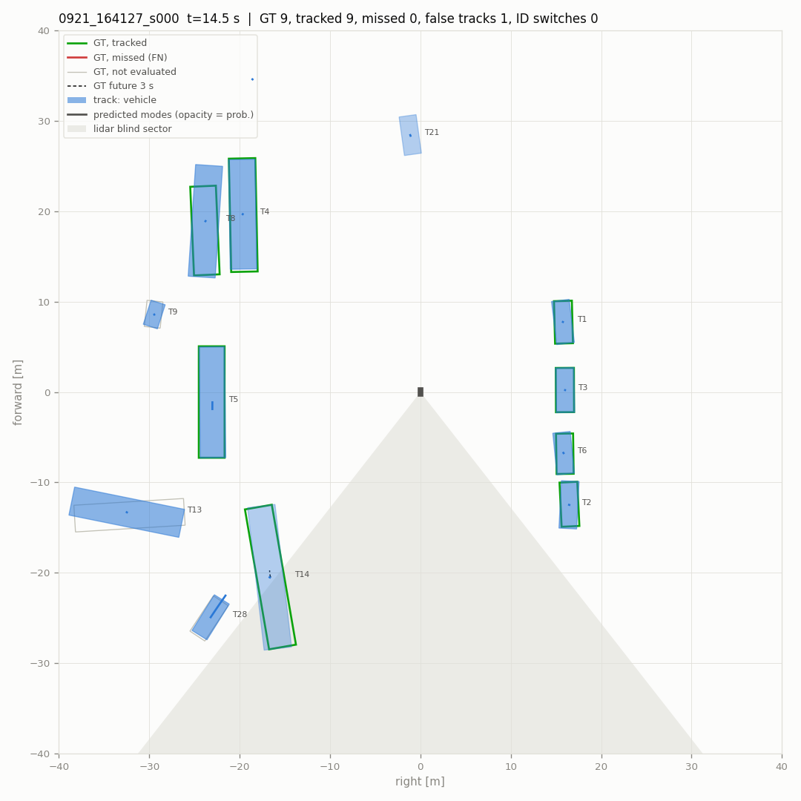
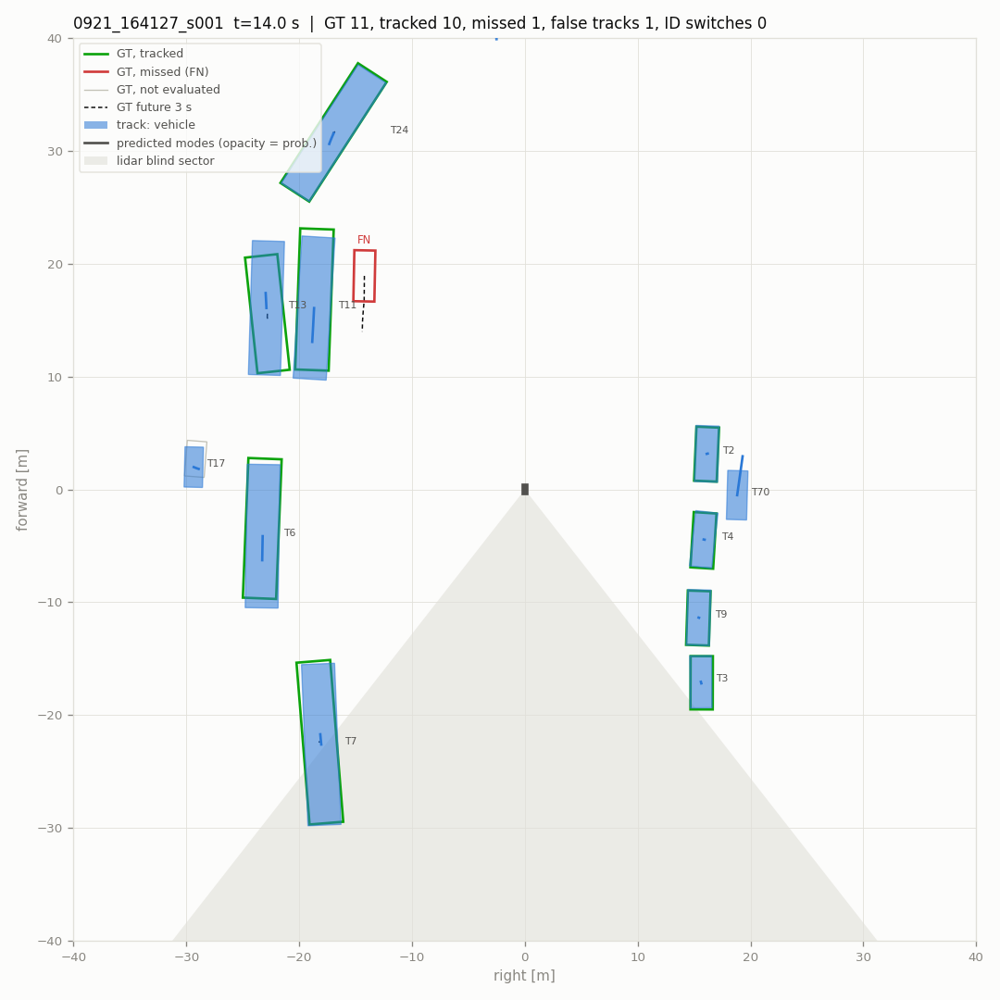
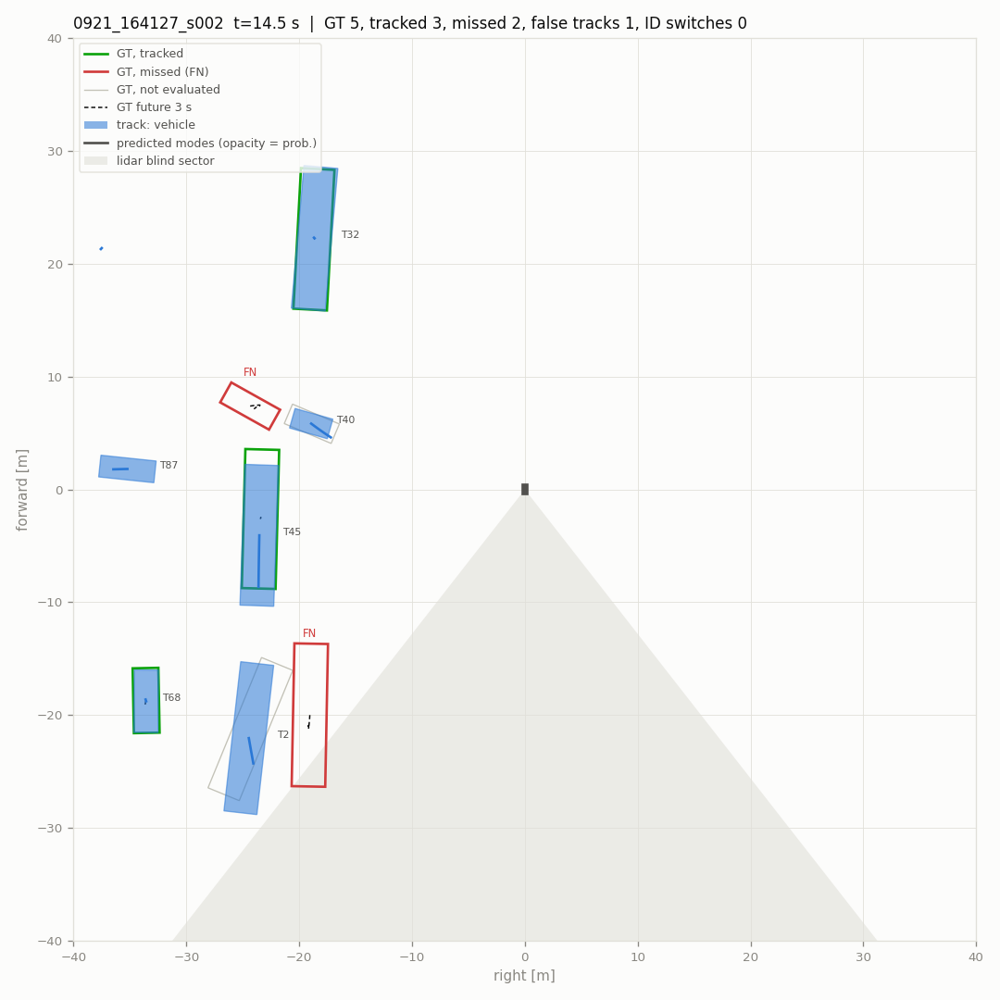
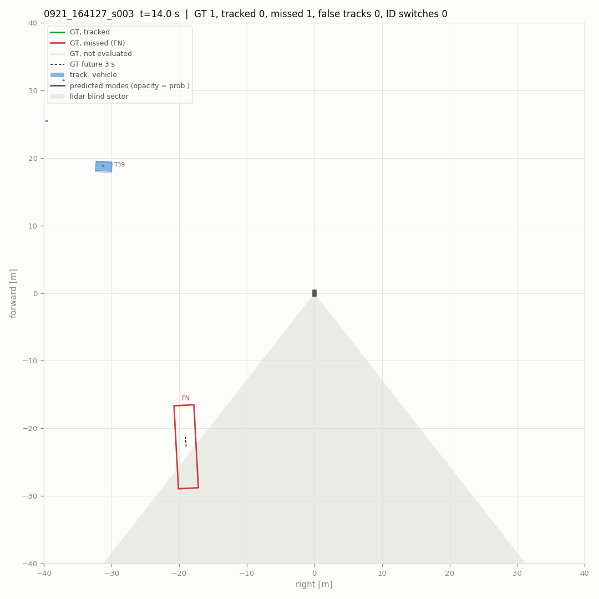
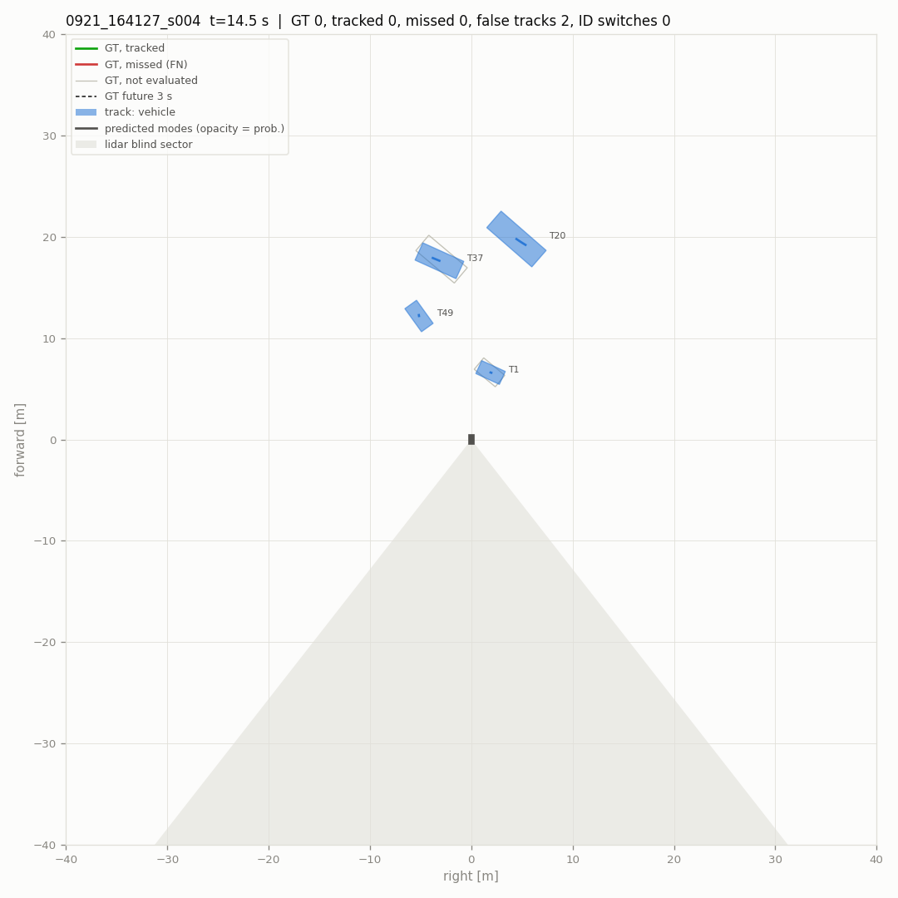
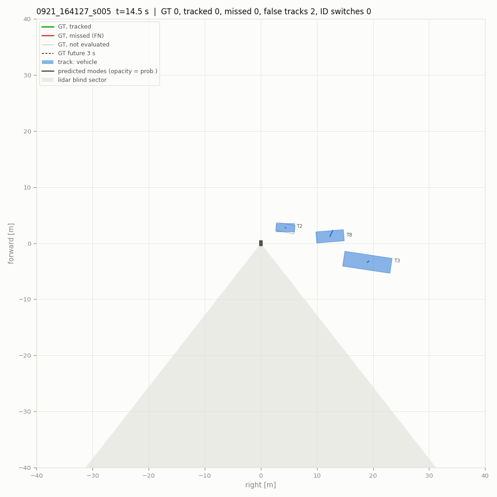
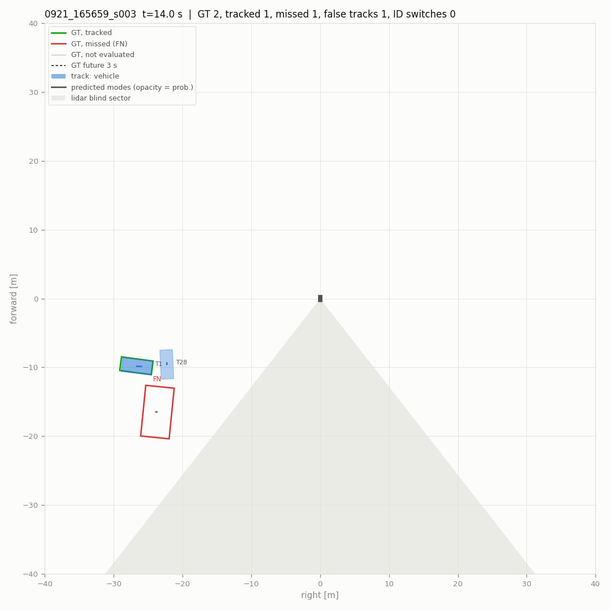
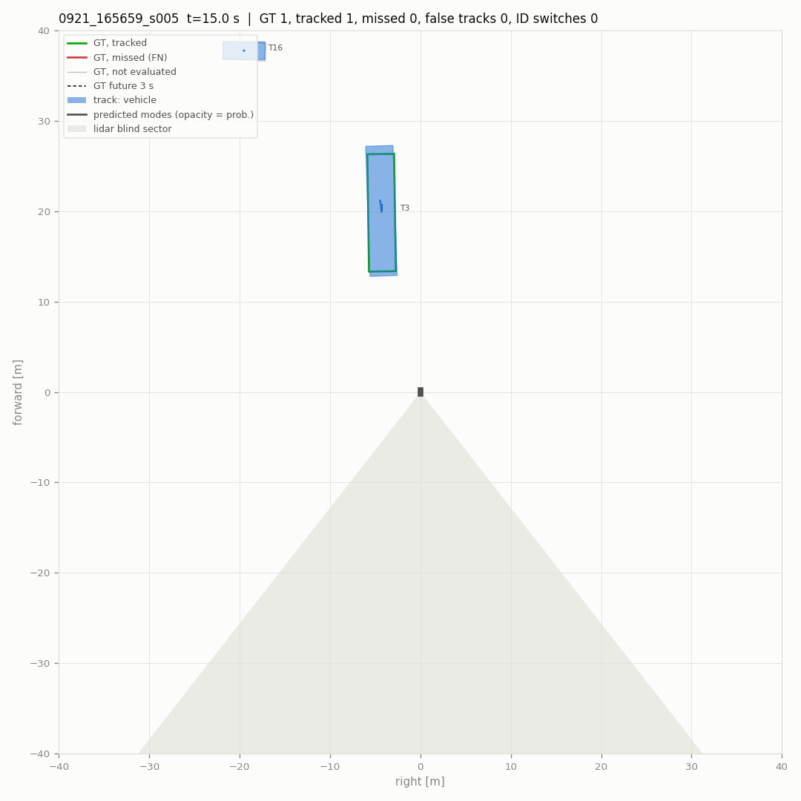
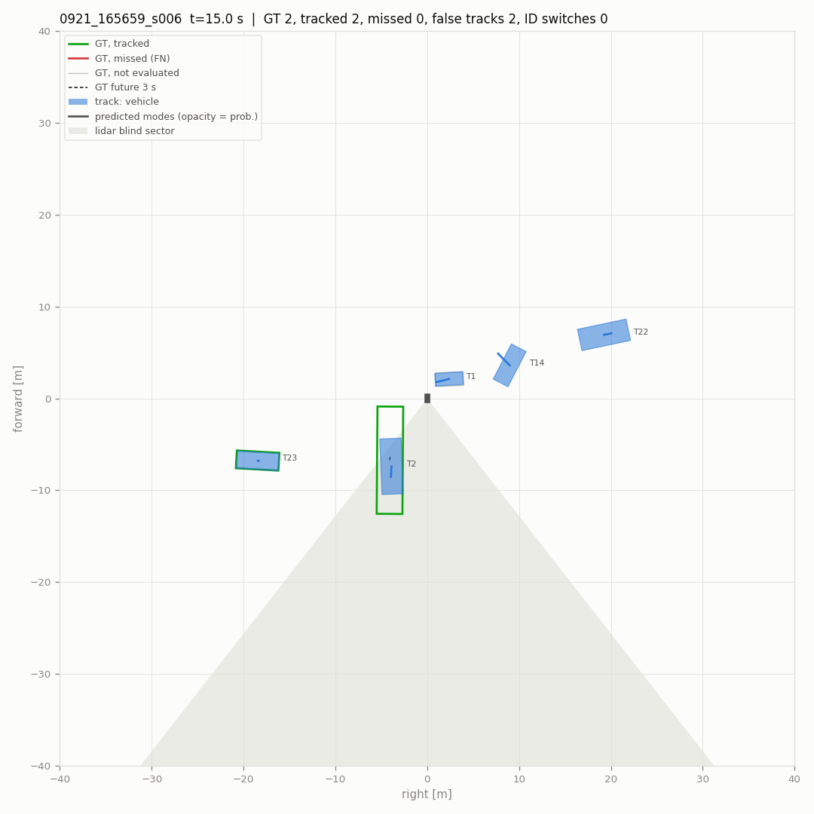

# Pipeline evaluation

- scenes (10): 0921_164127_s000, 0921_164127_s001, 0921_164127_s002, 0921_164127_s003, 0921_164127_s004, 0921_164127_s005, 0921_165659_s003, 0921_165659_s004, 0921_165659_s005, 0921_165659_s006
- 2884 frames, 580 keyframes scored (4.8 min)
- detections: `raw` from `data/tune/deploy/{scene}/pillar/results.pkl`
- parameters: defaults
- scored: vehicles that are not ignore boxes, within 40 m and with current-sweep points; a detection or track on any other labelled box is not counted. Label tracks stitched into one vehicle: 19.
- intervals: 90 % over 0 resamples of the scenes

## Main metrics

| metric | value | interval |
|---|---|---|
| detections: recall within near range | **0.839** | - |
| detections: precision within near range | **0.825** | - |
| detections: F1 within near range | **0.832** | - |
| detections: false per keyframe | **0.641** | - |
| tracks: MOTA | **0.609** | - |
| tracks: IDF1 | **0.786** | - |
| tracks: ID switches / min | **1.862** | - |
| tracks: false tracks / min | **27.102** | - |
| tracks: confirm delay p90 [s] | **1.200** | - |
| motion: relevant moving stretches missed | **2** | - |
| motion: parked reported moving / h | **86.891** | - |
| prediction: FDE 3 s, moving [m] | **2.795** | - |
| prediction: miss rate 3 s, moving | **0.521** | - |

## Detections at the reporting threshold

Vehicle threshold 0.40 (`tracker.high_score`), 2 m match, keyframes. Near: within 30 m.

| range | precision | recall | TP | FP | FN |
|---|---|---|---|---|---|
| 0-30 m | 0.825 | 0.839 | 1149 | 243 | 221 |
| 30-40 m | 0.618 | 0.576 | 209 | 129 | 154 |

False detections per keyframe 0.641. AP over all scores: AP@2.0 0.834, AP@4.0 0.853, AP@2.0 0-20 m 0.933, 20-40 m 0.788.

## Tracking

Reported tracks (confirmed, coasting included) against the scored vehicles, keyframes, 2 m.

| MOTA | MOTP m | IDF1 | recall | precision | IDSW | IDSW / min | FRAG | MT | ML | vehicles | TP | FP | FN |
|---|---|---|---|---|---|---|---|---|---|---|---|---|---|
| **0.609** | 0.28 | **0.786** | 0.815 | 0.802 | 9 | 1.86 | 41 | 34 | 7 | 59 | 1412 | 348 | 321 |

- false tracks (a track false on consecutive keyframes counts once): 27.10 per minute
- a vehicle coming into 30 m waits for its first matched track: median 0.5 s, p90 1.2 s (17 vehicles; 1 never tracked; 0.5 s resolution)

### Where the errors are

| false tracks: cause | count |
|---|---|
| second track on a tracked vehicle | 2 |
| beside a vehicle (2-4 m off) | 21 |
| coasting after the vehicle was lost | 24 |
| nothing labelled nearby | 301 |

| missed vehicles (FN) | count |
|---|---|
| detected, not tracked | 54 |
| not detected | 267 |
| 0-10 m | 7 |
| 10-20 m | 26 |
| 20-30 m | 162 |
| 30-40 m | 126 |
| 1-9 pts | 13 |
| 10-49 pts | 65 |
| >=50 pts | 243 |

Blind sector (142-218 deg behind the robot) and the 20 deg bands beside it:

| zone | scored vehicles | missed | missed share | tracks | false | false share |
|---|---|---|---|---|---|---|
| elsewhere | 1317 | 227 | 0.172 | 1398 | 310 | 0.222 |
| edge | 402 | 90 | 0.224 | 339 | 32 | 0.094 |
| blind | 14 | 4 | 0.286 | 23 | 6 | 0.261 |

## Motion state

Online state against the labels' moving flags (tools/dog/motion_eval.py). Relevant: >= 1 m/s and within 30 m.

| moving recall | false moving | parked reported moving | false episodes (per h) | moving stretches missed | latency median / p90 s | relevant missed | relevant latency median / p90 s |
|---|---|---|---|---|---|---|---|
| 0.760 | 0.0170 | 4 / 38 | 7 (86.9) | 3 / 19 | 0.50 / 1.50 | **2 / 9** | 0.50 / 1.20 |

## Prediction

Tracks matched to a vehicle with 3 s of labelled future (keyframes every 0.5 s). Moving: >= 1.5 m in 3 s; turning: heading changes > 15 deg. ADE1 / FDE1: the most likely mode; minADE / minFDE: the best; MR: no mode ends within 2 m. IMM is what runs online (IMM: tier 1, learned: tier 2), CV keeps the track's velocity. Moving vehicles: the most likely mode's error split against the labelled path, along: mean distance along it from the true position (speed, starting, stopping), bias: its mean signed value (+: ahead, predicted too fast), across: mean distance from the path (its shape: what a road map could fix).

**all matched** (1123 samples)

| predictor | horizon | ADE1 | FDE1 | minADE | minFDE | MR@2m | along | bias | across |
|---|---|---|---|---|---|---|---|---|---|
| IMM | 1 s | 0.43 | 0.49 | 0.43 | 0.49 | 0.060 | - | - | - |
| IMM | 2 s | 0.56 | 0.74 | 0.56 | 0.74 | 0.102 | - | - | - |
| IMM | 3 s | 0.68 | 1.01 | 0.68 | 1.01 | 0.140 | - | - | - |
| CV | 1 s | 0.43 | 0.49 | 0.43 | 0.49 | 0.060 | - | - | - |
| CV | 2 s | 0.56 | 0.75 | 0.56 | 0.75 | 0.102 | - | - | - |
| CV | 3 s | 0.68 | 1.01 | 0.68 | 1.01 | 0.140 | - | - | - |

**moving** (117 samples)

| predictor | horizon | ADE1 | FDE1 | minADE | minFDE | MR@2m | along | bias | across |
|---|---|---|---|---|---|---|---|---|---|
| IMM | 1 s | 0.94 | 1.13 | 0.94 | 1.13 | 0.188 | 1.07 | 0.19 | 0.23 |
| IMM | 2 s | 1.35 | 1.98 | 1.35 | 1.98 | 0.368 | 1.92 | 0.03 | 0.40 |
| IMM | 3 s | 1.77 | 2.80 | 1.77 | 2.79 | 0.521 | 2.72 | -0.07 | 0.58 |
| CV | 1 s | 0.94 | 1.13 | 0.94 | 1.13 | 0.188 | 1.07 | 0.19 | 0.24 |
| CV | 2 s | 1.35 | 1.99 | 1.35 | 1.99 | 0.368 | 1.92 | 0.03 | 0.42 |
| CV | 3 s | 1.77 | 2.80 | 1.77 | 2.80 | 0.521 | 2.72 | -0.07 | 0.60 |

**moving, straight** (101 samples)

| predictor | horizon | ADE1 | FDE1 | minADE | minFDE | MR@2m | along | bias | across |
|---|---|---|---|---|---|---|---|---|---|
| IMM | 1 s | 0.94 | 1.12 | 0.94 | 1.12 | 0.198 | 1.07 | 0.24 | 0.21 |
| IMM | 2 s | 1.34 | 1.96 | 1.34 | 1.96 | 0.376 | 1.89 | 0.17 | 0.36 |
| IMM | 3 s | 1.75 | 2.76 | 1.75 | 2.76 | 0.525 | 2.64 | 0.15 | 0.51 |
| CV | 1 s | 0.94 | 1.12 | 0.94 | 1.12 | 0.198 | 1.07 | 0.24 | 0.22 |
| CV | 2 s | 1.34 | 1.96 | 1.34 | 1.96 | 0.376 | 1.89 | 0.17 | 0.37 |
| CV | 3 s | 1.75 | 2.76 | 1.75 | 2.76 | 0.525 | 2.64 | 0.15 | 0.53 |

**moving, turning** (16 samples)

| predictor | horizon | ADE1 | FDE1 | minADE | minFDE | MR@2m | along | bias | across |
|---|---|---|---|---|---|---|---|---|---|
| IMM | 1 s | 0.94 | 1.17 | 0.94 | 1.17 | 0.125 | 1.07 | -0.10 | 0.36 |
| IMM | 2 s | 1.42 | 2.13 | 1.42 | 2.13 | 0.312 | 2.16 | -0.80 | 0.71 |
| IMM | 3 s | 1.89 | 3.02 | 1.89 | 3.02 | 0.500 | 3.25 | -1.47 | 1.06 |
| CV | 1 s | 0.94 | 1.17 | 0.94 | 1.17 | 0.125 | 1.07 | -0.10 | 0.36 |
| CV | 2 s | 1.42 | 2.13 | 1.42 | 2.13 | 0.312 | 2.16 | -0.80 | 0.71 |
| CV | 3 s | 1.89 | 3.02 | 1.89 | 3.02 | 0.500 | 3.25 | -1.47 | 1.06 |

**moving, < 3 m/s** (107 samples)

| predictor | horizon | ADE1 | FDE1 | minADE | minFDE | MR@2m | along | bias | across |
|---|---|---|---|---|---|---|---|---|---|
| IMM | 1 s | 0.95 | 1.14 | 0.95 | 1.14 | 0.196 | 1.09 | 0.30 | 0.25 |
| IMM | 2 s | 1.38 | 2.02 | 1.38 | 2.02 | 0.393 | 1.96 | 0.18 | 0.43 |
| IMM | 3 s | 1.80 | 2.86 | 1.80 | 2.85 | 0.551 | 2.78 | 0.11 | 0.61 |
| CV | 1 s | 0.95 | 1.15 | 0.95 | 1.15 | 0.196 | 1.09 | 0.30 | 0.25 |
| CV | 2 s | 1.38 | 2.02 | 1.38 | 2.02 | 0.393 | 1.96 | 0.18 | 0.44 |
| CV | 3 s | 1.80 | 2.86 | 1.80 | 2.86 | 0.551 | 2.78 | 0.11 | 0.63 |

**moving, >= 6 m/s** (10 samples)

| predictor | horizon | ADE1 | FDE1 | minADE | minFDE | MR@2m | along | bias | across |
|---|---|---|---|---|---|---|---|---|---|
| IMM | 1 s | 0.80 | 0.96 | 0.80 | 0.96 | 0.100 | 0.95 | -0.95 | 0.07 |
| IMM | 2 s | 1.11 | 1.57 | 1.11 | 1.57 | 0.100 | 1.55 | -1.55 | 0.15 |
| IMM | 3 s | 1.41 | 2.13 | 1.41 | 2.13 | 0.200 | 2.08 | -2.08 | 0.23 |
| CV | 1 s | 0.81 | 0.96 | 0.81 | 0.96 | 0.100 | 0.95 | -0.95 | 0.08 |
| CV | 2 s | 1.12 | 1.58 | 1.12 | 1.58 | 0.100 | 1.55 | -1.55 | 0.16 |
| CV | 3 s | 1.41 | 2.15 | 1.41 | 2.15 | 0.200 | 2.08 | -2.08 | 0.26 |

## Training targets

The tier-2 training targets (prediction/dataset.py) of the same samples, cut from this run's track log the way train_predictor.py cuts them, against the labelled future: a pseudo ground truth, smoothed afterwards from the tracker's positions (filtered) or from the matched detections' centers (measured). windows: samples whose track has a training window there. Errors in m; > 1 m: share; along / bias / across as above (moving).

| targets | samples | windows | horizon | mean | p90 | > 1 m | along | bias | across |
|---|---|---|---|---|---|---|---|---|---|
| filtered | all matched | 970 / 1123 | 1 s | 0.23 | 0.62 | 0.049 | - | - | - |
| filtered | all matched | 970 / 1123 | 2 s | 0.24 | 0.62 | 0.048 | - | - | - |
| filtered | all matched | 970 / 1123 | 3 s | 0.26 | 0.69 | 0.057 | - | - | - |
| filtered | moving | 85 / 117 | 1 s | 0.52 | 1.17 | 0.165 | 0.50 | 0.22 | 0.10 |
| filtered | moving | 85 / 117 | 2 s | 0.62 | 1.40 | 0.259 | 0.60 | 0.16 | 0.12 |
| filtered | moving | 85 / 117 | 3 s | 0.66 | 1.46 | 0.259 | 0.65 | 0.14 | 0.11 |
| filtered | static | 885 / 1006 | 1 s | 0.21 | 0.51 | 0.038 | - | - | - |
| filtered | static | 885 / 1006 | 2 s | 0.20 | 0.51 | 0.028 | - | - | - |
| filtered | static | 885 / 1006 | 3 s | 0.22 | 0.58 | 0.037 | - | - | - |
| measured | all matched | 970 / 1123 | 1 s | 0.16 | 0.32 | 0.012 | - | - | - |
| measured | all matched | 970 / 1123 | 2 s | 0.15 | 0.32 | 0.008 | - | - | - |
| measured | all matched | 970 / 1123 | 3 s | 0.17 | 0.35 | 0.016 | - | - | - |
| measured | moving | 85 / 117 | 1 s | 0.18 | 0.38 | 0.012 | 0.16 | 0.03 | 0.04 |
| measured | moving | 85 / 117 | 2 s | 0.21 | 0.53 | 0.035 | 0.20 | -0.04 | 0.04 |
| measured | moving | 85 / 117 | 3 s | 0.22 | 0.64 | 0.047 | 0.21 | -0.04 | 0.04 |
| measured | static | 885 / 1006 | 1 s | 0.15 | 0.32 | 0.012 | - | - | - |
| measured | static | 885 / 1006 | 2 s | 0.15 | 0.31 | 0.006 | - | - | - |
| measured | static | 885 / 1006 | 3 s | 0.16 | 0.34 | 0.014 | - | - | - |

## Hazard proxy

A moving vehicle that comes within 5 m of the robot within 3 s (labelled future, the robot's own path) should raise an alarm: a moving track whose most likely predicted path, or its position now, comes that close. Few such vehicles in 0921; the numbers are for the controlled scenes to come (DATA_COLLECTION_PLAN.md 3.2).

- events 6, reported 3, lead before the closest approach: median 1.0 s, min 1.0 s
- alarms without such a vehicle: 1 (12.4 per hour)

## Timing (this machine, ms per frame: median / p90)

| stage | median | p90 |
|---|---|---|
| filter | 1.43 | 3.11 |
| track | 1.80 | 4.87 |
| predict | 1.09 | 3.75 |

## Issues (`issues.csv`)

| kind | count |
|---|---|
| ID switch | 9 |
| bad prediction | 44 |
| false moving | 7 |
| false track | 56 |
| hazard not reported | 3 |
| lost vehicle | 27 |
| missed moving vehicle | 2 |

## Snapshots

Middle keyframe of each scene, robot at the center heading up. Green / red outlines: scored vehicles tracked / missed; grey: not scored; filled: reported tracks; lines: the two most likely predicted modes; dashes: labelled 3 s future; shaded: the blind sector.

