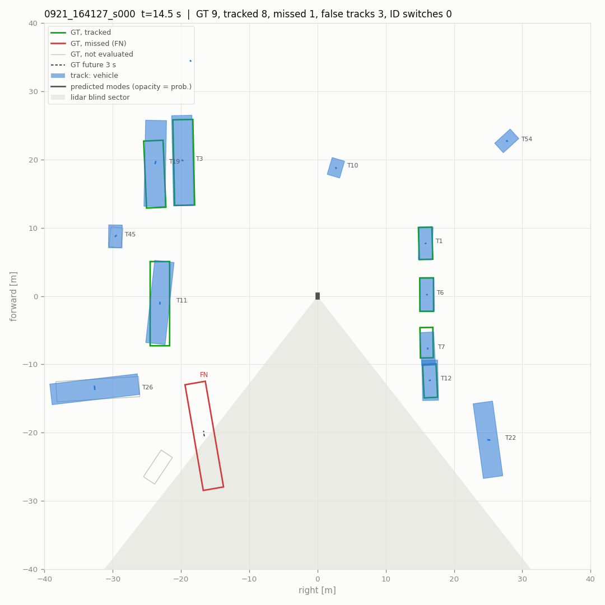
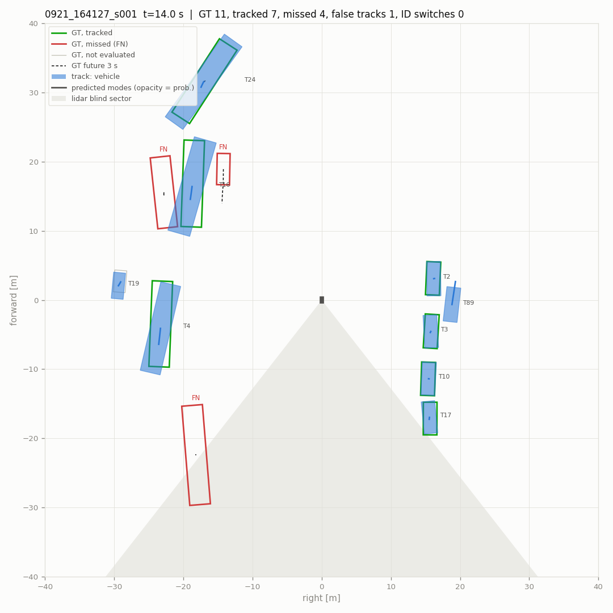
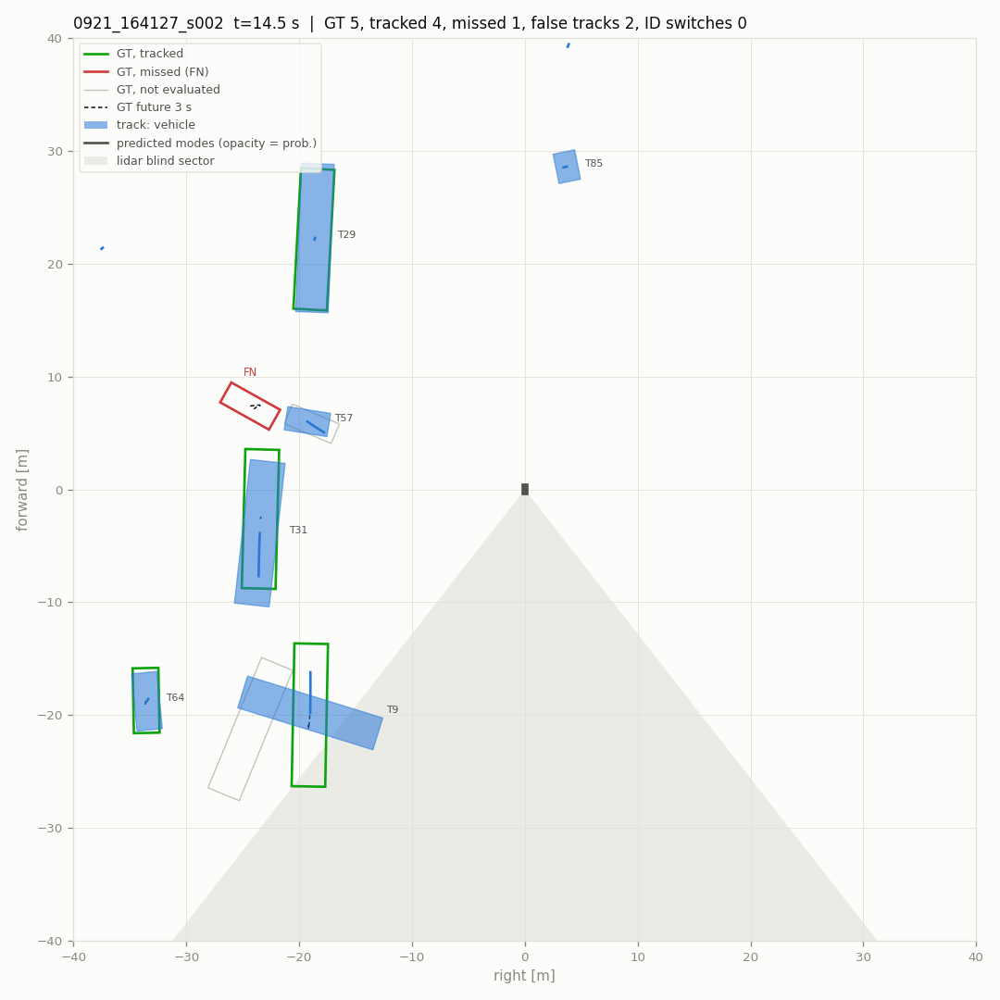
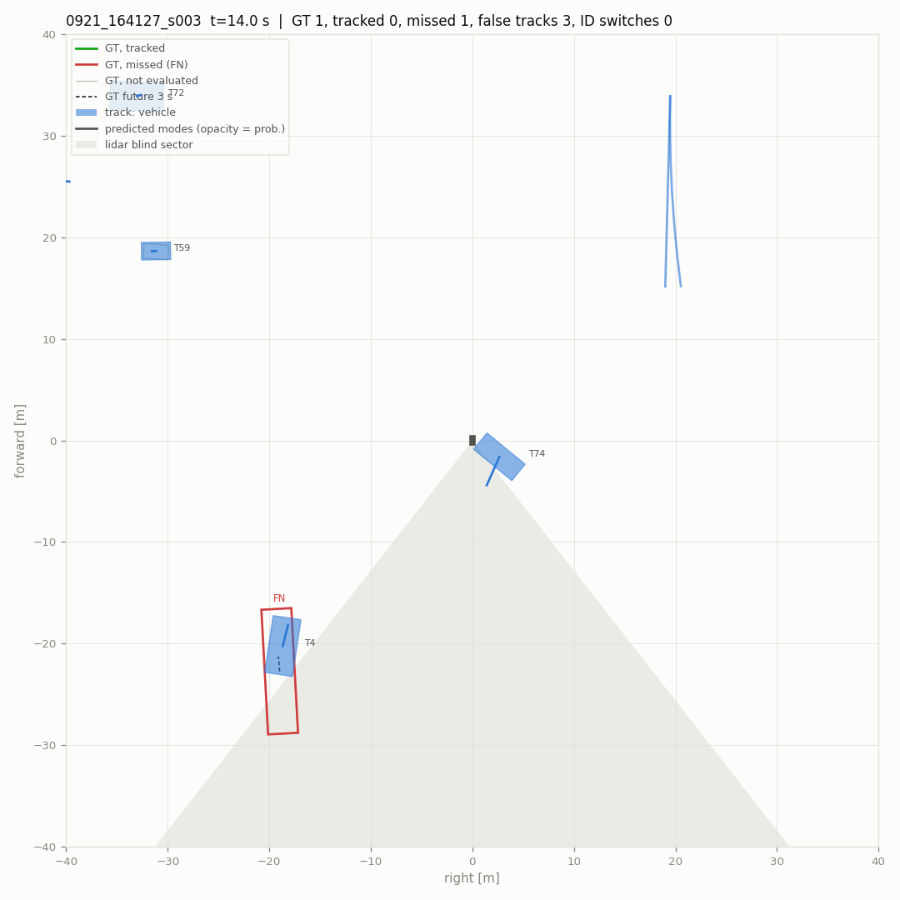
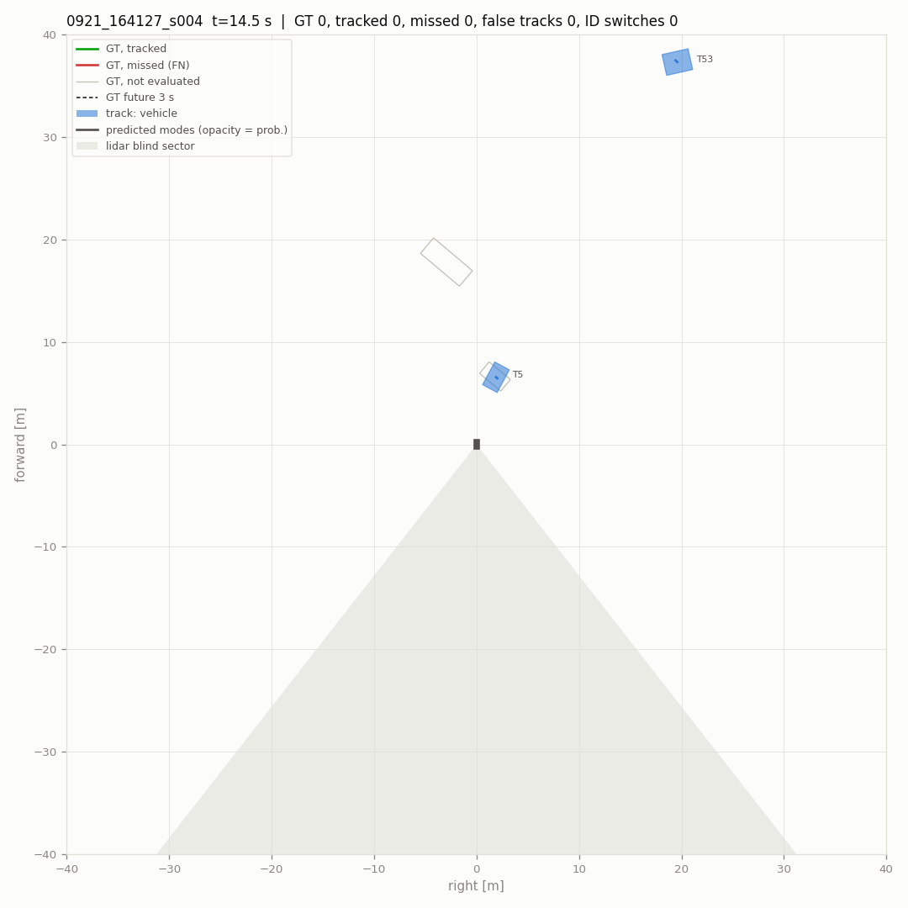
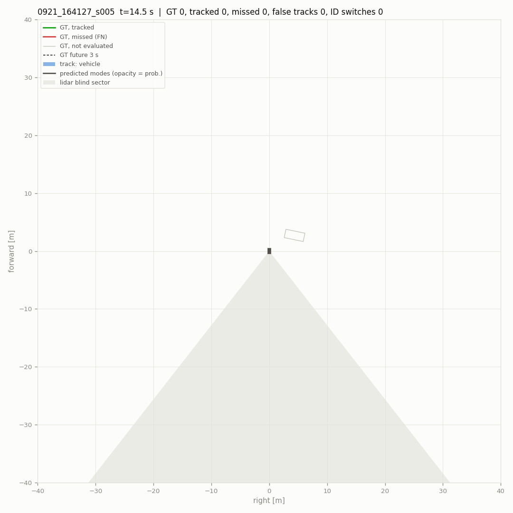
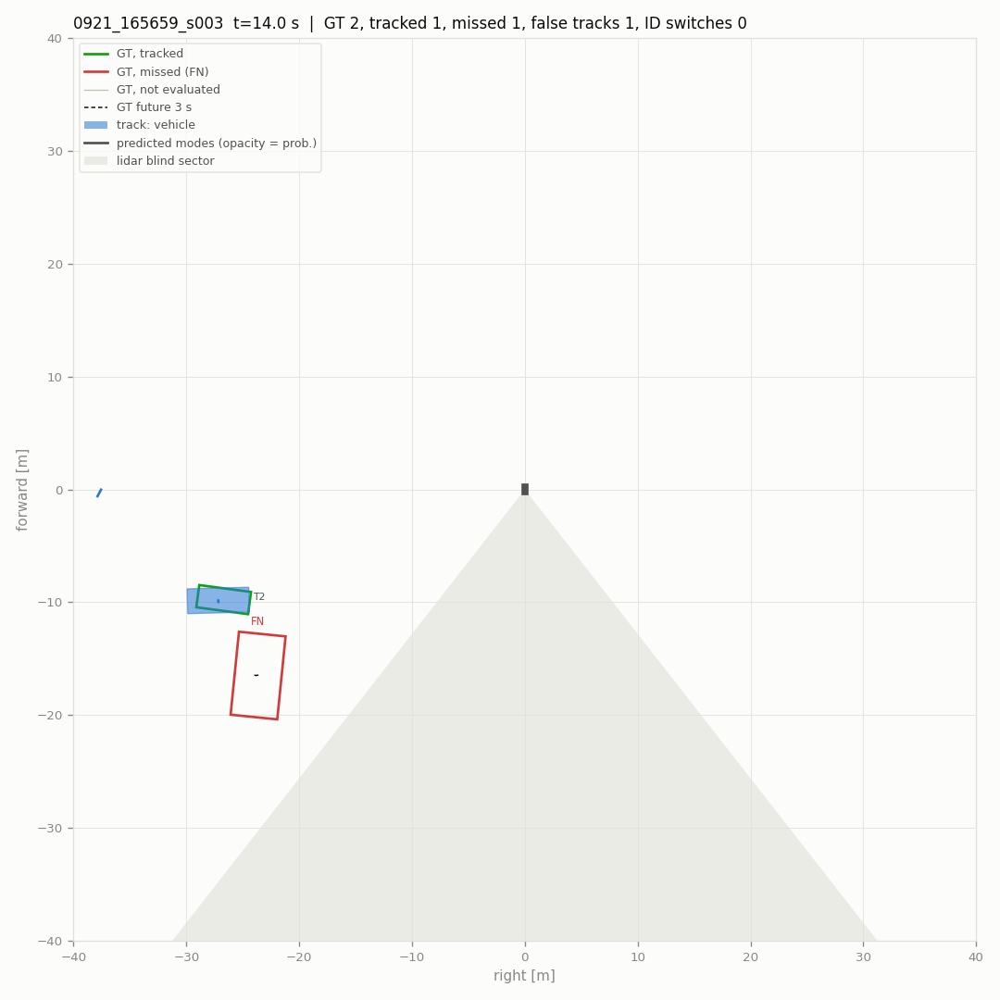
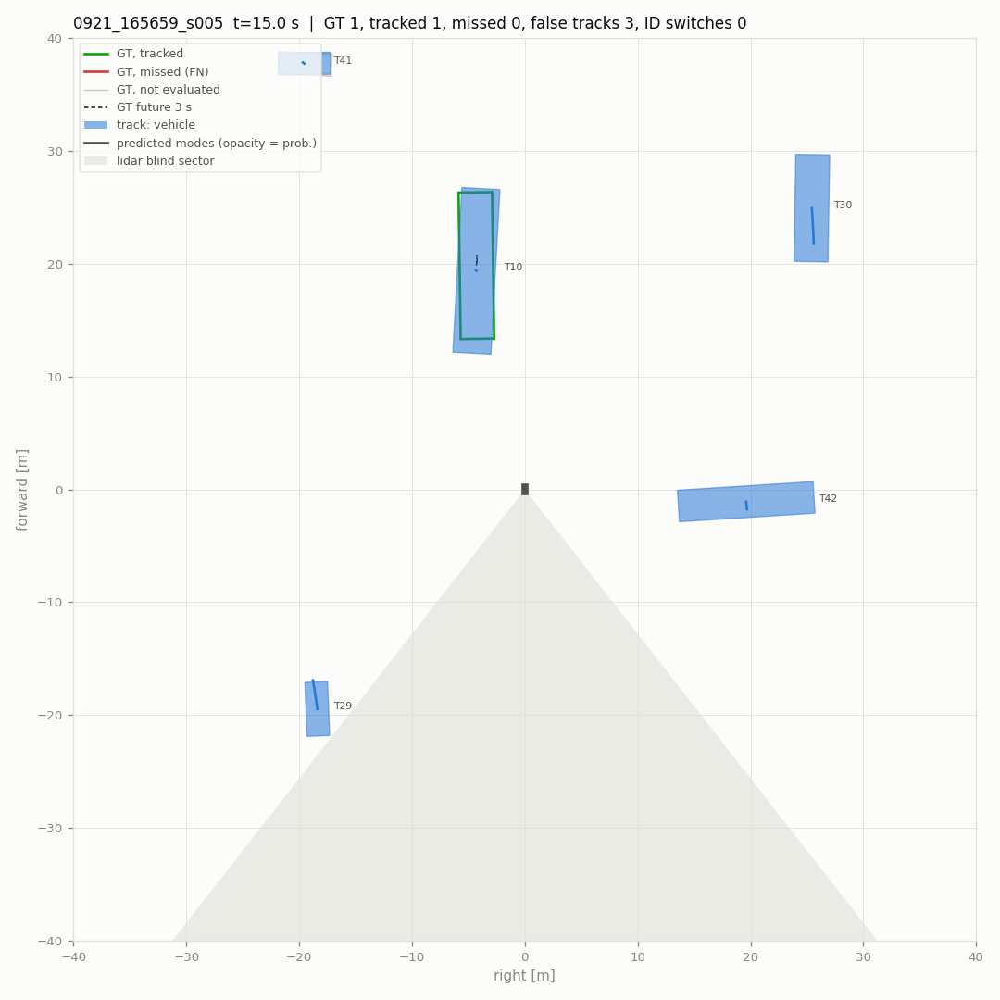
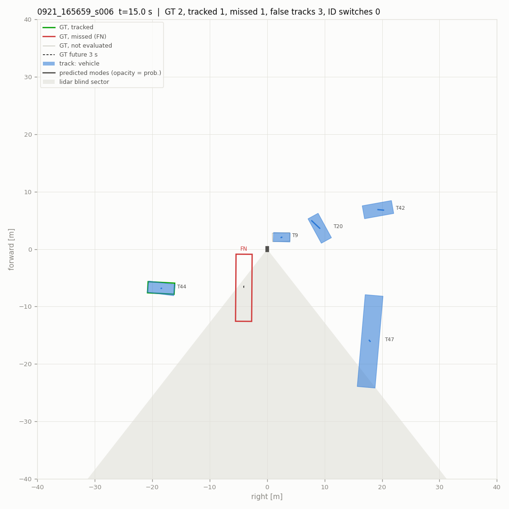

# Pipeline evaluation

- scenes (10): 0921_164127_s000, 0921_164127_s001, 0921_164127_s002, 0921_164127_s003, 0921_164127_s004, 0921_164127_s005, 0921_165659_s003, 0921_165659_s004, 0921_165659_s005, 0921_165659_s006
- 2884 frames, 580 keyframes scored (4.8 min)
- detections: `raw` from `data/deploy/T27_runs/{scene}/trt_int8/results.pkl`
- parameters: defaults
- scored: vehicles that are not ignore boxes, within 40 m and with current-sweep points; a detection or track on any other labelled box is not counted. Label tracks stitched into one vehicle: 19.
- intervals: 90 % over 500 resamples of the scenes

## Main metrics

| metric | value | interval |
|---|---|---|
| detections: recall within near range | **0.770** | 0.735 – 0.795 |
| detections: precision within near range | **0.762** | 0.633 – 0.813 |
| detections: F1 within near range | **0.766** | 0.688 – 0.796 |
| detections: false per keyframe | **1.017** | 0.725 – 1.374 |
| tracks: MOTA | **0.420** | 0.167 – 0.502 |
| tracks: IDF1 | **0.694** | 0.599 – 0.731 |
| tracks: ID switches / min | **2.276** | 0.835 – 3.918 |
| tracks: false tracks / min | **43.238** | 32.431 – 53.725 |
| tracks: confirm delay p90 [s] | **2.250** | 1.000 – 5.358 |
| motion: relevant moving stretches missed | **2** | 0.000 – 4.000 |
| motion: parked reported moving / h | **49.652** | 24.652 – 84.857 |
| prediction: FDE 3 s, moving [m] | **3.397** | 2.422 – 3.937 |
| prediction: miss rate 3 s, moving | **0.735** | 0.520 – 0.824 |

## Detections at the reporting threshold

Vehicle threshold 0.40 (`tracker.high_score`), 2 m match, keyframes. Near: within 30 m.

| range | precision | recall | TP | FP | FN |
|---|---|---|---|---|---|
| 0-30 m | 0.762 | 0.770 | 1042 | 325 | 312 |
| 30-40 m | 0.442 | 0.554 | 210 | 265 | 169 |

False detections per keyframe 1.017. AP over all scores: AP@2.0 0.710, AP@4.0 0.738, AP@2.0 0-20 m 0.901, 20-40 m 0.622.

## Tracking

Reported tracks (confirmed, coasting included) against the scored vehicles, keyframes, 2 m.

| MOTA | MOTP m | IDF1 | recall | precision | IDSW | IDSW / min | FRAG | MT | ML | vehicles | TP | FP | FN |
|---|---|---|---|---|---|---|---|---|---|---|---|---|---|
| **0.420** | 0.40 | **0.694** | 0.765 | 0.693 | 11 | 2.28 | 31 | 32 | 8 | 59 | 1325 | 586 | 408 |

- false tracks (a track false on consecutive keyframes counts once): 43.24 per minute
- a vehicle coming into 30 m waits for its first matched track: median 0.5 s, p90 2.2 s (18 vehicles; 0 never tracked; 0.5 s resolution)

### Where the errors are

| false tracks: cause | count |
|---|---|
| second track on a tracked vehicle | 1 |
| beside a vehicle (2-4 m off) | 19 |
| coasting after the vehicle was lost | 60 |
| nothing labelled nearby | 506 |

| missed vehicles (FN) | count |
|---|---|
| detected, not tracked | 51 |
| not detected | 357 |
| 0-10 m | 10 |
| 10-20 m | 26 |
| 20-30 m | 235 |
| 30-40 m | 137 |
| 1-9 pts | 22 |
| 10-49 pts | 80 |
| >=50 pts | 306 |

Blind sector (142-218 deg behind the robot) and the 20 deg bands beside it:

| zone | scored vehicles | missed | missed share | tracks | false | false share |
|---|---|---|---|---|---|---|
| elsewhere | 1317 | 223 | 0.169 | 1538 | 444 | 0.289 |
| edge | 402 | 172 | 0.428 | 369 | 140 | 0.379 |
| blind | 14 | 13 | 0.929 | 4 | 2 | 0.500 |

## Motion state

Online state against the labels' moving flags (tools/dog/motion_eval.py). Relevant: >= 1 m/s and within 30 m.

| moving recall | false moving | parked reported moving | false episodes (per h) | moving stretches missed | latency median / p90 s | relevant missed | relevant latency median / p90 s |
|---|---|---|---|---|---|---|---|
| 0.701 | 0.0115 | 4 / 37 | 4 (49.7) | 7 / 20 | 0.50 / 1.40 | **2 / 9** | 0.50 / 2.90 |

## Prediction

Tracks matched to a vehicle with 3 s of labelled future (keyframes every 0.5 s). Moving: >= 1.5 m in 3 s; turning: heading changes > 15 deg. ADE1 / FDE1: the most likely mode; minADE / minFDE: the best; MR: no mode ends within 2 m. IMM is what runs online (IMM: tier 1, learned: tier 2), CV keeps the track's velocity. Moving vehicles: the most likely mode's error split against the labelled path, along: mean distance along it from the true position (speed, starting, stopping), bias: its mean signed value (+: ahead, predicted too fast), across: mean distance from the path (its shape: what a road map could fix).

**all matched** (1059 samples)

| predictor | horizon | ADE1 | FDE1 | minADE | minFDE | MR@2m | along | bias | across |
|---|---|---|---|---|---|---|---|---|---|
| IMM | 1 s | 0.54 | 0.60 | 0.54 | 0.60 | 0.071 | - | - | - |
| IMM | 2 s | 0.66 | 0.85 | 0.66 | 0.85 | 0.105 | - | - | - |
| IMM | 3 s | 0.79 | 1.10 | 0.79 | 1.10 | 0.141 | - | - | - |
| CV | 1 s | 0.54 | 0.60 | 0.54 | 0.60 | 0.071 | - | - | - |
| CV | 2 s | 0.67 | 0.85 | 0.67 | 0.85 | 0.105 | - | - | - |
| CV | 3 s | 0.79 | 1.10 | 0.79 | 1.10 | 0.141 | - | - | - |

**moving** (102 samples)

| predictor | horizon | ADE1 | FDE1 | minADE | minFDE | MR@2m | along | bias | across |
|---|---|---|---|---|---|---|---|---|---|
| IMM | 1 s | 1.30 | 1.53 | 1.30 | 1.53 | 0.284 | 1.49 | 0.40 | 0.25 |
| IMM | 2 s | 1.78 | 2.51 | 1.78 | 2.50 | 0.520 | 2.50 | 0.37 | 0.41 |
| IMM | 3 s | 2.25 | 3.40 | 2.25 | 3.39 | 0.735 | 3.41 | 0.40 | 0.59 |
| CV | 1 s | 1.30 | 1.53 | 1.30 | 1.53 | 0.284 | 1.49 | 0.40 | 0.25 |
| CV | 2 s | 1.79 | 2.51 | 1.79 | 2.51 | 0.520 | 2.49 | 0.37 | 0.43 |
| CV | 3 s | 2.25 | 3.40 | 2.25 | 3.40 | 0.735 | 3.41 | 0.40 | 0.60 |

**moving, straight** (91 samples)

| predictor | horizon | ADE1 | FDE1 | minADE | minFDE | MR@2m | along | bias | across |
|---|---|---|---|---|---|---|---|---|---|
| IMM | 1 s | 1.36 | 1.59 | 1.36 | 1.59 | 0.308 | 1.55 | 0.51 | 0.25 |
| IMM | 2 s | 1.85 | 2.59 | 1.85 | 2.59 | 0.527 | 2.56 | 0.58 | 0.41 |
| IMM | 3 s | 2.33 | 3.50 | 2.33 | 3.49 | 0.725 | 3.45 | 0.72 | 0.58 |
| CV | 1 s | 1.36 | 1.59 | 1.36 | 1.59 | 0.308 | 1.55 | 0.51 | 0.26 |
| CV | 2 s | 1.85 | 2.60 | 1.85 | 2.60 | 0.527 | 2.56 | 0.58 | 0.42 |
| CV | 3 s | 2.33 | 3.50 | 2.33 | 3.50 | 0.725 | 3.45 | 0.72 | 0.59 |

**moving, turning** (11 samples)

| predictor | horizon | ADE1 | FDE1 | minADE | minFDE | MR@2m | along | bias | across |
|---|---|---|---|---|---|---|---|---|---|
| IMM | 1 s | 0.83 | 1.01 | 0.83 | 1.01 | 0.091 | 0.95 | -0.47 | 0.24 |
| IMM | 2 s | 1.22 | 1.76 | 1.22 | 1.76 | 0.455 | 1.96 | -1.40 | 0.45 |
| IMM | 3 s | 1.60 | 2.57 | 1.60 | 2.57 | 0.818 | 3.06 | -2.28 | 0.63 |
| CV | 1 s | 0.83 | 1.01 | 0.83 | 1.01 | 0.091 | 0.94 | -0.47 | 0.25 |
| CV | 2 s | 1.22 | 1.77 | 1.22 | 1.77 | 0.455 | 1.96 | -1.40 | 0.46 |
| CV | 3 s | 1.60 | 2.57 | 1.60 | 2.57 | 0.818 | 3.06 | -2.29 | 0.65 |

**moving, < 3 m/s** (95 samples)

| predictor | horizon | ADE1 | FDE1 | minADE | minFDE | MR@2m | along | bias | across |
|---|---|---|---|---|---|---|---|---|---|
| IMM | 1 s | 1.27 | 1.49 | 1.27 | 1.49 | 0.284 | 1.45 | 0.58 | 0.26 |
| IMM | 2 s | 1.74 | 2.46 | 1.74 | 2.46 | 0.495 | 2.45 | 0.62 | 0.42 |
| IMM | 3 s | 2.20 | 3.34 | 2.20 | 3.33 | 0.726 | 3.36 | 0.72 | 0.61 |
| CV | 1 s | 1.27 | 1.49 | 1.27 | 1.49 | 0.284 | 1.45 | 0.58 | 0.26 |
| CV | 2 s | 1.75 | 2.46 | 1.75 | 2.46 | 0.495 | 2.45 | 0.62 | 0.44 |
| CV | 3 s | 2.21 | 3.34 | 2.21 | 3.34 | 0.726 | 3.36 | 0.72 | 0.62 |

**moving, >= 6 m/s** (7 samples)

| predictor | horizon | ADE1 | FDE1 | minADE | minFDE | MR@2m | along | bias | across |
|---|---|---|---|---|---|---|---|---|---|
| IMM | 1 s | 1.79 | 2.05 | 1.79 | 2.05 | 0.286 | 2.03 | -2.03 | 0.13 |
| IMM | 2 s | 2.32 | 3.12 | 2.32 | 3.12 | 0.857 | 3.05 | -3.05 | 0.23 |
| IMM | 3 s | 2.85 | 4.19 | 2.85 | 4.19 | 0.857 | 4.05 | -4.01 | 0.33 |
| CV | 1 s | 1.79 | 2.06 | 1.79 | 2.06 | 0.286 | 2.03 | -2.03 | 0.15 |
| CV | 2 s | 2.33 | 3.14 | 2.33 | 3.14 | 0.857 | 3.05 | -3.05 | 0.25 |
| CV | 3 s | 2.87 | 4.22 | 2.87 | 4.22 | 0.857 | 4.05 | -4.01 | 0.37 |

## Training targets

The tier-2 training targets (prediction/dataset.py) of the same samples, cut from this run's track log the way train_predictor.py cuts them, against the labelled future: a pseudo ground truth, smoothed afterwards from the tracker's positions (filtered) or from the matched detections' centers (measured). windows: samples whose track has a training window there. Errors in m; > 1 m: share; along / bias / across as above (moving).

| targets | samples | windows | horizon | mean | p90 | > 1 m | along | bias | across |
|---|---|---|---|---|---|---|---|---|---|
| filtered | all matched | 912 / 1059 | 1 s | 0.34 | 0.98 | 0.088 | - | - | - |
| filtered | all matched | 912 / 1059 | 2 s | 0.34 | 0.98 | 0.086 | - | - | - |
| filtered | all matched | 912 / 1059 | 3 s | 0.36 | 0.99 | 0.095 | - | - | - |
| filtered | moving | 68 / 102 | 1 s | 0.75 | 1.41 | 0.265 | 0.73 | 0.48 | 0.12 |
| filtered | moving | 68 / 102 | 2 s | 0.78 | 1.32 | 0.309 | 0.76 | 0.41 | 0.14 |
| filtered | moving | 68 / 102 | 3 s | 0.85 | 1.41 | 0.368 | 0.83 | 0.30 | 0.13 |
| filtered | static | 844 / 957 | 1 s | 0.31 | 0.97 | 0.073 | - | - | - |
| filtered | static | 844 / 957 | 2 s | 0.31 | 0.96 | 0.068 | - | - | - |
| filtered | static | 844 / 957 | 3 s | 0.32 | 0.97 | 0.073 | - | - | - |
| measured | all matched | 912 / 1059 | 1 s | 0.27 | 0.90 | 0.057 | - | - | - |
| measured | all matched | 912 / 1059 | 2 s | 0.27 | 0.81 | 0.049 | - | - | - |
| measured | all matched | 912 / 1059 | 3 s | 0.28 | 0.88 | 0.058 | - | - | - |
| measured | moving | 68 / 102 | 1 s | 0.26 | 0.49 | 0.059 | 0.25 | 0.12 | 0.06 |
| measured | moving | 68 / 102 | 2 s | 0.23 | 0.46 | 0.000 | 0.22 | 0.02 | 0.06 |
| measured | moving | 68 / 102 | 3 s | 0.34 | 0.52 | 0.074 | 0.32 | -0.08 | 0.07 |
| measured | static | 844 / 957 | 1 s | 0.27 | 0.92 | 0.057 | - | - | - |
| measured | static | 844 / 957 | 2 s | 0.27 | 0.88 | 0.053 | - | - | - |
| measured | static | 844 / 957 | 3 s | 0.28 | 0.90 | 0.057 | - | - | - |

## Hazard proxy

A moving vehicle that comes within 5 m of the robot within 3 s (labelled future, the robot's own path) should raise an alarm: a moving track whose most likely predicted path, or its position now, comes that close. Few such vehicles in 0921; the numbers are for the controlled scenes to come (DATA_COLLECTION_PLAN.md 3.2).

- events 6, reported 3, lead before the closest approach: median 1.0 s, min 1.0 s
- alarms without such a vehicle: 1 (12.4 per hour)

## Timing (this machine, ms per frame: median / p90)

| stage | median | p90 |
|---|---|---|
| filter | 1.67 | 3.62 |
| track | 2.56 | 6.42 |
| predict | 1.13 | 4.15 |

## Issues (`issues.csv`)

| kind | count |
|---|---|
| ID switch | 11 |
| bad prediction | 44 |
| false moving | 4 |
| false track | 107 |
| hazard not reported | 3 |
| lost vehicle | 31 |
| missed moving vehicle | 2 |

## Snapshots

Middle keyframe of each scene, robot at the center heading up. Green / red outlines: scored vehicles tracked / missed; grey: not scored; filled: reported tracks; lines: the two most likely predicted modes; dashes: labelled 3 s future; shaded: the blind sector.

