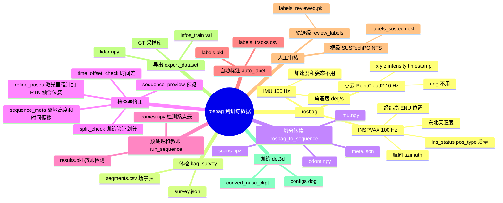

# 数据链路：从 rosbag 到可训练数据

这份文档讲清楚下面几件事：
- 一份 kygi665 录制的 rosbag 里有哪些话题、各字段是什么意思、哪些被用到；
- 数据依次经过哪些脚本，每个脚本做了什么处理、生成了什么文件；
- 人工审核改了哪些字段；
- 最后怎样变成 det3d 能直接训练的数据集。

- 操作步骤（命令、参数、怎么判断结果）见 [BAG_SPLIT.md](BAG_SPLIT.md)（长 bag 切分）和 [DOG_FINETUNE.md](DOG_FINETUNE.md)（标注与微调）。
- 线上运行时的数据流（节点、各段耗时）见 [DOG_DATAFLOW.md](DOG_DATAFLOW.md)。

文中的数字来自运动样例 bag（`samples/rosbag2_2026_09_21-16_41_27_moving`，27 帧）和服务器上的 0921 两份录制。

思维导图见 [data_lineage_mindmap.html](data_lineage_mindmap.html)（在浏览器里打开，可以折叠展开）。本文第 0 节有一个文字版。

---

## 0. 总览

```text
rosbag（3 个话题）
  │ ① bag_survey.py            只读时间戳和定位，不解码点云
  ▼
data/survey/<录制>/  survey.json  survey.png  segments.csv（场景切分表）
  │ ② rosbag_to_sequence.py    一遍读完，按场景写序列
  ▼
data/seq/<场景>/     meta.json  scans/*.npz  imu.npy  odom.npy
  │ ③ sequence_preview / sequence_meta / time_offset_check / split_check / refine_poses
  │                            只检查或改 meta.json 和位姿（odom.npy），不动点云
  ▼
data/preview/  data/survey/split/split.csv
  │ ④ run_sequence.py          预处理（与线上一致）+ 教师模型（Voxel + TTA）
  ▼
data/runs/<场景>/    frames/<时间戳>.npy（检测系点云）  voxel/results.pkl（教师检测）
  │ ⑤ auto_label.py            跟踪 + 整条轨迹回溯修正
  ▼
data/labels/<场景>/  labels.pkl  labels_tracks.csv
  │ ⑥ 人工审核：review_labels.py（轨迹级） / sustechpoints_convert.py（框级）
  ▼
data/labels/<场景>/  labels_reviewed.pkl  /  labels_sustech.pkl
  │ ⑦ export_dataset.py        转到网络坐标系、det3d 框格式，按录制分训练 / 验证
  ▼
data/dog/            infos_train.pkl  infos_val.pkl  lidar/  gt_database_5sweeps_withvelo/  dbinfos_train_*.pkl
  │ ⑧ convert_nusc_ckpt.py + tools/train.py configs/dog/*.py
  ▼
微调后的权重 → 下一轮当教师（回到 ④），或部署到 Orin（ros2_node.py -p robot:=kygi）
```



### 坐标系

链路里点和框会在下面 5 个坐标系之间转换。

| 记号 | 名称 | 定义 | 出现在哪里 |
|---|---|---|---|
| L | 雷达系 | XT32 自己的坐标系（bag 里的 `frame_id: hesai_lidar`） | bag 点云、`scans/*.npz` |
| B | 机身系 | INSPVAX 的约定：`yaw = 180° − azimuth`，只有航向、没有横滚俯仰。L 到 B 是绕 z 转 180°（`T_body_lidar`，`KYGI_LIDAR_RPY`） | 去畸变、IMU |
| W | 世界系 | ENU（东、北、天），原点是这份录制第一个 `ins_status = 3` 的定位点；同一录制的所有场景共用这个原点 | `odom.npy`、跟踪、地图 |
| D | 检测系 | 重力对齐，航向跟机身，原点在机身正下方的地面（机身原点下移 `base_height`），再用近处地面在线修正高度和倾斜（`auto_ground` / `auto_level`） | 预处理输出、教师检测、标签、审核 |
| M | 网络系 | 虚拟 nuScenes 雷达：`x_M = Rz(+90°)·x_D`，`z_M = z_D − 1.84 m`，以沿用 nuScenes 预训练模型的 z 先验 | 训练数据集、网络输入输出 |

**kygi 的前进方向是 D 系的 +y，不是 +x**：INSPVAX 的机身系约定（`yaw = 180° − azimuth`）让机身 x 轴指向狗的侧面。运动样例里，速度方向和 D 系 x 轴正好差 90.2°。所以进入 M 系后，前进方向是 −x_M，而 nuScenes 训练时是 +y_M，相当于整个场景转了 90°。
- 在 nuScenes mini_val（81 个关键帧）上把场景同样转 90° 再送进 nuScenes Pillar 模型：mAP 从 0.663 降到 0.650（车辆 0.700→0.692，行人 0.790→0.783，骑行者 0.498→0.475），车辆朝向误差从 0.27 rad 增加到 0.34 rad。
- 影响很小，微调后的模型又是按 kygi 的这个映射训练和部署的，所以**不改**。如果要改，教师推理、`export_dataset.py` 和线上节点的 `ModelFrame` 必须一起改。

框在 D 系里统一写成 `[x, y, z, l, w, h, yaw]`：中心点、长宽高、yaw 从 +x 逆时针。进入训练集时改成 det3d 格式 `[x, y, z, w, l, h, vx, vy, r]`，其中 `r = −yaw − π/2`。

---

## 1. 原始数据：rosbag 里的 3 个话题

0921 的 bag 里只有这 3 个话题。16:56 那份长 924 s，共 30 GB，其中点云占 9243 × 3.17 MB ≈ 29 GB。

| 话题 | 类型 | 频率 | 用途 |
|---|---|---|---|
| `/robot/topic/rdap/top_point_cloud2` | `sensor_msgs/PointCloud2` | 10 Hz | 点云 |
| `/rte/rdap/rtk/imus/data_raw` | `sensor_msgs/Imu` | 100 Hz | 角速度（去畸变、位姿插值） |
| `/rte/rdap/rtk/inspvax` | `kygi665_msgs/INSPVAX` | 100 Hz | 位置、航向、速度（位姿） |

**两种时间**：bag 给每条消息记了写入时刻（log time），消息头里还有传感器给的时间戳（`header.stamp`）。下游所有处理都用 `header.stamp`。
- 雷达：写入时刻比 `header.stamp` 晚约 0.105 s，因为 `header.stamp` 是一圈扫描的开始，转完一圈（0.1 s）才发出来。
- IMU、INS：两者相差不到 1 ms。

`bag_survey.py` 会统计这个差值（`log_minus_header`）作为时钟检查。

### 1.1 点云 `/robot/topic/rdap/top_point_cloud2`

**消息级字段**

| 字段 | 实际值 | 含义 | 是否使用 |
|---|---|---|---|
| `header.stamp` | 秒 + 纳秒 | 这一圈扫描**开始**的时刻 | 用：场景按它切分；只读时间戳时直接从原始字节第 4–12 字节取，不解码点云 |
| `header.frame_id` | `hesai_lidar` | 坐标系名 | 不用（外参写在代码里） |
| `height` × `width` | 1 × 128000 | 每帧固定 128000 个槽位，无回波的槽位是 0 或 NaN | 用来解析 |
| `point_step` | 26 字节 | 每个点占的字节数 | 用来解析 |
| `is_dense` | False | 含无效点 | 转换时去掉无效点 |

**逐点字段**

| 字段 | 类型 | 含义 | 是否使用 |
|---|---|---|---|
| `x` `y` `z` | float32，m | 雷达系 L 下的坐标 | 用 |
| `intensity` | float32，0–255 | 回波强度 | 用（网络的第 4 维输入，不缩放） |
| `ring` | uint16 | 第几根激光线（XT32 共 32 线） | 不用，转换时丢掉 |
| `timestamp` | float64，s | 这个点的**绝对**采集时间（Hesai 驱动 2.0） | 用：逐点去畸变；整帧时刻取最大值，也就是扫描结束 |

一帧里约 106000 个有效点。雷达是双回波模式（最后回波 + 最强回波），两个回波重合时同一个点会出现两次，所以去重后只剩约 52000 个点（见第 5 节）。

### 1.2 IMU `/rte/rdap/rtk/imus/data_raw`

| 字段 | 实测 | 含义 | 是否使用 |
|---|---|---|---|
| `header.stamp` | | 采样时刻 | 用 |
| `header.frame_id` | `imu_link` | | 不用 |
| `angular_velocity.x/y/z` | 例：−2.98, 0.38, −0.20 | 角速度，**单位是 deg/s**，在 INS 的坐标轴下 | 用：乘 π/180 转成 rad/s，再绕 z 转 180° 到机身系 B（`gyro_from_kygi_imu`） |
| `linear_acceleration` | z ≈ 0.88 | 加速度；看数值是以 g 为单位，不是 m/s² | 不用 |
| `orientation`、各协方差 | (0, 0, 0, 1)、0 | 没有提供 | 不用 |

### 1.3 定位 `/rte/rdap/rtk/inspvax`（kygi665 组合导航，NovAtel INSPVAX 格式）

| 字段 | 实测 | 含义 | 是否使用 |
|---|---|---|---|
| `header.stamp` | | 解算时刻 | 用 |
| `header.frame_id` | `gps` | | 不用 |
| `kygi_header.*` | `message_name` INSPVAX，`gps_week_number` 2437，`time_status` 180 | 设备报文头（GPS 周、周内毫秒、时间状态） | 不用 |
| `ins_status.data` | 3 | 组合导航状态，3 = `INS_SOLUTION_GOOD` | 用：不是 3 的行直接丢掉；第一个是 3 的行作为 ENU 原点 |
| `pos_type.data` | 56 | 定位类型 | 用于质量统计（`meta.inspvax_pos_type`、预览的 `rtk` 检查），见下面的说明 |
| `latitude` `longitude` | 度 | 纬度、经度 | 用：转成 ENU 坐标（相对原点，单位 m） |
| `height` | 217.1 m | 高程 | 用：参与 ENU 换算 |
| `undulation` | −38.0 m | 大地水准面差距 | 不用 |
| `north_velocity` `east_velocity` `up_velocity` | 1.58, 0.47, −0.005 m/s | 北、东、天方向速度 | 用：写进 `odom.npy` 的速度列，按 (东, 北, 天) 排 |
| `roll` `pitch` | 度 | 横滚、俯仰 | **不用**：加减速时不可信（0.6 s 内 pitch 从 +2.8° 跳到 −9.9°，陀螺积分不到 2°）。地面倾斜改由点云在线找平 |
| `azimuth` | 196.8° | 航向，从正北顺时针 | 用：机身航向 `yaw = (180° − azimuth)`，换成弧度，在 ENU 下从东向逆时针 |
| `*_stdev` | 纬度 0.013 m，航向 0.20° | 各量的标准差 | 不用（只在核对定位质量时看） |
| `ext_sol_status`、`time_since_update` | 2048、0 | 扩展解算状态、距上次更新的时间 | 不用 |

**pos_type 的取值**：
- 代码按 NovAtel 标准，认为 **56 = RTK 固定解，55 = RTK 浮点解**，54 / 52 是差分或星基增强。
- 仓库里 `kygi665_msgs/msg/PositionOrVelocityType.msg` 的常量名写的是 `INS_RTKFLOAT=56`、`INS_RTKFIXED=55`，和标准正好相反。
- 实测 56 时的位置标准差是 1.3 cm，是固定解的精度，所以按 56 = 固定解处理是对的，是消息文件的常量名写反了。
- 0921 那份长 bag 里，56 占 93%，其余是 54（4399 条）、52（1341 条）、55（359 条）。

**已知问题**：狗急停时，INS 报的速度会冲过头（2.5 m/s），位置跑到真实位置前面约 0.45 m，并保持 1 秒以上；随后位置每约 0.2 s 被往回拉一次（最多 0.33 m），但没拉够（运动样例 bag 的最后 1 s）。
- 预览里的 `ins_step_m` 量的是往回拉的跳变，`shift_p90_m` 用激光配准量位姿误差本身；
- 修正方法见第 4 节的 `refine_poses.py`。

---

## 2. ① 体检：`tools/dog/bag_survey.py`

**输入**：整个 bag。
- 点云只读 `header.stamp`，直接从原始字节里取，不解码，所以 30 GB 的 bag 读起来也快；
- IMU 读时间戳；
- INSPVAX 读时间、状态、位置、速度。

**处理**：
- 统计各话题的频率和最大间隔，以及写入时刻与 `header.stamp` 的差值（时钟检查）；
- INS 状态好且 RTK 固定的时间段，与雷达连续的时间段取交集，得到可用区间；
- 在可用区间里按约 30 s 切出场景；
- 时间上最后一段（默认 20%）划为验证，它前面一个场景作为缓冲，不转换。

**输出**：`data/survey/<录制>/`

| 文件 | 内容 |
|---|---|
| `survey.json` | 各话题条数和频率、雷达帧数和最大间隔、单条大小、IMU / INS 频率、`pos_type` 分布、路程、`log_minus_header`（各话题差值的中位数和 5% / 95% 分位）、可用时长和区间、场景列表、训练 / 验证时长、验证路线离训练路线 10 m 内的比例 |
| `survey.png` | 轨迹图（训练蓝、验证橙、未用灰）、速度、偏航角速度、pos_type、雷达帧间隔 |
| `segments.csv` | 一行一个场景，列见下表 |

`segments.csv` 的列：

| 列 | 含义 |
|---|---|
| `name` | 场景名 `<录制>_sNNN` |
| `t_start` `t_end` | 雷达 `header.stamp` 的起止时间（左闭右开），精确到微秒 |
| `duration` `scans` | 时长、雷达帧数 |
| `path_m` `mean_speed` `moving_share` | 路程、平均速度、速度 > 0.3 m/s 的时间占比 |
| `pos_types` | 这段时间里各 pos_type 的计数 |
| `split` | `train` / `val` |
| `keep` | 1 = 转换，0 = 不转换（例如验证前面的缓冲场景） |
| `note` | 例如 `static (robot not moving)`、`buffer before val` |

人可以改 `keep`、`split`、`name` 三列，下一步按改过的表转换。

---

## 3. ② 切分转换：`tools/dog/rosbag_to_sequence.py`

**输入**：bag 和 `segments.csv` 里 `keep = 1` 的行。

**处理**（整个 bag 只读一遍，边读边写）：
- **点云**：
  - 先看 `header.stamp` 落在哪个场景，不属于任何场景就跳过、不解码；
  - 解码后去掉无效点（0 或 NaN），丢掉 `ring`；
  - 每个点保留绝对时间 `timestamp`，整帧时刻取最大值（扫描结束）；
  - 原样写盘，不做任何几何处理，仍在雷达系 L。
- **IMU**：角速度从 deg/s 转成 rad/s，从 INS 轴转到机身系 B。只保留场景时间范围前后各多 1 s（`--pad`）的数据，去畸变和位姿插值要用。
- **INSPVAX**：
  - `ins_status` 不是 3 的行丢掉；
  - 第一个状态好的点作为整份录制共用的 ENU 原点；
  - 经纬高转成 ENU 位置；`azimuth` 转成航向四元数（只有 yaw）；东北天速度原样写入；
  - 同样前后多留 1 s。
- **离地高度**：每个场景每隔 10 帧，用该帧在机身系下的点云估计一次，取中位数。
  - 估计方法是 2–15 m 环内取 z 的第 5 百分位附近的点，它们的中位数就是地面。
  - 只看一帧的话，结果会受脚下地形影响：0921 的 29 个场景，第一帧估出 0.59–1.05 m，而真实值约 0.72 m。

**输出**：`data/seq/<场景>/`，一个场景一个目录。

| 文件 | 形状 / 类型 | 内容 |
|---|---|---|
| `scans/000000.npz` … | 每帧一个 | `xyz` (N,3) float32，雷达系 L；`intensity` (N,) float32，0–255；`t` (N,) float64，每个点的绝对时间；`stamp` float64，扫描结束时刻 |
| `imu.npy` | (M,4) float64 | `t, wx, wy, wz`：机身系角速度，rad/s |
| `odom.npy` | (K,11) float64 | `t, x, y, z, qx, qy, qz, qw, vx, vy, vz`：W 系里的位置（ENU，m）、姿态（只有航向）、速度（东、北、天，m/s）。跑过 `refine_poses.py` 后，东、北坐标和速度换成融合后的值 |
| `odom_ins.npy` | (K,11) float64 | 只在跑过 `refine_poses.py` 后存在：融合前的 INS 原始数据，同样格式，是以后每次融合的输入 |
| `meta.json` | JSON | 见下表。**最后写**，目录里没有它说明这个场景没写完 |

`meta.json` 的字段：

| 字段 | 写入者 | 含义 |
|---|---|---|
| `T_body_lidar` | 转换器 | 4×4 外参，L 到 B（kygi 是绕 z 转 180°） |
| `base_height` | 转换器 / `sequence_meta.py` | 机身原点（这里就是雷达原点）离地高度，m |
| `base_height_sweeps` | 同上 | 估计用了几帧（`n`）、p10 / p90、每几帧取一次（`every`）；手动指定时为 `{"fixed": true}` |
| `base_height_first_sweep` | `sequence_meta.py` | 修正前只用第一帧估出的旧值（保留一份备查） |
| `lat0` `lon0` `h0` | 转换器 | ENU 原点，同一录制的所有场景都一样 |
| `inspvax_pos_type` | 转换器 | 场景内（含前后 1 s）各 pos_type 的计数 |
| `det_frame` | 转换器 | kygi 是 `{"auto_ground": true, "auto_level": true}`：检测系用近处地面在线修正高度和倾斜 |
| `segment` | 转换器 / `split_check.py` | `name, t_start, t_end, split`；`split_check.py --apply` 会改 `split`，体检给的原值存在 `split_survey` |
| `lidar_time_offset` | `sequence_meta.py`（可选） | 读取时加到所有雷达时间上的秒数，用来把雷达时钟对齐到 INS 时钟，默认 0 |
| `pose_source` | `refine_poses.py` | 没有这个字段表示用的是 INS 位姿；`kiss-icp+ins` 表示激光里程计 + RTK 融合 |
| `pose_refine` | `refine_poses.py` | 修正量（中位、p90、最大）、INS 不可信的时间占比、不可靠时段 `bad_intervals`（这些帧不要标注）、未验证时段 `unverified_intervals`、可信段里激光 1 s 位移和 INS 的差，以及所用参数 |
| `lidar` `source` | 转换器 | `XT32`、来源 bag 的路径 |

体积：一帧在 bag 里 3.17 MB，压缩成 npz 后约 0.6 MB。

---

## 4. ③ 检查与修正（不动点云）

这一步的工具只读序列，最多改 `meta.json`；`refine_poses.py` 还会改 `odom.npy`（INS 原始数据另存为 `odom_ins.npy`）。点云和 IMU 文件不变。

| 脚本 | 读 | 写 | 改了什么数据 |
|---|---|---|---|
| `sequence_preview.py` | 序列（每 5 帧做一次和线上一样的预处理） | `data/preview/<录制>/`：每个场景一张 PNG，`checks.csv` / `checks.json`，`index.html` | 不改。检查项：帧间错位 `align_m`；激光测出的相隔 1 s 两帧的位姿误差 `shift_p90_m`（沿行进方向的误差也能测出）；地面高度 `ground_z_m`；倾斜 `tilt_deg`；各话题最大间隔；`rtk`；INS 位置跳变 `ins_step_m` |
| `refine_poses.py` | 序列的 `scans/`、`odom.npy`（或已有的 `odom_ins.npy`） | `odom.npy`、`odom_ins.npy`；`--plots` 时每个场景一张轨迹和修正量图 | KISS-ICP 激光里程计与 RTK 融合：INS 可信时由 INS 定住轨迹、激光补帧与帧之间的运动；INS 不可信时（急停）由激光把两端可信的 INS 连起来。改 `odom.npy` 的东、北坐标和速度，`meta.json` 加 `pose_source`、`pose_refine` |
| `sequence_meta.py` | `meta.json`，每 10 帧一个 `scans/*.npz` | `meta.json` | `base_height`（多帧中位数或给定值）、`base_height_sweeps`、`base_height_first_sweep`、`lidar_time_offset` |
| `time_offset_check.py` | 有转弯的序列 | `time_offset.csv/json`、每个场景一张 PNG | 不改。在转弯处扫描雷达时间偏移，给出建议值；确认后用 `sequence_meta.py` 写入 |
| `split_check.py` | 所有序列的 `meta.json` 和 `odom.npy` | `data/survey/split/`：`split_check.csv/json/png`；加 `--apply` 后还写 `split.csv` | 加 `--apply` 时改 `meta.json` 的 `segment.split`（`train` / `val` / `drop`），原值存进 `split_survey` |

`split.csv` 的列：`name, split, reason`。`drop` 的场景不进入后面的步骤。

---

## 5. ④ 预处理 + 教师推理：`tools/dog/run_sequence.py`

**输入**：一个序列。`SequenceReader` 把 IMU、定位、雷达帧按时间排好依次送出：
- 如果设置了 `lidar_time_offset`，送出前加到雷达时间上；
- 雷达帧在扫描结束时刻送出。

**预处理**（`dog_perception/preprocess/`）。每帧依次做下面这些，和线上节点、`auto_label.py`、`sequence_preview.py` 用的是同一份代码。括号里是运动样例 bag 的中位数。

| 步骤 | 做什么 | 点数 |
|---|---|---|
| 有效点 | 转换时已去掉 0 和 NaN | 106 000 |
| 去重 `dedup_returns` | 双回波重合的点在 1 mm 网格上只保留一个 | 52 000 |
| 去自身点 `SelfFilter` | 在机身系去掉狗身体和腿所在的盒子（x ±0.6，y ±0.4，z −0.8…0.3 m）、0.4 m 以内的点、3 m 内的孤立飞点 | 37 600 |
| 去畸变 | 用 100 Hz 位姿（INS 锚定 + 陀螺积分）把每个点挪到扫描结束时刻的机身位置 | 不变 |
| 到世界系 | 用扫描结束时刻的位姿转到 W，放进最近 5 帧的缓存 | 不变 |
| 构造检测系 D | 机身航向 + 原点下移 `base_height`，再用 1.5–8 m 的地面修正高度（±0.3 m）和倾斜（±5°） | |
| 多帧拼接 | 最近 5 帧（跨度 ≤ 0.55 s）转到当前 D 系，每个点加一列 `dt`（这帧比当前帧早多少秒） | 约 188 000 |

**教师模型**：CenterPoint-Voxel，第一轮用 nuScenes 权重，之后用自己微调的 Voxel 模型；开 `--tta`（双翻转测试增强），分数阈值 0.1，留低分框给跟踪用。网络在 M 系里运行，结果转回 D 系。

**输出**：`data/runs/<场景>/`

| 文件 | 内容 |
|---|---|
| `frames/<stamp>.npy` | （`--save-frames`）每帧 (N,5) float32 `[x, y, z, intensity, dt]`，D 系，就是检测器的输入。约 3.7 MB/帧 |
| `voxel/results.pkl` | 列表，每帧一个 dict：`stamp`、`T_world_det`（D 到 W，4×4）、`T_world_body`、`detections`、`tracks`、`predictions`、`timings` |
| `voxel/track_log.npz` | 跟踪日志（给轨迹预测模型训练用） |
| `voxel.mcap` | Foxglove 可视化：点云、上报的检测、轨迹、位姿 |

`detections` 的结构（`Detections`）：

| 字段 | 形状 | 含义 |
|---|---|---|
| `boxes` | (N,7) | D 系 `[x, y, z, l, w, h, yaw]` |
| `velocities` | (N,2) | D 系对地速度，m/s |
| `scores` | (N,) | 置信度 |
| `labels` | (N,) | 0 车辆、1 行人、2 骑行者 |
| `subclasses` | (N,) | 0 car、1 truck、2 bus、3 pedestrian、4 cyclist；−1 表示未知 |

5 个检测头（car / truck / bus / pedestrian / cyclist）的输出合并成 3 类，子类保留在 `subclasses` 里。

---

## 6. ⑤ 自动标注：`tools/dog/auto_label.py`（算法在 `dog_perception/autolabel.py`）

**输入**：`results.pkl` 里每帧的 `stamp`、`T_world_det`、`detections`。也可以不给 `results.pkl`，让它自己跑教师模型。

**处理**：先把框转到 W 系做跟踪，再利用整段录制，对每条轨迹做非因果修正（可以用到之后的帧）：

| 修正项 | 方法 |
|---|---|
| 类别、子类 | 整条轨迹按分数加权投票，消除类别跳变；车辆的 car / truck / bus 也这样投票 |
| 尺寸、z | 分数加权中位数（刚体尺寸不变） |
| 中心 | RTS 平滑；0.5 s 以内的漏检做插值补帧（`interpolated = True`） |
| 静止 / 运动 | 平滑后的轨迹速度 > 0.4 m/s **且**教师速度头 > 0.15 m/s，才算运动 |
| 静止轨迹 | 速度置零；框的分布够集中时，位置固定为加权中位数 |
| 朝向 | 运动快（> 1 m/s）时取运动方向，否则取框朝向的环形均值，180° 歧义用运动方向消解 |
| 删除 | 观测少于 5 次或平均分 < 0.3 的轨迹 |
| 待审核 | 平均分 < 0.5 的轨迹，标 `review = True` |

**输出**：`data/labels/<场景>/`

`labels.pkl`：

```text
{"sequence": 来源,
 "frames": [{"stamp": 扫描结束时刻,
             "T_world_det": 4×4,
             "objects": [{"track_id", "label"（vehicle/pedestrian/cyclist）,
                          "subclass"（car/truck/bus，非车辆与 label 相同，没有时为 None）,
                          "box"（7，D 系）, "velocity"（2，D 系）, "score",
                          "review", "interpolated", "moving"}]}]}
```

`labels_tracks.csv`：一条轨迹一行，给人工审核用。待审核的和低分的排在前面。

列：`track_id, label, subclass, review, mean_score, frames, interpolated, t_first, t_last, min_range_m, moving_share, max_speed, action, from, to, note`。

样例 bag 的结果：静止 bag 28 帧、463 个框、19 条轨迹（7 条待审核）；运动 bag 27 帧、327 个框、17 条轨迹（13 条待审核）。

---

## 7. ⑥ 人工审核

两种方式可以单独用，也可以接着用：先在轨迹级把明显的错改掉，再到框级精修。约定是训练场景至少做轨迹级审核，验证场景用 SUSTechPOINTS 逐框看。

### 7.1 轨迹级：`tools/dog/review_labels.py`

1. `mcap`：把标签、点云（`frames/`）和教师的原始框（灰色）写成 `review.mcap`，在 Foxglove 里看。
2. 人改 `labels_tracks.csv` 的 `action` 列。`from` / `to`（距录制开始的秒数）可以只改一段轨迹。
3. `apply`：生成 `labels_reviewed.pkl`。

每种 action 对数据的改动：

| action | 改动 |
|---|---|
| `ok` | 不改，只清掉 `review` |
| `drop` | 删掉这条轨迹（或 `from`–`to` 那一段）的所有框 |
| `vehicle` / `pedestrian` / `cyclist` | 改 `label`；改成 vehicle 时子类清空，改成另外两类时子类跟着变 |
| `car` / `truck` / `bus` | `label = vehicle`，`subclass` 改成对应子类 |
| `flip` | `box[6]`（yaw）加 180° |
| `static` | 速度置零，位置和朝向固定为一个值 |

几个 action 可以用 `+` 组合，例如 `cyclist+flip`。凡是 `drop` 以外的动作，都会把 `review` 清掉，并加上 `reviewed = True`。

审核后仍标着 `review` 的轨迹，在导出时用 `--skip-review` 丢掉。这一步只能改已有的轨迹，不能新增漏掉的物体。

样例结果：静止 bag 删掉 1 条，运动 bag 删掉 3 条。

### 7.2 框级：`tools/dog/sustechpoints_convert.py` + SUSTechPOINTS

**`export`**：把标签和点云写成 SUSTechPOINTS 的场景 `third_party/SUSTechPOINTS/data/<场景>/`，`--every 5` 表示 10 Hz 里只取 2 Hz。
- `lidar/<帧名>.pcd`：D 系点云，整体下移 1.8 m（这个工具假定雷达离地 1.8 m），强度缩放到 0–1；帧名是微秒时间戳。
- `label/<帧名>.json`：每个框写成 `{obj_id（= track_id）, obj_type（Car/Truck/Bus/Pedestrian/BicycleRider）, obj_attr（待审核的写 "review"）, psr: {position, scale（l,w,h）, rotation.z（yaw）}}`。
- `dog_meta.json`：记下 SUSTechPOINTS 不保存的信息：每帧的 `stamp`、`T_world_det`、分数、z 偏移。

**在 SUSTechPOINTS 里**：可以挪框、改尺寸、改朝向、改类型、删框，**也可以新增漏标的物体**。

**`import`**：生成 `labels_sustech.pkl`，格式和 `labels.pkl` 一样。
- z 移回原位；
- 类型映射回类别和子类：Car / Van → car；Truck 和各种工程车 → truck；Bus / Tram / LongVehicle → bus；
- 中心没被挪动的框，保留导出时的速度；挪过的框和新加的框，按同一 `obj_id` 在 W 系的标注中心重新算速度（±0.5 s 差分，低于静止阈值的置零）；
- 所有框都是 `review = False`、`reviewed = True`；
- 只包含导出的那些帧（`--every 5` 就是 2 Hz）。

---

## 8. ⑦ 导出数据集：`tools/dog/export_dataset.py`

**输入**：每个场景给一对 `--recording <run 目录> <labels 文件>`。labels 文件用 `labels_sustech.pkl`；没有就用 `labels_reviewed.pkl`。`--val-recordings` 列出验证场景，用了 3.4 节的划分时就是 `split.csv` 里的 `val`。

**处理**（逐帧，只处理 labels 里有、`frames/` 里也有的帧）：
- 点云：`frames/<stamp>.npy` 从 D 系转到 M 系（`ModelFrame.points_to_model`：绕 z 转 +90°，z 减 1.84 m），存成 float32；
- 框：从 D 系转到 M 系，再写成 det3d 格式 `[x, y, z, w, l, h, vx, vy, r]`（`r = −yaw − π/2`），float32；
- 类名：默认是检测头的 5 类，车辆用 `subclass`。旧标签没有子类时按尺寸猜（长 ≥ 10 m 为 bus，长 ≥ 6.5 m 或高 ≥ 2.8 m 为 truck，否则 car），并打印数量提醒。`--classes coarse` 输出 3 类，给旧的 `*_3cls` 配置用；
- `--skip-review`：丢掉仍标着 `review` 的框；
- 按录制分训练 / 验证，不按帧随机分。

**输出**：`--out` 目录。训练配置默认读 `data/dog`；导到别的目录时，改配置里的 `data_root` 等路径，或者建软链接。

| 文件 | 内容 |
|---|---|
| `lidar/<场景>/<stamp>.npy` | (N,5) float32 `[x, y, z, intensity, dt]`，M 系 |
| `infos_train.pkl`、`infos_val.pkl` | 列表，每帧一个 dict：`token`（`<场景>_<stamp>`）、`lidar_path`（相对路径）、`gt_boxes` (M,9)、`gt_names` (M,)、`sequence`、`timestamp` |
| `gt_database_5sweeps_withvelo/<类>/<token>_<类>_<i>.bin` | （`--gt-db`）每个训练框内的点，float32 (K,5)，坐标减去框中心 |
| `dbinfos_train_5sweeps_withvelo.pkl` | 按类分组的列表：`name, path, image_idx, gt_idx, box3d_lidar, num_points_in_gt, difficulty, group_id`，给 GT 采样增强用 |

样例结果：训练 28 帧、验证 27 帧；框数 bus 111、car 127、cyclist 51、pedestrian 83、truck 106。

---

## 9. ⑧ 训练：det3d

1. **初始化权重**：`tools/dog/convert_nusc_ckpt.py` 让狗的每个检测头直接继承 nuScenes 里对应的检测头：全部回归分支，加上热力图里对应的那个通道。主干网络、neck 和共享卷积原样复制。
   - car 头继承 car 头；
   - truck 头继承 truck / construction_vehicle 头里 truck 的通道；
   - bus 头继承 bus / trailer 头里 bus 的通道；
   - pedestrian 头继承 pedestrian 头；
   - cyclist 头继承 motorcycle / bicycle 头里 bicycle 的通道。

   输出 `work_dirs/dog_voxel_init.pth`（Pillar 是 `dog_pp_init.pth`），也就是配置里的 `load_from`。
2. **训练**：`python tools/train.py configs/dog/dog_centerpoint_voxel_xt32.py --work_dir <目录>`。
   - `DogDataset`（`det3d/datasets/dog/dog.py`）读 `infos_*.pkl`，加载 `lidar/*.npy`；
   - 输入有 5 个特征（x, y, z, intensity, dt），已经是拼好 5 帧的点云，不再另外拼接。
3. **训练时的数据增强**：
   - GT 采样：从 `dbinfos` 里每帧额外贴入 car 2、truck 2、bus 2、pedestrian 4、cyclist 4 个物体，点数太少的不用（车辆 < 10 点、行人和骑行者 < 5 点）；
   - 全局旋转 ±45°、缩放 0.95–1.05、平移标准差 0.1 m、俯仰和横滚 ±2°（模拟残余的找平误差和坡道）。
4. **结果**：`<work_dir>/latest.pth`。之后：
   - 当下一轮的教师（回到第 5 节）；
   - 或者用 `export_pillar_onnx.py` 导出，在 Orin 上部署。线上节点用 `-p robot:=kygi`，检测系的构造和训练数据完全一致。

---

## 10. 目录总表：谁写、谁读

| 路径 | 写入者 | 读取者 | 是否提交 git |
|---|---|---|---|
| `<bag>/` | 录制 | ①② | 否（原始数据，不修改） |
| `data/survey/<录制>/` | ① | ②、人 | 是 |
| `data/seq/<场景>/` | ②；`meta.json` 还会被 `sequence_meta.py`、`split_check.py` 改 | ③④⑤ | 否（服务器数据盘） |
| `data/preview/<录制>/`、`data/preview/time_offset/` | ③ | 人 | 是 |
| `data/survey/split/` | `split_check.py` | ④⑦ 的批处理循环 | 是 |
| `data/runs/<场景>/` | ④ | ⑤⑥⑦ | 否 |
| `data/labels/<场景>/` | ⑤⑥ | ⑥⑦ | 否（审核过的标签建议另外备份） |
| `third_party/SUSTechPOINTS/data/<场景>/` | ⑥ export / 标注工具 | ⑥ import | 否 |
| `data/dog/`（或 `data/dog_v001/`） | ⑦ | ⑧ | 否 |
| `work_dirs/`、`data/train/` | ⑧ | 部署、下一轮教师 | 否 |

---

## 11. 追踪一个点和一个框

**一个点**：
1. bag 里：`x, y, z`（float32，L 系），`timestamp` 是 1789980191.43。
2. `scans/000005.npz`：`xyz`、`t` 原样保存。
3. 预处理：
   - 去重、去自身点后保留下来；
   - 去畸变：按它自己的时间，用 IMU / INS 位姿挪到扫描结束时刻的机身系 B；
   - 转到世界系 W；
   - 转到当前帧的 D 系，`dt = 0`；之后 4 帧里它也会出现，`dt` 依次是 0.1 s、0.2 s……
4. `frames/<stamp>.npy` 的一行：`[x_D, y_D, z_D, intensity, dt]`。
5. `lidar/<场景>/<stamp>.npy` 的一行：`[x_M, y_M, z_M, intensity, dt]`，其中 `x_M = −y_D`，`y_M = x_D`，`z_M = z_D − 1.84`。

**一个框**：
1. 教师在 M 系输出，转回 D 系后存进 `results.pkl` 的 `detections.boxes[i] = [x, y, z, l, w, h, yaw]`。
2. `auto_label.py` 用 `T_world_det` 把它转到 W 系做跟踪、平滑、投票，再转回各帧自己的 D 系，存进 `labels.pkl` 的 `objects[j].box`。
3. 审核可能改它的类别、子类、朝向（`flip`）、速度和位置（`static`）、尺寸和位置（SUSTechPOINTS），或者删掉它。
4. `export_dataset.py` 把它转到 M 系，写成 `gt_boxes[k] = [x, y, z, w, l, h, vx, vy, r]`，`gt_names[k] = 'car'` 等。
5. 训练时，GT 采样可能把它的点贴到别的帧里。
