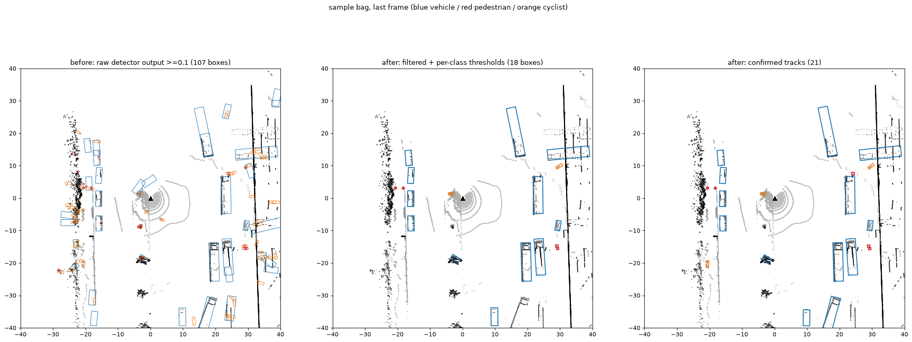
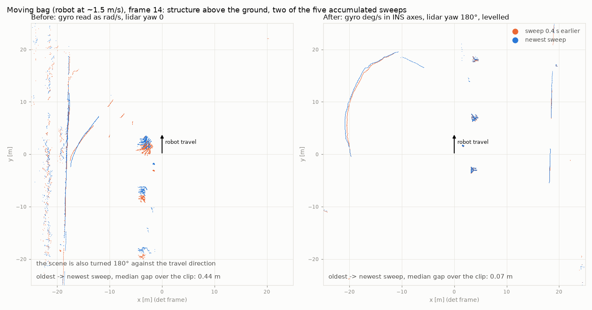

# 轮足机器狗 XT32 感知四段流水线：方案评审与实现

本文档包含三部分：(1) 对原方案的评审和优化点；(2) 优化后的方案与本仓库中的实现对应关系；(3) 使用方法、仿真验证结果与已知局限。

代码位于 `dog_perception/`（四段流水线库）、`tools/dog/`（离线/在线工具）、`configs/dog/`（微调配置）、`det3d/datasets/dog/`（det3d 数据集）、`tests/dog/`（96 个测试，其中 Voxel 前向在无 CUDA 时跳过）。

**部署前提：NVIDIA Jetson Orin（TensorRT）。** 本文早期版本按 BPU 部署来写。凡是受部署平台影响的结论，都已按 Orin 改写；改了哪些、为什么改、上板怎么做，见[第 8 节](#8-orin-部署)。

---

## 1. 评审结论

原方案的主体方向是对的：四段式结构，部署选 Pillar 路线，用 CenterPoint 自带的速度头配合贪心匹配做跟踪，预测先上 Kalman、有数据后再换学习模型。下面按影响大小列出需要修正或补充的地方。

| # | 原方案 | 问题 / 优化 | 影响 |
|---|---|---|---|
| 1 | 去畸变"一步解决" | 位姿必须是 **IMU 频率**（≥200 Hz），不能对 10 Hz LIO 位姿做线性插值。步态的俯仰振动恰好会被插值抹平。另外需要 PTP 时间同步 | 高 |
| 2 | "重力对齐是否有必要？" | **有必要，而且几乎零成本**。LIO 给出的是重力对齐的世界系位姿，检测器需要的是"重力对齐、航向跟随机身、原点在地面"的检测系。这一步只是一个 4×4 变换，合并进多帧拼接的变换里即可 | 高 |
| 3 | z 按重力系 [-1,3] | 需要固定原点，并把检测系映射到**虚拟 nuScenes 雷达系**（离地 1.84 m，前向为 +y）。这样预训练模型学到的绝对 z / 高度先验可以直接沿用 | 高 |
| 4 | 未提及 | **近场垂直盲区**：XT32 视场 -16°~+15°，装在约 0.6 m 高处时，行人要在 4.1 m 以外才能完整进入视场。1 m 处只能看到 0.31–0.87 m 高度的一段。nuScenes 数据里没有这种样本 | 高 |
| 5 | 3~5 帧累积，"32 线变百线" | 固定为 **5 帧**（dt 范围 0–0.4 s，对应 nuScenes 的 0–0.45 s，点数约 32 万，nuScenes 约 34 万）。"变百线"的说法偏乐观：狗速度慢，相邻帧的光束几乎重合。多帧累积的实际收益在于与预训练分布对齐，以及让速度头可用 | 中 |
| 6 | 检测范围 ±40 m | 改为 **±40.8 m**。网格尺寸需要是网络最大步长的整数倍（Pillar 为 408 格，Voxel 为 1088 格）。另外 Voxel 模型的 z 网格**不能改**，稀疏主干需要 41 个 z 格 | 中（否则直接报错或权重失配） |
| 7 | 3 类，nuScenes 预训练后微调 | 不要随机初始化 head。做 **head 权重迁移**。车按尺寸分成 car / truck / bus 三个 head，各自继承 nuScenes 对应的 head；pedestrian 继承 pedestrian 通道，cyclist 继承 bicycle 通道；输出时合并成三类，再做一次类内 NMS（[DOG_FINETUNE.md](DOG_FINETUNE.md) 第 12 节） | 中 |
| 8 | OpenPCDet 训练 | 本仓库就是 CenterPoint 原版（det3d），已加入 `DogDataset`、狗的配置（5 个 head，输出 3 类）和 GT 采样库，**不需要迁移框架** | 低 |
| 9 | 离线大模型教师 | 在逐帧检测之外，补一步**轨迹级非因果精修**：类别投票、尺寸取中位数、RTS 平滑补漏检、用运动方向消除朝向歧义。仿真中行人 AP@0.5 m 从 0.59 提升到 0.99 | 中 |
| 10 | 跟踪：中心距离匹配 | 必须在 **LIO 世界系**里跟踪。速度头的输出直接作为 KF 量测。关联采用**两阶段**（高分检测先匹配，低分检测只用于延续已有轨迹）。行人保活时间放宽到 1.5 s | 高 |
| 11 | 第一档 IMM (CV/CTRV) | 改用 CV + CT（笛卡尔速度的协调转弯模型），两者共享 5 维状态，没有角度回绕问题。跟踪器的滤波器与预测器共用这一个 IMM，每个模态单独外推，自然得到多模态输出 | 中 |
| 12 | 第二档：自监督 | 要把**机器狗自身**作为邻居输入。输入使用跟踪器的因果估计，真值使用 RTS 平滑后的轨迹。对比时必须用**线上 IMM 的真实输出**作为基线 | 中 |

### 1.1 预处理

**去畸变。** 旋转是畸变的主要来源：30°/s 的步态俯仰角速度乘以 100 ms 扫描时间等于 3°，在 20 m 处造成约 1 m 的位移；而 1 m/s 平移在 100 ms 内只有 0.1 m。所以旋转必须用陀螺仪积分。本实现 `ImuPropagator` 的做法：以 LIO 位姿为锚点，两次锚点之间做陀螺积分，平移按 LIO 速度外推。LIO 结果通常在 IMU 数据之后才到，届时会从新锚点重新传播。仿真条件为 8° 俯仰、0.5 rad/s 转向，墙面点误差从 59 cm 降到 0.8 cm（传感器噪声为 1 cm）；由 10 Hz 里程计加 400 Hz 陀螺积分得到的位姿，效果同样是 0.8 cm。

- XT32 支持 PTP（IEEE 1588）和 GPS PPS，**必须和 IMU 共用同一时钟**，否则去畸变反而会引入误差。逐点时间取 Hesai 驱动输出的 `timestamp` 字段。
- 如果 LIO（例如 FAST-LIO2 的 `cloud_registered_body`）已经输出去畸变后的点云，可以设置 `PreprocessConfig(deskew=False)`，避免重复处理。

**重力对齐。** LIO 的 body 系点云会跟着狗身俯仰；world 系点云的航向和位置则不跟随机器人。检测系（det frame）是 `Rz(yaw_body)`，原点为机身原点下移 `base_height`，由 `preprocess/frames.py` 构造。仿真中地面点 z 的标准差在机体系下为 51 cm，在检测系下为 6 cm。坡道和蹲姿造成的残余偏差可以用 `auto_ground` 在线修正。

**虚拟 nuScenes 雷达系**（`detection/frame_adapter.py`）。nuScenes 预训练模型学到的是"雷达离地 1.84 m、车头朝 +y"的绝对 z 先验。映射关系为 `x_M = Rz(90°)·x_D + [0,0,-1.84]`。微调数据使用同一映射，因此预训练的 z 头和高度头在微调后依然有效。

**自体滤除**（`preprocess/self_filter.py`）：
- 在**机体系**中做：腿跟着机身运动，而不是跟着重力方向。
- 放在去畸变**之前**：只需要静态外参，计算便宜。
- 包围盒按腿和轮的**摆动包络**设置，而不是站立姿态。如果包络太大，可以通过 `dynamic_boxes` 接口传入由关节编码器算出的实时盒子。
- 半径离群滤波只在近场（默认 3 m 内）做，否则会误删远处本来就稀疏的行人点。

**多帧累积**（`preprocess/accumulator.py`）。过去的帧存成世界系坐标，每帧变换到当前检测系，并附加 dt 通道。最新一帧排在最前面：pillar 每柱最多容纳 20 个点，溢出时保留下来的是最新的点，这与 det3d 推理时的顺序一致。

**近场盲区**（原方案没有提到，是最大的风险）。雷达离地约 0.6 m 时：
- 地面最近照射点在 0.6 / tan16° ≈ **2.1 m** 处；
- 1.7 m 高的行人要在 (1.7 − 0.6) / tan15° ≈ **4.1 m** 以外才能完整入视场；
- 1 m 处只能看到 0.31–0.87 m 高度的一段，也就是腿和腰。

对应措施：
- 微调数据要专门采集 4 m 内的近距离交互场景；
- 跟踪器的尺寸做轨迹级平滑，保留远处观测到的完整尺寸；
- **1.5 m 内的安全不能依赖学习检测器**，规划侧需要用几何占据或最近点做兜底；
- 结构上如果允许，把雷达下倾 5°–10° 或者装高一些，收益会非常明显。

**10 Hz。** 同意选 10 Hz。补充一个量化参考：30 m 处一个 0.6 m 宽的行人约占 6 列（0.18°）、3 条线（1°）；40 m 处只剩约 2 条线。因此 ±40 m 基本是 32 线雷达的有效上限，远距离召回主要靠跟踪来维持。

### 1.2 检测

**Orin 部署切分**（`detection/pillar_export.py`、`tools/dog/export_pillar_onnx.py`）。scatter、top-k 和 NMS 的输出位置或数量都取决于数据，不放进 TensorRT 引擎。网络切成两个静态形状的引擎，和社区 CenterPoint-Pillar TensorRT 移植（pfe + rpn）的切法相同：

```
GPU/主机   体素化 + pillar 特征装饰(10维)      本仓库是 numpy 参考实现，上板放 GPU
TensorRT   PFN (Linear/BN1d 改写为 1x1 Conv/BN2d, 静态形状 1x10xP_maxxN_max)   pfn.onnx
GPU/主机   scatter 到 BEV                       本仓库是 numpy 参考实现，上板放 GPU
TensorRT   RPN neck + CenterHead (纯稠密 2D 卷积)                              rpn_head.onnx
GPU/主机   解码 + circle NMS                     detection/decode.py
```

导出时，RPN 里每一组 `ZeroPad2d(1) + Conv(padding=0)` 都被合并成一个 `Conv(padding=1)`，结果完全相同。不合并的话，ONNX 里会有一个 Pad 节点，它的 pads 由 Shape/Slice/Cast 子图在运行时算出，较老的 TensorRT ONNX 解析器不接受。合并后 `rpn_head.onnx` 只剩 Conv、BN、ReLU、ConvTranspose、Concat 五种算子。

验证结果（样例 bag 中一帧 5 帧累积的点云，22.3 万点、9663 个柱）：onnxruntime 与 PyTorch 逐段比较，相对误差为 PFN 2.0e-5、BEV 2.0e-5、head 特征图 4.5e-5。两边都经过同样的检测过滤，最终都是 8 个框，分数最大差 2.5e-6，中心最大差 1.2e-5 m。NumPy 解码器与 det3d 原版 `CenterHead.predict` 逐框一致（有单测覆盖）。TensorRT 引擎本身还没有在 Orin 上跑过，见第 8 节。

**NMS。** 使用中心距离的 circle NMS，替代原来依赖 CUDA 编译算子的旋转 IoU NMS。CenterPoint 官方的 nuScenes 提交用的也是这种方式。Orin 有 CUDA，旋转 NMS 也能编译，但 circle NMS 更便宜，而且每个 task 只剩几十个框，在 CPU 上做就够了，所以保留。

**范围与 z。** Pillar 只有一个 z 柱，z 范围只起裁剪作用，可以自由调整。Voxel 模型的 z 网格必须保持 [-5, 3]，也就是 41 格；否则稀疏主干输出的 BEV 通道数和预训练 neck 对不上。因此代码对点云做 z 裁剪，但网格本身不变。

**类别收敛**（`detection/boxes.py: NUSC_TO_DOG`）：
- car / truck / bus / trailer / construction_vehicle 映射为 vehicle；
- bicycle / motorcycle 映射为 cyclist；
- barrier 和 traffic_cone 丢弃，交给占据图处理。

由于 car、truck、bus 属于不同的 task head，映射后同一物体可能出现两个框，所以之后要再做一次类内 NMS。另外，nuScenes 的 bicycle 类包含停放的无人自行车；这对狗来说是静态障碍物，可以通过速度来区分。

**微调**（`configs/dog/dog_centerpoint_{pp,voxel}_xt32.py`）：
- 每个类别一个 task，车分成 car / truck / bus 三个 task（和 nuScenes 按尺寸分组一致），输出时合并为 vehicle。
- 用 `tools/dog/convert_nusc_ckpt.py` 从 nuScenes 权重迁移 head（car、truck、bus、pedestrian、bicycle 各对各）。旧的单 vehicle head 配置保留为 `*_3cls.py`。
- GT-sampling 开启。在重力对齐、原点在地面的检测系下，采样粘贴的目标才会贴地。
- 增加 ±2° 的俯仰/横滚增强（`global_pitch_roll_noise`，新加到 det3d 的 `Preprocess` 中）。
- 训练数据直接保存**预处理后的多帧点云**，与线上使用同一份预处理代码，从源头保证训练和部署一致。

**Pillar 与 Voxel 的对比方法。** 把同一份预处理输出同时喂给两个模型（`run_sequence.py --detectors pillar,voxel`），然后在人工校正过的标注上，按 0–10 / 10–20 / 20–40 m 分段比较 AP、ATE、AVE 和延迟（`compare_detectors.py`）。**不要用 Voxel 教师自己生成的标签去评估 Voxel。** 建议的定位（Orin 前提）：

- **线上默认用 Pillar。** 两个稠密 TensorRT 引擎，工具链简单；同一块 GPU 还要跑预处理（见 8.3），可能还有其他任务。官方在 TITAN RTX 上的测速：Pillar 31 FPS，Voxel 0.1 m 16 FPS，我们用的 0.075 m 更慢。
- **Voxel 在 Orin 上能部署，只是更贵。** 如果在自己的标注上，Voxel 在 0–20 m 的行人上明显更好，并且 Orin 上实测的端到端延迟放得下，就可以换成线上模型，路线见 8.2。
- 不管线上用哪个，Voxel 都继续做离线教师，并提供精度上限作为参照。

### 1.3 标注

教师模型用 Voxel 加双翻转 TTA（`--tta`）。离线跟踪之后做轨迹级非因果精修（`dog_perception/autolabel.py`）：

- 类别：按分数加权投票；
- 尺寸和 z：取加权中位数；
- 中心点：RTS 平滑，并插值补上 0.5 s 以内的漏检；
- 静止 / 运动：轨迹速度（±0.5 s 差分）> 0.4 m/s 并且教师速度头 > 0.15 m/s 的帧才算运动，否则速度为 0；整条轨迹都静止且框聚得紧时，位置取加权中位数。只看轨迹不行：狗走动时，静止的车被看到的那一面在变，框中心跟着漂，会被当成在动；只看速度头又会漏掉慢速运动。nuScenes 上的对比见 [DOG_FINETUNE.md](DOG_FINETUNE.md)；
- 朝向：运动快（> 1 m/s）时取运动方向，否则取框朝向的环形均值，180° 歧义用运动方向（从没动过就用分数最高的框）消解；
- 过滤：丢弃太短或平均分太低的轨迹；
- 所有轨迹导出到 `*_tracks.csv`，低置信的标为待审核，人工在 Foxglove 里看过后按轨迹修正（`tools/dog/review_labels.py`），见 [DOG_FINETUNE.md](DOG_FINETUNE.md)。

在仿真中，对同一个带噪声的教师（每帧 0.5 个虚警、10% 朝向翻转），行人指标变化如下：

| | AP@0.5m | ATE | AVE |
|---|---|---|---|
| 逐帧教师 | 0.59 | 0.19 m | 0.31 m/s |
| 轨迹级精修后 | **0.99** | **0.07 m** | **0.14 m/s** |

关于数据量：5k–10k 帧在 10 Hz 下只相当于 8–17 分钟的录制。相邻帧高度相关，所以**场景数量比帧数更重要**，建议至少 30 段不同场景，并按录制段划分训练集和验证集。从第二轮开始，可以用自己微调好的 Voxel 模型当教师，做自训练迭代。

### 1.4 跟踪

实现见 `tracking/tracker.py` 和 `tracking/imm.py`。

- **在 LIO 世界系中跟踪。** 狗原地转向时，机体系里静止的行人看起来会动。CenterPoint 输出的速度已经是对地速度（多帧拼接时做了自运动补偿），旋转到世界系就可以直接作为量测。单测：机器人以 1 rad/s 原地转 5 s，静止行人的估计速度小于 0.2 m/s。
- **速度头作为 KF 量测** `[x, y, vx, vy]`，而不只是在关联时用来反推位置。这样新轨迹在第一帧就有速度。
- **两阶段关联**：高分检测（≥0.35）先和所有轨迹匹配；低分检测（0.1–0.35）只用来延续已确认的轨迹，不新建轨迹。这对 32 线雷达下远处或被遮挡的行人收益很大。
- **门限**：按类别设定（行人 1.5 m、骑行者 2.5 m、车辆 3 m），并随预测协方差自适应放大。
- **生命周期**：
  - tentative 状态命中 2 次后确认，期间容忍 1 帧漏检；
  - 保活时间：行人 1.5 s，车辆和骑行者 1.0 s。狗的视角低，遮挡时间长，原方案的 5–10 帧（0.5–1 s）对行人来说偏短；
  - 保活期间输出 `coasting` 标志和随时间膨胀的协方差，由规划侧决定是否使用。
- **框属性平滑**：z 和尺寸用 EMA；车辆朝向做 180° 消歧，速度超过 1 m/s 时与运动方向对齐；行人朝向在行走时取速度方向。

### 1.5 预测

**第一档**（`prediction/kinematic.py`）：
- 车辆和骑行者：CV + CT 双模型 IMM。每个模态单独外推，得到"直行"和"持续转弯"两条轨迹，并附带模态概率。
- 行人：低噪声 CV + 高噪声 CV，分别对应"平稳行走"和"急停、变向"。两条轨迹在 3 s 内始终相距不到 0.25 m 时按矩匹配合并成一条；实际上两个滤波器的增益不同，速度估计总有差别，仿真中只有约 1/5 的帧会合并，多数时候输出两条（见 [TRACKING_PREDICTION.md](TRACKING_PREDICTION.md) 3.2 节）。
- 输出 3 s、步长 0.5 s 的均值和协方差。

**第二档**（`prediction/model.py`、`features.py`、`dataset.py`）：
- 网络结构：GRU 或小 Transformer 编码过去 2 s；社交注意力作用于邻居，并**把机器狗自身作为一个邻居**（行人会避让机器人，这是狗场景里最强的交互信号）；BEV 占据图可选接入（`use_raster`）；K=6 个模态，训练方式为 WTA 下的 Laplace NLL 加模态分类交叉熵。
- 数据：输入用跟踪器的**因果**估计，与线上一致；真值用 RTS 平滑后的**非因果**轨迹；丢弃未来被遮挡超过 20% 的窗口。
- `TrackLogger` 会同时记录**线上 IMM 的预测**，保证两档在完全相同的样本上比较。我最初用"在跟踪器输出上重新跑一遍 IMM"作为基线，这相当于双重滤波，速度估计滞后，结果比 CV 还差；改用线上真实输出后，基线才可信。
- 指标：多模态看 minADE、minFDE 和 MR@2m；单模态看 ADE1 和 FDE1。WTA 训练出的 top-1 模态对应的是某一个具体的机动假设，单独拿出来往往不如 CV，所以**规划应该使用全部模态和它们的概率**。
- 上线门槛：第二档在同一份 held-out 数据上的 minFDE 和 MR 都要优于第一档，才切换。线上历史不足 0.5 s 的轨迹会自动回退到 IMM。

---

## 2. 模块与文件对应

逐函数的调用链路和每一步的数据 shape（在样例 bag 上实测）见 [DOG_DATAFLOW.md](DOG_DATAFLOW.md)；离线数据从 rosbag 话题字段一路到训练集的链路（每个脚本的处理、产出的文件、审核改的字段）见 [DATA_LINEAGE.md](DATA_LINEAGE.md) 和它的思维导图 [data_lineage_mindmap.html](data_lineage_mindmap.html)；网络逐层详解见 [CENTERPOINT_NETWORK.md](CENTERPOINT_NETWORK.md)（Pillar）和 [CENTERPOINT_VOXEL_NETWORK.md](CENTERPOINT_VOXEL_NETWORK.md)（Voxel，含与 Pillar 的逐项对比）；跟踪、预测和 IMM 原理见 [TRACKING_PREDICTION.md](TRACKING_PREDICTION.md)。

```
LidarScan(XT32, 逐点时间) ─┐        IMU 400Hz ─┐   LIO 10Hz ─┐
                          ▼                   ▼              ▼
             [1] preprocess/  self_filter → deskew(PoseBuffer/ImuPropagator)
                              → det frame(重力对齐) → 5帧累积 [x,y,z,i,dt]
                          ▼
             [2] detection/   ModelFrame(虚拟nuScenes雷达系) → CenterPoint-Pillar | Voxel (det3d)
                              → nuScenes10类→3类 + 类内NMS → Detections(det frame)
                          ▼  T_world_det
             [3] tracking/    IMM(CV/CT) + 两阶段关联 + 生命周期 (LIO world frame)
                          ▼
             [4] prediction/  第一档 IMM 外推 | 第二档 GRU/Transformer 多模态 (IMM 兜底)
                          ▼
             pipeline.to_local() → 重力对齐的局部系, 给规划
```

| 路径 | 内容 |
|---|---|
| `dog_perception/pose_buffer.py` | IMU 频率位姿缓冲（SLERP），LIO + 陀螺积分传播 |
| `dog_perception/inspvax.py` | INSPVAX → ENU 位姿；kygi RTK IMU 的单位和轴（deg/s，轴与机身系相同）、INS 杠杆臂、雷达外参的实测值 |
| `dog_perception/preprocess/` | 去畸变、自体滤除、检测系、地面高度估计、多帧累积、`Preprocessor` |
| `dog_perception/detection/centerpoint.py` | det3d Pillar/Voxel 统一封装，支持范围/NMS 配置和双翻转 TTA |
| `dog_perception/detection/pillar_export.py`, `decode.py` | Orin/TensorRT 两段切分和 NumPy 解码 |
| `dog_perception/detection/evaluate.py` | 中心距离 AP（含分距离段）、ATE、ASE、AOE、AVE |
| `dog_perception/tracking/evaluate.py` | 跟踪指标：MOTA、MOTP、IDF1、IDSW、FRAG、MT/ML |
| `dog_perception/tracking/` | IMM、贪心/匈牙利匹配、多目标跟踪器 |
| `dog_perception/prediction/` | 第一档 IMM 外推、特征构造、自监督数据、模型、训练/评估 |
| `dog_perception/autolabel.py` | 离线轨迹级精修 |
| `dog_perception/label_review.py` | 按轨迹审核：轨迹表、修正动作、审核用 Foxglove MCAP |
| `dog_perception/pipeline.py` | 四段串联 `PerceptionPipeline` |
| `dog_perception/sim.py` | XT32 + 足式步态仿真器（测试和演示用） |
| `det3d/datasets/dog/` + pipeline 改动 | `DogDataset`、GT-sampling、俯仰/横滚增强 |
| `configs/dog/` | Pillar/Voxel 微调配置（±40.8 m、5 帧；head 为 car / truck / bus / 行人 / 骑行者，输出 3 类）；`*_3cls.py` 是旧的单 vehicle head 布局 |
| `tools/dog/rosbag_to_sequence.py` | ROS1/ROS2 bag 转序列（无需安装 ROS，依赖 `rosbags`）；边读边写，`--segments` 一次切出多个场景 |
| `tools/dog/bag_survey.py`, `sequence_preview.py` | 长 bag 体检、切场景（`segments.csv`）；转换后的序列逐个做可视化和数值检查，含 INS 位置跳变（[BAG_SPLIT.md](BAG_SPLIT.md)） |
| `tools/dog/sequence_meta.py` | 不重转 bag，修正序列 `meta.json` 里的离地高度（多帧中位数或给定值）和雷达时间偏移 |
| `tools/dog/time_offset_check.py` | 在转弯处测雷达和 INS 之间的时间差；仿真里能准确找回注入的 50 ms 偏差 |
| `tools/dog/refine_poses.py` | 先把 INS 位置从杠杆臂点（激光雷达后方 0.54 m）挪到机身原点，再把 KISS-ICP 激光里程计（陀螺提供旋转先验）与 RTK 融合（位置和航向都是激光管局部、INS 管长期）：两者都健康时激光管局部、INS 只消慢漂移；一方不健康时由另一方接管；都不健康时标为不可靠。改写 `odom.npy`（原始的存为 `odom_ins.npy`）。验证用预览的 `shift` 检查（[BAG_SPLIT.md](BAG_SPLIT.md) 3.5 节） |
| `tools/dog/split_check.py` | 多份录制的训练 / 验证划分：去掉静止的验证场景，从训练录制里留出离其余路线最远的一段做验证，按路线 10 m 内的重叠去掉代价小的一方；输出地图和 `split.csv` |
| `tools/dog/run_sequence.py` | 录制数据回放，Pillar/Voxel 并行跑，输出结果、跟踪日志和帧数据 |
| `tools/dog/auto_label.py`, `export_dataset.py` | 教师自动标注，导出为 DogDataset 并建 GT 库 |
| `tools/dog/review_labels.py` | 自动标注的人工审核：生成 MCAP、按轨迹表修正标签 |
| `tools/dog/sustechpoints_convert.py`（`dog_perception/sustechpoints.py`） | 与 SUSTechPOINTS 互转标签（逐框修正、补漏标），并启动该工具 |
| `third_party/SUSTechPOINTS/` | 3D 点云标注工具 SUSTechPOINTS 的源码（GPL-3.0，版本和本地修改见 `VENDORED.md`） |
| `tools/dog/nusc_autolabel_eval.py` | 在 nuScenes 上用真值检查自动标注质量 |
| `tools/dog/compare_detectors.py` | Pillar 与 Voxel 对比（AP、分段 AP、延迟、轨迹碎片化） |
| `tools/dog/convert_nusc_ckpt.py` | nuScenes 10 类 head 到狗的 5 个 head（或旧的 3 个）的权重迁移 |
| `tools/dog/export_pillar_onnx.py` | 导出给 TensorRT 用的两段 ONNX，逐段校验，并打印上板建引擎的 `trtexec` 命令 |
| `tools/dog/profile_detector.py` | 在一帧上测网络逐层的 shape、参数量、计算量（稀疏卷积按实际邻接对计）和各段耗时 |
| `tools/dog/train_predictor.py` | 第二档训练，与 CV/IMM 对比 |
| `tools/dog/ros2_node.py`（参数在 `dog_perception/node_config.py`） | 在线 ROS 2 节点（MarkerArray 可视化）。`-p robot:=kygi` 一次设好 kygi 的话题、INSPVAX 定位、外参、离地高度 0.72 m、`auto_ground` / `auto_level`，和训练序列的处理一致 |
| `tools/dog/run_sim_demo.py` | 仿真端到端演示，输出各段指标 |
| `tools/dog/nusc_clip_eval.py`（`dog_perception/nuscenes_clip.py`、`clip_viz.py`、`foxglove.py`） | 在 nuScenes 片段上跑检测、跟踪、预测，与真值对比，输出 Foxglove MCAP 和指标报告，见 [NUSC_CLIP_EVAL.md](NUSC_CLIP_EVAL.md) |

---

## 3. 使用流程

所有命令都在仓库根目录执行，并设置 `PYTHONPATH=.`。下面按 LIO 里程计（如 FAST-LIO）写；kygi665（XT32 + RTK 组合导航）录制的完整微调流程，包括人工审核，见 [DOG_FINETUNE.md](DOG_FINETUNE.md)。

```bash
# 0) 录制数据 -> 序列（base_height 为机身原点离地高度，extrinsic 为雷达在 LIO body 系下的外参）
python tools/dog/rosbag_to_sequence.py --bag rec_001/ --out data/rec_001 \
    --lidar-topic /lidar_points --imu-topic /imu/data --odom-topic /Odometry \
    --extrinsic-t 0.2 0 0.15 --extrinsic-rpy 0 0 0 --base-height 0.45

# 1) 用 nuScenes 预训练的 Pillar 和 Voxel 直接跑（两者输入完全相同）
python tools/dog/run_sequence.py --seq data/rec_001 --detectors pillar,voxel \
    --ckpt-pillar nusc_pp.pth --ckpt-voxel nusc_voxel.pth --save-frames --out work_dirs/rec_001

# 2) 离线教师自动标注 -> 在 Foxglove 里看、按轨迹表 labels_tracks.csv 修正 -> 对比两个检测器
python tools/dog/auto_label.py --seq data/rec_001 --ckpt-voxel nusc_voxel.pth --tta --out data/rec_001/labels.pkl
python tools/dog/review_labels.py mcap --labels data/rec_001/labels.pkl --frames work_dirs/rec_001/frames \
    --out data/rec_001/review.mcap
python tools/dog/review_labels.py apply --labels data/rec_001/labels.pkl --edits data/rec_001/labels_tracks.csv \
    --out data/rec_001/labels_reviewed.pkl
python tools/dog/compare_detectors.py --labels data/rec_001/labels_reviewed.pkl \
    --results pillar=work_dirs/rec_001/pillar/results.pkl voxel=work_dirs/rec_001/voxel/results.pkl

# 3) 微调：导出数据集 + GT 库（--skip-review 丢掉没审核的低置信轨迹），迁移 head，用 det3d 训练
python tools/dog/export_dataset.py --recording work_dirs/rec_001 data/rec_001/labels_reviewed.pkl \
    --recording work_dirs/rec_002 data/rec_002/labels_reviewed.pkl --val-recordings rec_002 --out data/dog \
    --gt-db --skip-review
python tools/dog/convert_nusc_ckpt.py --src nusc_pp.pth --dst work_dirs/dog_pp_init.pth
python tools/train.py configs/dog/dog_centerpoint_pp_xt32.py    # 单卡；评估、对比、验收见 DEVELOPMENT_WORKFLOW.md
python tools/dist_test.py configs/dog/dog_centerpoint_pp_xt32.py --work_dir work_dirs/dog_pp --checkpoint work_dirs/dog_centerpoint_pp_xt32/latest.pth

# 4) 部署 Pillar：导出两段 ONNX 并与 PyTorch 逐段校验；把 deploy/ 拷到 Orin 上建 FP16 引擎（见第 8 节）
python tools/dog/export_pillar_onnx.py --config configs/dog/dog_centerpoint_pp_xt32.py \
    --checkpoint work_dirs/dog_centerpoint_pp_xt32/latest.pth --out deploy/ --check frame.npy
# 在 Orin 上
trtexec --onnx=deploy/pfn.onnx --saveEngine=deploy/pfn.engine --fp16
trtexec --onnx=deploy/rpn_head.onnx --saveEngine=deploy/rpn_head.engine --fp16

# 5) 第二档预测：用多段录制的跟踪日志训练，并与 IMM 比较
python tools/dog/train_predictor.py --logs "work_dirs/rec_*/pillar/track_log.npz" \
    --val-logs work_dirs/rec_009/pillar/track_log.npz --encoder gru --out work_dirs/pred/gru.pt

# 录制的 bag 直接出 Foxglove 可视化（点云 / 上报检测 / 轨迹 / 位姿），配置由权重自动选择
python tools/dog/run_bag_mcap.py --bag samples/rosbag2_2026_09_21-16_41_27 \
    --ckpt work_dirs/pretrained/nusc_pp.pth --mcap work_dirs/sample.mcap

# 在线（ROS 2）
python3 tools/dog/ros2_node.py --ros-args -p detector:=dog_pillar -p checkpoint:=pp.pth \
    -p predictor_model:=work_dirs/pred/gru.pt -p extrinsic_t:="[0.2,0.0,0.15]" -p base_height:=0.45
# kygi665（RTK INSPVAX 定位）：检测系和训练数据完全一致（离地 0.72 m，auto_ground + auto_level）
python3 tools/dog/ros2_node.py --ros-args -p robot:=kygi -p config:=dog_pillar -p checkpoint:=<权重>

# 仿真演示和测试
python tools/dog/run_sim_demo.py --frames 80 --plot 3 --out work_dirs/sim_demo
python -m pytest tests/dog -q
```

---

## 4. 仿真验证结果

仿真器（`dog_perception/sim.py`）模拟的内容：
- XT32 几何：32 线，-16°~+15°，2000 列 × 10 Hz，逐点时间，1 cm 测距噪声；
- 卷帘畸变：每一列都从它自己时刻的位姿发射光线，运动目标也按该时刻的位置摆放；
- 步态：6° 俯仰、3° 横滚、2 cm 起伏，速度 1.2 m/s，转向 0.15 rad/s；
- 机身载荷的自遮挡；
- 400 Hz 陀螺和晚到 30 ms 的 10 Hz 里程计（带噪声）。

检测器使用 **oracle**，即 GT 加噪声。没有真实权重时，这是验证跟踪和预测的唯一办法。检测精度本身需要用真实数据配合 `compare_detectors.py` 来评估。

**预处理**（80 帧，每 5 帧统计一次）

| 指标 | 结果 |
|---|---|
| 墙面点距误差 RMS（未去畸变 → 去畸变） | 0.113 m → **0.027 m**（残差主要来自注入的里程计噪声：1 cm / 0.1°；用无噪声 IMU 频率位姿时为 0.8 cm） |
| 地面点 z 标准差（机体系 → 检测系） | 0.52 m → **0.055 m** |
| 自体点（机身载荷） | 2412 → **0** 点/帧 |

**跟踪**（oracle 检测，16 个运动目标，80 帧；只统计点数 ≥5 的可见目标）

| 指标 | 结果 |
|---|---|
| MOTA | 0.903 |
| 召回 | 0.906（oracle 的检测率本身约 0.9） |
| ID 切换 | 2 |
| 位置 RMSE | 6.9 cm（检测噪声 10 cm） |
| 速度 RMSE | 0.23 m/s（检测速度噪声 0.25 m/s） |

**延迟**（x86 4 vCPU，Python）：预处理 23 ms，跟踪 6 ms，IMM 预测 13 ms（约 16 条轨迹）。

**预测**：用 10 段 × 60 s 仿真跟踪日志训练第二档（9 段训练、1 段验证，约 2.8 万个窗口，CPU 上训练 25 个 epoch）。

**(a) 留出的仿真跟踪日志**（2849 个窗口，第一档用线上记录的 IMM 输出）：

| 预测器 | minADE | minFDE | ADE1 | FDE1 | MR@2m |
|---|---|---|---|---|---|
| CV（最后速度外推） | 0.808 | 1.656 | 0.808 | 1.656 | 0.309 |
| 第一档 IMM (CV/CT) | 0.722 | 1.494 | 0.802 | 1.638 | 0.265 |
| 第二档 GRU（K=6） | 0.350 | 0.658 | 0.720 | 1.489 | 0.033 |
| 第二档 小 Transformer（K=6） | **0.328** | **0.617** | **0.691** | **1.437** | **0.025** |

**(b) 激光仿真端到端**（80 帧，对比目标**真实**的未来 3 s；机器人速度 1.2 m/s，和训练日志的 0.4 m/s 不同，属于分布外测试）：

| 预测器 | minADE | minFDE | ADE1 | FDE1 | MR@2m |
|---|---|---|---|---|---|
| 第一档 IMM | 0.734 | 1.507 | **0.822** | **1.703** | 0.302 |
| 第二档 GRU | 0.449 | **0.867** | 0.911 | 1.867 | **0.083** |
| 第二档 Transformer | **0.441** | 0.868 | 0.932 | 1.925 | 0.103 |

结论：
- 多模态指标（minFDE、MR）第二档大幅领先。
- 在分布外场景下，第二档概率最大的单条轨迹（FDE1）**比 IMM 差**。这正是第 1.5 节强调的：规划侧应使用全部模态及其概率；是否从第一档切换到第二档，要看它在自己留出数据上的表现是否过门槛。

注意：仿真中的目标按"分段恒定速度/转向率"随机机动，**没有社交交互**，而第二档的主要优势（对机器人的避让等交互）在仿真里体现不出来。表中第二档的领先主要来自多模态覆盖，真实效果需要用实车日志重新评估。

---

## 5. 对原仓库的兼容性修改

新环境（Python ≥3.10、新版 numba、无 CUDA 的 CPU 机器）下原仓库无法导入或训练，做了以下最小修复：

- `det3d/models/__init__.py`、`backbones/__init__.py`：`import importlib.util`（Python 3.11 下 `importlib.util` 不会被隐式导入）；缺少 iou3d 编译算子时，two-stage 的 roi_heads 改为可选导入。
- `det3d/torchie/trainer/checkpoint.py`：spconv 改为可选依赖，Pillar 模型不再需要它。
- `det3d/solver/*.py`、`torchie/parallel/collate.py`：`collections.Iterable/Sequence/Mapping` 改为 `collections.abc`，这些名字在 Python 3.10 中已被移除，而 Ubuntu 22.04 / JetPack 6 自带的就是 3.10。
- `torch.load` 的四处调用（`det3d/torchie/trainer/checkpoint.py`、`detection/centerpoint.py`、`prediction/model.py`、`tools/dog/convert_nusc_ckpt.py`）：显式传 `weights_only=False`（新版 torch 默认值改成了 True，会拒绝加载这些权重）；遇到不认识该参数的老版本 torch（JetPack 5 上常见）时，自动退回不带该参数的调用。
- `det3d/core/bbox/geometry.py: points_in_convex_polygon_jit`：新版 numba（nopython 默认开启）不再支持列表花式索引，改写为显式循环，已对照原公式验证。GT-sampling 的碰撞检测依赖这个函数。
- `det3d/core/sampler/{preprocess,sample_ops}.py`：GT 库里没有的类别（比如还没录到公交）在按点数过滤和采样时跳过，原来会直接 `KeyError`。

## 6. 已知局限（没有在本环境中验证的部分）

- **没有真实 XT32 数据和 nuScenes 预训练权重**（官方权重托管在 OneDrive，本环境无法下载）。所有检测相关的数字只验证了管线和一致性，Pillar 与 Voxel 的精度和延迟对比需要在你的机器上用步骤 1–2 实测。
- 检测封装里的 Voxel 前向需要 CUDA 版 spconv（CPU 版 spconv 不支持带 bias 的卷积）。本环境只用 `profile_detector.py` 的 CPU 绕行办法跑通过前向，实测了逐层 shape 和计算量（[CENTERPOINT_VOXEL_NETWORK.md](CENTERPOINT_VOXEL_NETWORK.md)），没有 GPU 上的耗时拆分。
- 本环境没有 ROS，`ros2_node.py` 没有在真实 ROS 下运行过。`tests/dog/test_ros2_node.py` 用替身代替 rclpy 和消息包，把运动样例 bag 按到达顺序回放进 `robot:=kygi` 的节点，结果与训练序列的检测系点云逐帧一致。27 帧里有 20 帧中位差 < 5 mm；其余几帧差几厘米，因为 INS 位置正好在那时跳变：节点在线做插值，回放序列时只能外推。bag 转换器已用合成的 ROS2 bag 测试。
- kygi 数据里狗沿检测系 +y 前进（INSPVAX 机身系的约定），进入网络系后相对 nuScenes 的习惯朝向转了 90°。在 nuScenes mini_val 上同样转 90°，预训练 Pillar 的 mAP 只从 0.663 降到 0.650，所以没有改；详见 [DATA_LINEAGE.md](DATA_LINEAGE.md) 的坐标系一节。
- 本环境没有 Orin 和 TensorRT。导出的 ONNX 只用 onnxruntime 验证过；TensorRT 引擎的构建、FP16 精度和板上延迟都要在 Orin 上确认（第 8 节）。
- 预处理、跟踪和预测是 Python 参考实现。在 x86 上实测，网络以外的部分合计约 90 ms（见 [DOG_DATAFLOW.md](DOG_DATAFLOW.md) 第 5 节）。Orin 的 ARM 核会更慢，所以上板时预处理必须搬到 GPU，见 8.3。
- 仿真中的目标没有社交交互，所以第二档在真实数据上的收益（主要来自对机器人的避让等交互）需要用实车日志重新评估。

## 7. 实车样例 bag：检测框过多的原因与修复

样例是 `samples/rosbag2_2026_09_21-16_41_27`，共 2.8 s，包含 29 帧 XT32 点云、100 Hz IMU 和 100 Hz INSPVAX。机器人在整段数据中**静止不动**。检测用 nuScenes 预训练的 Pillar 权重 `work_dirs/pretrained/nusc_pp.pth`。



| 每帧平均 | 修复前（MCAP 画的就是这个） | 修复后 |
|---|---|---|
| 网络输出（分数 ≥0.1） | 102 | 102 |
| 几何过滤后 | – | 52.8 |
| 上报的检测（按类别阈值） | 102 | **16.4** |
| 确认轨迹 | 25–28，且持续增长 | **16.8** |

### 7.1 原因

1. **把给跟踪器用的低分框画了出来。** 检测器有意保留分数 ≥0.1 的框，因为跟踪器的第二阶段要用低分框延续已有轨迹。但 `run_bag_mcap.py` 和 `run_sequence.py --mcap` 直接把这些框画进了 MCAP。分数 <0.3 的框里绝大多数是误检。
2. **域差异造成的误检。** 这台机器人的雷达离地只有约 0.31 m，nuScenes 是 1.84 m。在灌木、树干和墙边会冒出大量低分的 cyclist / pedestrian 框，其中有的框点数 ≤3，有的底面悬空 0.8–1.7 m。另外，同一个物体上还会出现不同类别的重复框（car 头和 bicycle 头各出一个）。
3. **权重与配置不匹配时不会报错。** `run_bag_mcap.py` 默认用的是 **Voxel** 配置，而仓库里只提交了 **Pillar** 权重。det3d 的 `load_checkpoint` 遇到不匹配只打印警告：485 个参数中只有 293 个加载成功，整个稀疏 3D 主干都是随机初始化，输出几乎全是垃圾框。
4. **地面高度偏差。** 地面高度估计用的是 `-P10(z)`，而且下限被截断在 0.4 m。实际值约 0.31 m，导致检测系里的地面偏高 11 cm。
5. **双回波重复点。** 每帧 12.8 万个点里，约 2 万个坐标全为 0，约 3.3 万个落在传感器 0.4 m 以内的无效回波（被 `min_range` 滤掉）。双回波模式下同一坐标会重复出现，10.8 万个非零点去重后只剩 5.3 万。重复点对检测框数量影响不大，但让输入密度偏离了训练分布，计算量也翻倍。

### 7.2 修复

| 位置 | 改动 |
|---|---|
| `detection/filters.py` | 几何过滤，对所有分数都生效：当前帧点数要达到下限（车 5 / 人 3 / 骑行 3），框底相对地面不能悬空超过 0.7 m 或下沉超过 1.2 m，并做跨类别去重（中心落在更高分的其他类框内即删除）。另定义 `DEFAULT_SCORE_THRESHOLDS`（车 0.35 / 人 0.3 / 骑行 0.4），用于上报检测和新建轨迹 |
| `Detections.above()` | 按类别阈值取出应上报的检测 |
| `tracking/tracker.py` | 新建轨迹的门槛改为按类别；低分框只能延续轨迹。平滑分数低于 `output_min_score` 的轨迹不再输出，也不做预测，但内部保留，ID 不断 |
| `detection/centerpoint.py` | 加载权重前检查是否与配置匹配，不匹配直接报错，并提示权重实际对应哪种模型 |
| `tools/dog/run_bag_mcap.py` | 根据权重自动选择配置；外参可通过参数传入；使用统一的地面高度估计并开启 `auto_ground`；跑完整流水线（含跟踪）；MCAP 中 `/detections` 只画达到阈值的检测，新增 `/tracks`（显示 ID、类别、速度） |
| `preprocess` | `dedup_returns` 去掉双回波重复点；`estimate_base_height` 取代截断在 0.4 m 的 P10 估计 |

### 7.3 这次代码更新的评审意见（`7560387`、`da7e428`）

- **INSPVAX 的姿态约定**：`yaw = 180° − azimuth`，并丢弃 roll/pitch（与车上的解析器一致）。按 ENU 标准，车头朝向应为 `90° − azimuth`，所以这个 "body" 系的 x 轴与前进方向相差 90°。雷达外参在代码里默认为单位阵，只有当点云坐标系恰好和这个约定一致时才对。样例 bag 中机器人静止，**无法验证这一点**。机器人一旦运动，这个约定错了会让多帧拼接出现拖影和重影。**已用运动 bag 验证（第 9 节）：雷达与这个 body 系差 180° yaw，默认外参已改。**
- **丢弃 roll/pitch 的影响**：INS 给出 roll 1.1°、pitch 0.7°。在检测系里拟合出的地面仍有约 0.6° 倾斜，30 m 处约 ±0.25 m。当时判断影响不大；运动 bag 上倾斜达 1.7°，已加地面找平（第 9 节）。
- **大文件进 git**：`.db3` 有 97 MB，已接近 GitHub 单文件 100 MB 的上限；`nusc_pp.pth` 有 72 MB。建议改用 Git LFS。另外 nuScenes 权重的许可是非商业用途。
- `checkpoint.py` 中加上 `weights_only=False` 是必要的（torch ≥2.6 的默认值会拒绝加载旧 checkpoint）。本次提交也同步修改了 `convert_nusc_ckpt.py` 和预测模型加载处的同样问题。

### 7.4 可调参数

- `DEFAULT_SCORE_THRESHOLDS`：上报阈值和新建轨迹阈值。召回不够就调低；误检多就调高，优先调骑行者。
- `DetectionFilterConfig`：`min_points`、`max_float`、`max_sink`、`cross_class_nms`。
- `TrackerConfig.output_min_score`：轨迹输出所需的平滑分数下限。

这些都是针对 nuScenes 预训练权重的临时措施。根本的解决办法仍然是用自采数据微调（第 3 节步骤 3）。


---

## 8. Orin 部署

部署平台定为 NVIDIA Jetson Orin，推理用 TensorRT。本节说明换平台后哪些结论变了，以及上板的做法和顺序。本环境没有 Orin，以下延迟和精度结论都要上板实测确认。

### 8.1 换平台后改了哪些结论

| 项 | 按 BPU 时的结论 | Orin 下的结论 |
|---|---|---|
| 线上检测器 | 只能用 Pillar，稀疏 3D 卷积上不了 BPU | 默认仍是 Pillar，但理由变成延迟和工具链；Voxel 也能上，见 8.2 |
| 推理精度 | 以 INT8 为主，有掉点风险 | 先用 FP16，不需要校准；INT8 是后续优化，要用实车帧校准 |
| 算子支持 | PFN 的 max-pool 和 concat 待确认 | 两个 ONNX 只含 TensorRT 原生支持的算子；Pad 子图在导出时已消掉（1.2 节） |
| 编译 | 主机上用工具链编译模型 | 在 Orin 上用 `trtexec` 构建引擎。引擎绑定 GPU 型号和 TensorRT 版本，不能在 x86 上建好再拷过去 |
| 预处理 | 跑在 CPU 上，改写成 C++ 即可 | ARM 核是瓶颈，要搬到 GPU，见 8.3 |
| NMS | circle NMS，在 CPU 上 | 不变 |
| 运行环境 | Python ≥3.10 | `dog_perception/` 和 `tools/dog/` 最低 Python 3.7（vermin 检查），兼容 torch <1.13，JetPack 5 和 6 都能直接跑 |

### 8.2 检测器：Pillar 与 Voxel 在 Orin 上的路线

- **Pillar**：`export_pillar_onnx.py` 导出两段 ONNX，在 Orin 上构建两个 FP16 引擎（8.4）。前后处理先沿用现在的 numpy 实现，再按 8.3 搬到 GPU。
- **Voxel** 有两条路：
  1. PyTorch + spconv 2.x（CUDA）直接跑 det3d 模型。改动最小，适合上板先测精度和延迟。spconv 要装与 JetPack 的 CUDA 版本对应的包，有的版本需要源码编译。
  2. NVIDIA [Lidar_AI_Solution](https://github.com/NVIDIA-AI-IOT/Lidar_AI_Solution) 里的 CUDA-CenterPoint：用 libspconv 加 TensorRT 的 C++ 实现，针对的正是 nuScenes 的 CenterPoint-Voxel 0.075 m 模型。我们的网格是 1088×1088（官方 1440×1440），并且是 3 类、3 个 task，需要用它的工具重新导出并修改解码，可行性待验证。
- **决策顺序**：先用 `compare_detectors.py` 在人工校正的标注上比精度。只有 Voxel 明显更好时，才在 Orin 上测路线 1 的延迟，再决定是否投入路线 2。

### 8.3 延迟预算：瓶颈在 ARM 核

雷达是 10 Hz，每帧必须在 100 ms 内处理完，还要给 LIO、运动控制等留余量。下表是 x86 上实测的网络以外各段（[DOG_DATAFLOW.md](DOG_DATAFLOW.md) 第 5 节）以及上板后的去处：

| 段 | x86 实测 ms | Orin 上的去处 |
|---|---|---|
| 去畸变（含去重、自体滤除） | 30.0 | GPU。每个点按时间桶取位姿再做变换，完全可以并行 |
| 多帧拼接 | 7.5 | GPU。历史帧常驻显存，每帧只对它们做一次 4×4 变换 |
| 体素化 | 13.1 | GPU。体素化、特征装饰、scatter 都写成 CUDA kernel，可参考 Lidar_AI_Solution 里的现成实现 |
| 后处理（解码映射 + 过滤） | 17.2 | 阈值和 top-k 放 GPU；NMS 和几何过滤在 CPU（框只有几十个），过滤里逐框数点改成用网格索引 |
| 跟踪 | 5.6 | CPU，之后移植 C++ |
| IMM 预测 | 16.6 | CPU，向量化或移植 C++ |
| **合计** | **90.0** | |

Orin 的 Cortex-A78AE 跑 numpy 一般比桌面 x86 慢，照搬现在的 Python 实现，网络以外的部分就会超过 100 ms。所以要先上板测出每段的实际时间，再按占比从大到小迁移。建议目标：网络以外合计 <15 ms，端到端 <50 ms。

Orin 的 CPU 和 GPU 共用同一块 DRAM，一帧 5 帧累积点云约 4 MB，拷贝本身不贵；主要收益来自并行计算，而不是省掉拷贝。

### 8.4 TensorRT 引擎

```bash
# x86 上导出并逐段校验（不需要 GPU）
python tools/dog/export_pillar_onnx.py --config configs/dog/dog_centerpoint_pp_xt32.py \
    --checkpoint work_dirs/dog_centerpoint_pp_xt32/latest.pth --out deploy/ --check frame.npy

# Orin 上：最高功耗模式并锁频后再测，否则数字偏大而且不稳定
sudo nvpmodel -q          # 查看当前模式，切到该型号的最高模式
sudo jetson_clocks
trtexec --onnx=deploy/pfn.onnx --saveEngine=deploy/pfn.engine --fp16
trtexec --onnx=deploy/rpn_head.onnx --saveEngine=deploy/rpn_head.engine --fp16

# 冒烟测试：TensorRT FP16 与 onnxruntime 对比（随机输入，只用来发现明显错误）
polygraphy run deploy/rpn_head.onnx --trt --fp16 --onnxrt --atol 1e-2 --rtol 1e-2
```

- `trtexec` 输出里的 GPU Compute Time 就是引擎本身的延迟，先用它判断检测网络占多少预算。
- **P_max = 30000**：样例帧有 9663 个柱，余量约 3 倍。PFN 的计算量正比于 P_max。统计完所有录制数据的最大柱数后，可以用 `--max-pillars` 适当调小；超出时导出脚本会报警。
- **FP16 验收要在检测层面做**：在同一批录制帧上，比较 TensorRT 引擎和 PyTorch 的检测结果（分数差、中心差、AP），只看特征图不够。这需要一个 TensorRT 版的检测后端（8.6 第 1 阶段）。
- **INT8**：`trtexec --int8` 在没有校准缓存时用的是假的 scale，只能用来测速度。真要用 INT8，需要拿几百帧实车数据做 PTQ 校准；hm 分支对量化敏感，必要时 head 保持 FP16（混合精度）。FP16 的延迟够用就不做。
- **DLA**：AGX Orin 和 Orin NX 有 DLA，Orin Nano 没有。`rpn_head` 只有 Conv/BN/ReLU/ConvTranspose/Concat，理论上可以放到 DLA（`--useDLACore=0 --allowGPUFallback`），给 GPU 腾出算力。但 DLA 通常比 GPU 慢，只在 GPU 被其他任务占满时再考虑。

### 8.5 软件环境

| | JetPack 5.1.x | JetPack 6.x |
|---|---|---|
| Ubuntu / Python | 20.04 / 3.8 | 22.04 / 3.10 |
| CUDA / TensorRT | 11.4 / 8.5 | 12.x / 8.6（6.0）或 10.x（6.1 起） |
| ROS 2 | Foxy 已停止维护；Humble 要源码编译 | Humble 有官方二进制包 |

建议用 JetPack 6。PyTorch 要用 NVIDIA 为 JetPack 发布的 aarch64 wheel，PyPI 上的 torch 在 Jetson 上没有 CUDA。numba 和 llvmlite 有 aarch64 wheel。Pillar 路线不需要 det3d 的 C++/CUDA 编译算子：circle NMS 在 det3d 里用 numba 实现，我们的解码器里是 numpy 实现。spconv 只有 Voxel 需要。

为兼容 JetPack 5 的老版本 torch，本次把 `torch.load(..., weights_only=False)` 改成：老版本没有该参数时自动退回。ONNX 导出在 torch ≥2.5 上会强制使用 TorchScript 导出器，因为 dynamo 导出器生成的图不一样，也没有验证过。

### 8.6 落地步骤

| 阶段 | 内容 | 验收 |
|---|---|---|
| 0 上板跑通 | JetPack 6 + NVIDIA 的 torch wheel。现有 Python 流水线不改代码，检测器在有 CUDA 时自动用 GPU 跑 PyTorch 模型（`run_bag_mcap.py`、`ros2_node.py`） | 样例 bag 结果与 x86 一致；拿到 Orin 上各段的实测延迟 |
| 1 TensorRT 检测 | 构建 FP16 引擎；给 `CenterPointDetector` 加 TensorRT 后端，复用现有的解码和过滤 | 录制帧上与 PyTorch 检测一致；测出网络延迟 |
| 2 预处理上 GPU | 去畸变、拼接、体素化、特征装饰、scatter 用 CUDA 实现（可先用 torch 张量运算过渡） | 与 numpy 参考实现逐点一致（复用现有单测）；网络以外 <15 ms |
| 3 C++ 节点 | ROS 2 C++ 节点，零拷贝接收点云，用 CUDA stream 串起各段；跟踪和预测移植 C++；定义给规划的 ObjectArray 消息 | 端到端 <50 ms，10 Hz 稳定不丢帧 |
| 4 可选 | INT8 校准、DLA、Voxel 线上化（8.2） | 按需 |

### 8.7 需要确认的信息

- **Orin 型号**（AGX Orin 64/32 GB、Orin NX 16/8 GB、Orin Nano）：决定 GPU 算力、有没有 DLA，以及 Voxel 值不值得考虑。
- **JetPack / TensorRT 版本**：TensorRT 8.x 和 10.x 的 Python 运行时接口不同，第 1 阶段的后端要按实际版本写。
- **同一块 Orin 上还跑什么**（LIO、建图、运动控制、其他网络）：决定感知能分到多少 CPU 和 GPU。

---

## 9. 运动样例 bag 校验

样例是 `samples/rosbag2_2026_09_21-16_41_27_moving`：3.1 s，27 帧点云，IMU 和 INSPVAX 都是 100 Hz。机器人以 1.4–2.5 m/s 直行，最后 0.6 s 减速到 0.15 m/s，航向只变了约 2.5°。第 7.3 节提醒过，静止 bag 验证不了位姿约定和雷达外参；这段数据把它们都暴露出来了。



图中只画地面以上的点，蓝色是最新一帧，橙色是 0.4 s 前的那一帧（多帧拼接里最老的一帧）。修复前，同一个物体错开 1 m 以上，整片点云还相对行进方向转了 180°；修复后两帧基本重合。

### 9.1 发现的问题

| # | 问题 | 怎么发现的 | 影响 | 修复 |
|---|---|---|---|---|
| 1 | RTK IMU（`/rte/rdap/rtk/imus/data_raw`）的角速度单位是 **deg/s**，加速度单位是 g；代码按 sensor_msgs 的约定当成 rad/s | 按 deg/s 理解，陀螺 z 与 INS 航向变化率的相关系数为 0.99，比例 1.06；按 rad/s 理解，3 s 内积出 136°，而 INS 只转了 2.5° | INS 每 10 ms 重置一次位姿，锚点之间靠陀螺积分。行驶中 z 轴角速度最大 25°/s，被当成 25 rad/s，10 ms 内就差 14° | `inspvax.gyro_from_kygi_imu`：换算成 rad/s。IMU 轴就是 body 轴（x 右、y 前、z 上；2026-10 核实，之前 x、y 被取反，见 [BAG_SPLIT.md](BAG_SPLIT.md) 3.5 节） |
| 2 | 雷达坐标系与 INSPVAX 的 body 系（`yaw = 180° − azimuth`）差 **180° yaw**，而外参默认是单位阵 | 去掉地面后做多初值 ICP：雷达系里机器人每 0.4 s 沿 −y 移动 0.60–0.67 m；INS 在 body 系里给出的是沿 +y 移动 0.63–0.67 m | 拼接时旧帧被往反方向挪，0.4 s 前那帧错开约 2 × 0.6 m；检测速度头和跟踪器都把静止物体当成以接近机器人的速度运动 | `KYGI_LIDAR_RPY = (0, 0, π)`，作为 `run_bag_mcap.py` 和 `rosbag_to_sequence.py --inspvax-topic` 的默认外参 |
| 3 | 位姿外推只用最后一段。INS 锚点常比 IMU 样本晚约 0.1 ms，两者之间几厘米的锚点修正被当成了速度 | 最后一帧检测系原点跳了 6.6 m（bag 里 INS 比最后一帧扫描早 6 ms 截止，需要外推） | 实时运行时，扫描常需要外推几毫秒，任何一次锚点修正都可能让整帧跳几米。静止时位置不变，所以静止 bag 看不出来 | `PoseBuffer` 外推时用最近 20 ms 的运动估计速度，并跳过短于 1 ms 的末段 |
| 4 | INS 只用了航向，机身和安装的倾斜没有去掉 | 检测系内拟合地面：pitch −1.0°（静止 bag）/ −1.7°（运动 bag），roll 约 −0.55° | 20 m 处地面高度偏 0.3–0.6 m | `DetFrameConfig.auto_level`：用 1.5–8 m 环内的地面点拟合平面，慢速（EMA）找平检测系 |
| 5 | 地面支撑过滤假定检测系 z = 0 处处是地面 | 找平后近处变好，但 25–40 m 处的局部地面偏离 z = 0 达 0.66 m（这片场地不是一个平面） | 远处的车被当成"漂浮"的框滤掉 | 过滤改用局部地面：当前帧在每个 2 m × 2 m 格内取最低点，再取框中心周围 4 m 圆内这些格子的 10% 分位；有点的格子太少时退回 z = 0。每帧多约 8 ms（Python，x86） |

**为什么不用 INS 的 roll/pitch。** 减速的 0.6 s 内，INS pitch 从 +2.8° 变到 −9.9°，但陀螺任何一个轴的积分都不到 2°，检测系里拟合的地面 pitch 的标准差也只有 0.3°。所以 INS 的 pitch 在加减速时不可信，继续只用航向，残余倾斜用地面找平处理。这和车上解析器只用航向的做法一致。

### 9.2 修复前后（运动 bag，nuScenes 预训练 Pillar）

| | 修复前 | 修复后 |
|---|---|---|
| 最老一帧到最新一帧的结构点间距（中位数） | 0.44 m | **0.07 m** |
| 上报检测的速度头输出（中位数） | 1.06 m/s | **0.00 m/s** |
| 已确认轨迹的速度（中位数）；超过 1 m/s 的比例 | 1.38 m/s；70% | **0.20 m/s；10%** |
| 每帧已确认轨迹 | 4.5（大多在 coasting） | 11.3 |
| 命中 ≥ 20 帧（共 27 帧）的轨迹 | 2 | 7 |
| 每帧上报检测 | 5.0 | 10.6 |

机器人速度约 1.5 m/s。修复前，静止场景的速度基本等于机器人的速度。修复后剩下的 0.15–0.2 m/s 来自 30–40 m 处停放车辆的中心抖动，这是预训练权重在 32 线远距离上的问题，微调后应改善；另有一个 0.5 m/s 的"骑行者"在机器人右侧 3.4 m 处，在世界系里移动了 1.1 m，可能是真人在走动。

静止 bag 在修复后基本不变：每帧上报 15.5 个检测、15.6 条已确认轨迹（第 7 节修复后为 16.4 和 16.8）。

### 9.3 还需要确认

- **前进方向。** 机器人的运动方向与 INS azimuth 相反（azimuth 197°，速度方向 17°）。假设这段数据是在向前开，那么按当前约定，body 系和检测系的 **+y 是前进方向，x 指向右侧**（与 7.3 节的分析一致），`to_local()` 交给规划的就是这个坐标系。如果规划侧期望 x 朝前，需要先确认车上 body 系的定义，再统一调整。
- **雷达相对 INS 的平移（杠杆臂）仍为 0。** 这段数据几乎没有转向，标定不出来；需要一段原地转向的数据。
- **起步阶段的速度。** 前 4 帧拼不满 5 个 sweep，速度头输出不可靠（有一条轨迹新建时速度为 10.8 m/s），跟踪器几帧后收敛。可以在拼接不满时不用检测速度初始化轨迹。
- **`auto_level` 只拟合近处的一个平面。** 坡度变化的场景（如进出坡道），远处仍会有偏差；检测过滤已经改用局部地面，不受影响，但网络输入仍会受影响。

### 9.4 复现

```bash
# 回归测试：多帧对齐、找平、静止场景不动（第二个测试需要 det3d 和权重）
python -m pytest tests/dog/test_real_data.py -k moving
# Foxglove 可视化
python tools/dog/run_bag_mcap.py --bag samples/rosbag2_2026_09_21-16_41_27_moving \
    --ckpt work_dirs/pretrained/nusc_pp.pth --mcap work_dirs/moving.mcap
```
