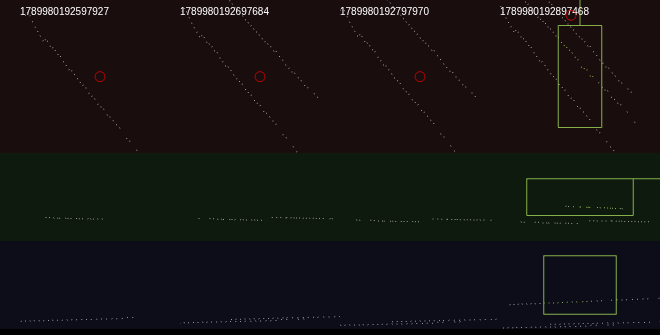
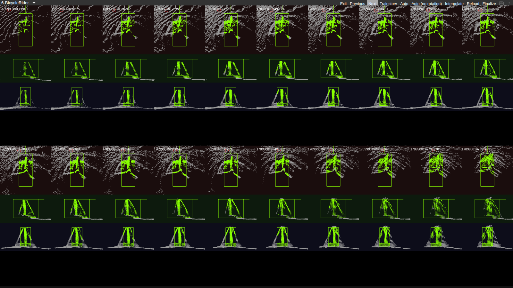
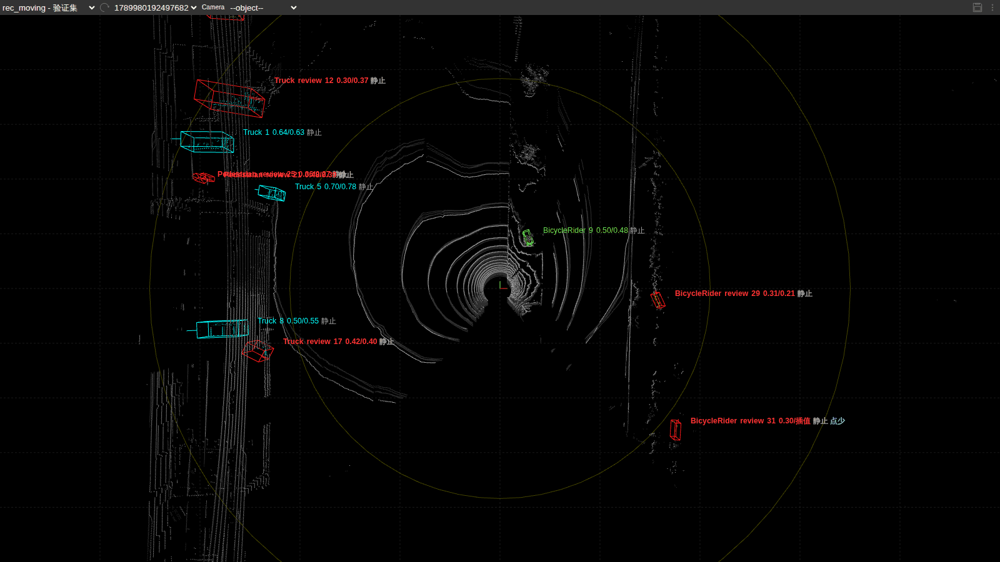
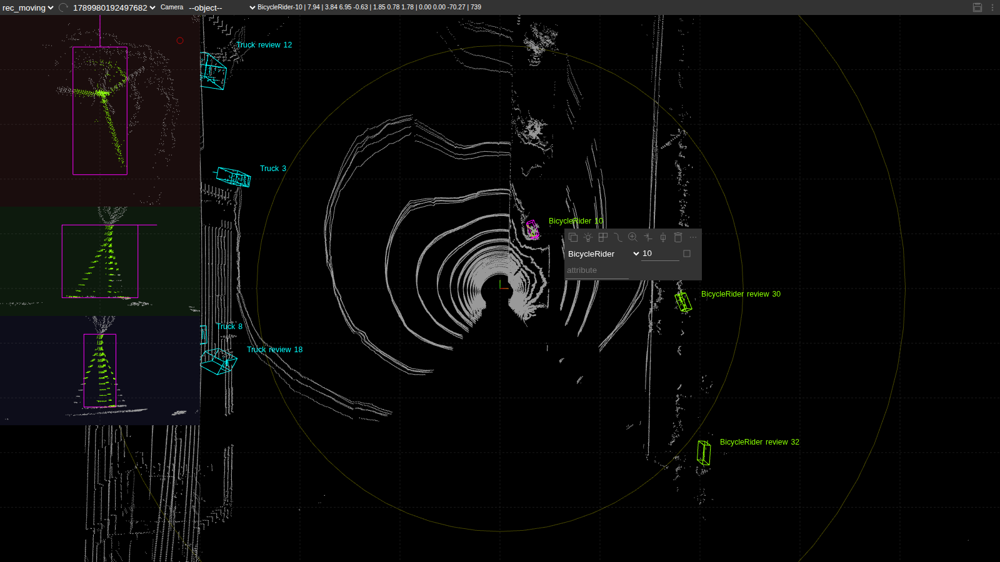
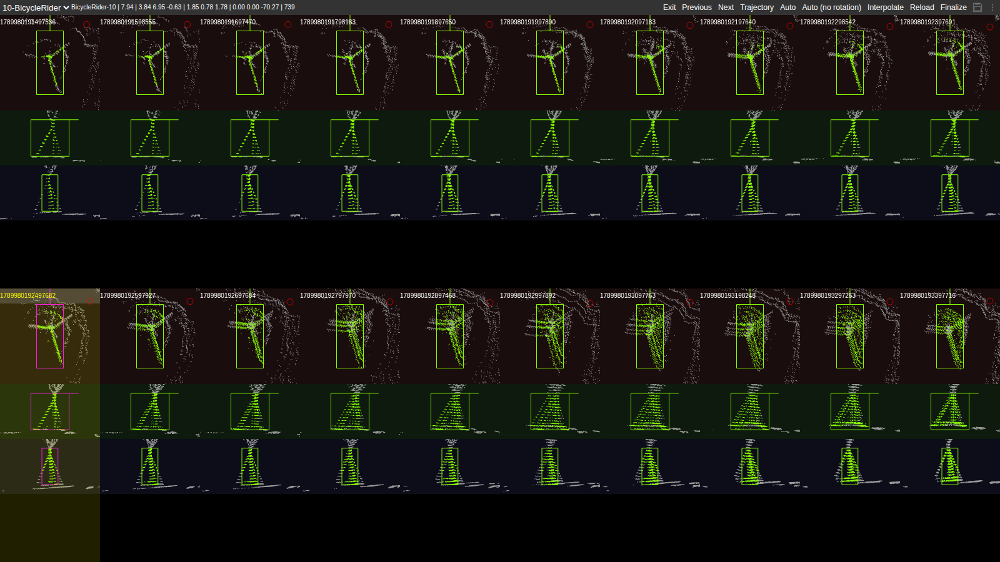
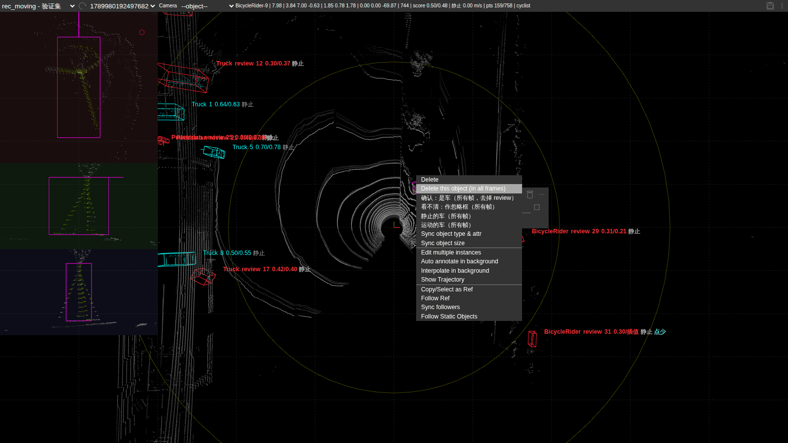
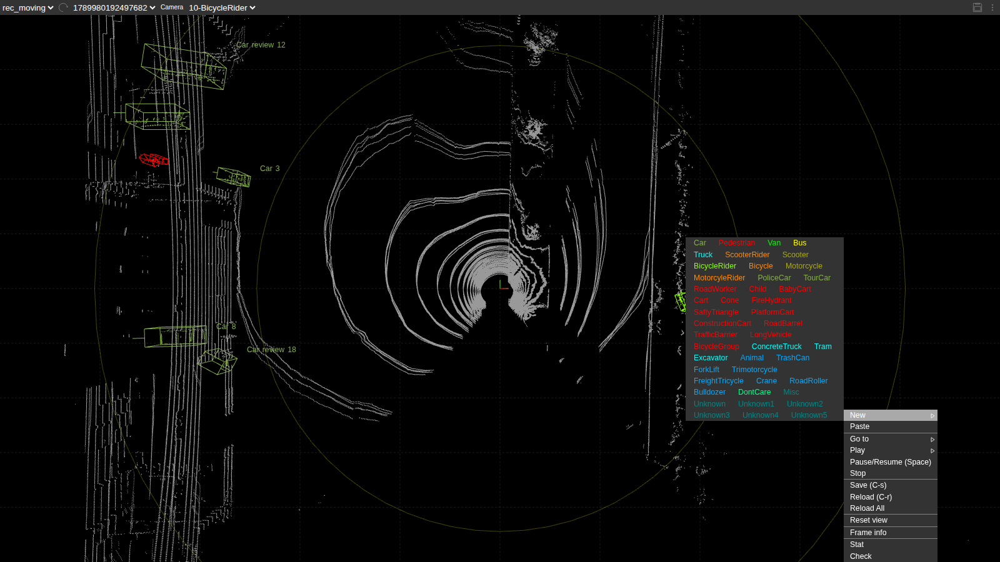
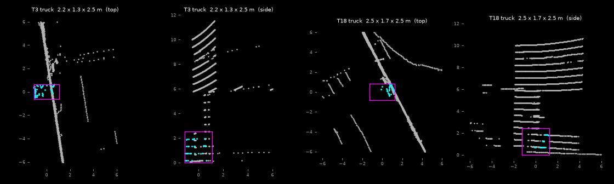

# 标注实操：用样例 bag 从提取走到训练数据

用仓库里的两段样例 bag，把 [DOG_FINETUNE.md](DOG_FINETUNE.md) 的 ①–⑤ 步完整走一遍：bag 转换 → 教师推理 → 自动标注 → 按轨迹审核 → SUSTechPOINTS 逐框审核 → 导回 → 生成训练数据。下面的命令和输出都是在本仓库实际跑出来的（2026-10-23 用当前代码重跑；第 2 步的 GPU 耗时和 Voxel 框数是 10-15 在 4090 上记的），照着做应该得到同样的结果。

| 录制 | bag | 帧数 | 用途 |
|---|---|---|---|
| `rec_static` | `samples/rosbag2_2026_09_21-16_41_27` | 28 | 训练集：只做按轨迹审核 |
| `rec_moving` | `samples/rosbag2_2026_09_21-16_41_27_moving`（狗在走） | 27 | 验证集：按轨迹 + 逐框审核 |

约定：

- 所有命令在仓库根目录执行，先 `export PYTHONPATH=.`。
- 产物都写在 `data/` 下（被 .gitignore 忽略）。SUSTechPOINTS 的场景写在 `third_party/SUSTechPOINTS/data/` 下（同样被忽略）。
- 第 2 步在同一段序列上同时跑 Pillar 和 Voxel，并另跑一遍 Voxel 双翻转 TTA。第 3 步起仍用 Pillar 的 `results.pkl`，这样后面记下来的框数不变。自己的数据用 Voxel + TTA，见第 9 节。

## 0. 准备

```bash
pip install -r requirements_dog.txt      # 其中 rosbags、mcap、cherrypy、jinja2 是这里要用的
```

另外要有一个 Foxglove（桌面版或网页版 app.foxglove.dev）用来看第 4 步生成的 MCAP，以及一个浏览器打开 SUSTechPOINTS。

## 1. bag → 序列

```bash
python tools/dog/rosbag_to_sequence.py --bag samples/rosbag2_2026_09_21-16_41_27 --out data/seq/rec_static \
    --lidar-topic /robot/topic/rdap/top_point_cloud2 --imu-topic /rte/rdap/rtk/imus/data_raw \
    --inspvax-topic /rte/rdap/rtk/inspvax
python tools/dog/rosbag_to_sequence.py --bag samples/rosbag2_2026_09_21-16_41_27_moving --out data/seq/rec_moving \
    --lidar-topic /robot/topic/rdap/top_point_cloud2 --imu-topic /rte/rdap/rtk/imus/data_raw \
    --inspvax-topic /rte/rdap/rtk/inspvax
```

应有的输出（最后两行）：

```
odom t 1789980087.992 .. 1789980090.793  span 2.8s  pos_type {56: 283}  base_height 0.31
wrote 29 scans, 283 imu, 283 odom -> data/seq/rec_static
odom t 1789980190.502 .. 1789980193.591  span 3.1s  pos_type {56: 310}  base_height 0.72
wrote 27 scans, 310 imu, 310 odom -> data/seq/rec_moving
```

检查：`pos_type` 全是 56（INS_RTKFIXED，RTK 固定解）。自己的数据如果混有别的值，说明定位有一段不是固定解，世界系轨迹会漂。

## 2. 教师推理 + 保存帧

一次命令里把两个检测器跑在同一份预处理点云上。`--tta` 会作用到这次启动的每一个检测器，所以双翻转单独再跑 Voxel。

```bash
python tools/dog/run_sequence.py --seq data/seq/rec_static --detectors pillar,voxel \
    --ckpt-pillar work_dirs/pretrained/nusc_pp.pth --ckpt-voxel work_dirs/pretrained/nusc_voxel.pth \
    --save-frames --device cuda:0 --out data/runs/rec_static
python tools/dog/run_sequence.py --seq data/seq/rec_moving --detectors pillar,voxel \
    --ckpt-pillar work_dirs/pretrained/nusc_pp.pth --ckpt-voxel work_dirs/pretrained/nusc_voxel.pth \
    --save-frames --device cuda:0 --out data/runs/rec_moving
python tools/dog/run_sequence.py --seq data/seq/rec_static --detectors voxel --tta \
    --ckpt-voxel work_dirs/pretrained/nusc_voxel.pth --device cuda:0 --out data/runs/rec_static_tta
python tools/dog/run_sequence.py --seq data/seq/rec_moving --detectors voxel --tta \
    --ckpt-voxel work_dirs/pretrained/nusc_voxel.pth --device cuda:0 --out data/runs/rec_moving_tta
```

RTX 4090 上的网络耗时（丢掉第一帧后的中位数，2026-10-15）：

```
rec_static   [pillar] 28 frames, 129.5 ms    [voxel] 28 frames, 112.0 ms    [voxel --tta] 28 frames, 122.1 ms
rec_moving   [pillar] 27 frames, 133.8 ms    [voxel] 27 frames, 115.7 ms    [voxel --tta] 27 frames, 126.3 ms
```

没有 GPU 时只跑 Pillar：`--detectors pillar --ckpt-pillar work_dirs/pretrained/nusc_pp.pth --save-frames`，去掉 `--device cuda:0`。本仓库的 4 核 CPU 上（2026-10-23）：

```
[pillar] 28 frames, network 453.9 ms (median)
mcap data/runs/rec_static/rec_static_pillar.mcap  28 frames
[pillar] 27 frames, network 522.6 ms (median)
mcap data/runs/rec_moving/rec_moving_pillar.mcap  27 frames
```

`run_sequence.py` 默认还会写一个 Foxglove MCAP（第一个检测器的点云、上报的框、轨迹和位姿），路径是 `data/runs/<rec>/<rec>_<检测器>.mcap`，不需要时加 `--no-mcap`。

上报阈值（车 0.35、人 0.30、骑行 0.40）下的框数，以及 2 m 内同类框的重合比例（10-15 在 4090 上；之后预处理有过改动，10-23 在 CPU 上重跑的 Pillar 是 rec_static 421 个（305 / 42 / 74）、rec_moving 287 个（146 / 76 / 65），只差一两个框）：

| | pillar 框 | voxel 框 | voxel+TTA 框 | pillar 被 voxel 盖住 | voxel 与 voxel+TTA 互相盖住 |
|---|---|---|---|---|---|
| rec_static | 420（车 304 / 人 42 / 骑行 74） | 370（273 / 54 / 43） | 401（276 / 76 / 49） | 70% | 90% / 83% |
| rec_moving | 287（147 / 78 / 62） | 196（106 / 47 / 43） | 168（93 / 43 / 32） | 44% | 79% / 92% |

检测结果里每个车框还带着子类，也就是教师的哪个 head 出的框（[DOG_FINETUNE.md](DOG_FINETUNE.md) 第 12 节）。nuScenes 的 bus、trailer head 出的框记为 truck（2026-10-22 起：教师常把大货车判成公交，同一辆车一会儿 truck 一会儿 bus）。Pillar 的车框：rec_static 为 car 116 / truck 189，rec_moving 为 car 38 / truck 108。

这两段没有人工真值，不能在狗的数据上分出谁更准。nuScenes 验证集上，当前这两份权重的成绩是 Voxel mAP 59.6 / NDS 66.8，Pillar mAP 50.3 / NDS 60.2（`configs/nusc/README.md`）。走动的那段里 Pillar 多出来的框，大部分 Voxel 对不上，和它在 nuScenes 上更弱是一致的。TTA 把四次翻转拼成一次前向，所以只慢大约 10 ms；它和单次 Voxel 重合最高。仓库里没有第三份预训练权重。标完并微调之后，狗自己的 Voxel 权重量才会超过这个 nuScenes 教师。

结果：`data/runs/<rec>/frames/*.npy`（预处理后的 5 帧拼接点云）、`data/runs/<rec>/{pillar,voxel}/results.pkl` 和 `data/runs/<rec>/<rec>_pillar.mcap`。只跑 Pillar 时，两段一共约 205 MB（点云 190 MB，MCAP 14 MB）。第 3 步起用的是 `pillar/results.pkl`。自己的数据改用 `voxel` 加 `--tta` 的 `results.pkl`，见第 9 节。

## 3. 自动标注

```bash
python tools/dog/auto_label.py --results data/runs/rec_static/pillar/results.pkl --out data/labels/rec_static/labels.pkl
python tools/dog/auto_label.py --results data/runs/rec_moving/pillar/results.pkl --out data/labels/rec_moving/labels.pkl
```

```
labelled 28 frames (0 left out: pose not trusted), 463 boxes, 19 tracks (7 flagged for review) -> data/labels/rec_static/labels.pkl, data/labels/rec_static/labels_tracks.csv
labelled 27 frames (0 left out: pose not trusted), 334 boxes, 18 tracks (14 flagged for review) -> data/labels/rec_moving/labels.pkl, data/labels/rec_moving/labels_tracks.csv
```

`auto_label.py` 默认还读 `data/runs/<rec>/frames`，数每个框里的点（当前帧 / 5 帧），点不够的框训练时作忽略框（[DOG_FINETUNE.md](DOG_FINETUNE.md) 第 14 节）。

`labels_tracks.csv` 每条轨迹一行，待审核的排在前面。待审核（`review` = 1）是：平均分 < 0.5，并且教师给 ≥ 0.6 分的帧不到 5 帧。`rec_moving` 的前几行：

```
track_id,label,subclass,review,train_as,mean_score,confident_frames,frames,interpolated,few_points,t_first,t_last,min_range_m,length_m,height_m,moving_share,max_speed,action,from,to,note
12,vehicle,truck,1,ignore,0.301,0,25,3,0,0.20,2.60,43.9,7.2,3.2,0.00,0.00,,,,
31,cyclist,cyclist,1,ignore,0.303,0,15,7,4,1.10,2.50,31.1,2.3,1.4,0.00,0.00,,,,
29,cyclist,cyclist,1,ignore,0.309,2,17,4,0,1.00,2.60,22.1,2.1,1.4,0.00,0.00,,,,
48,vehicle,car,1,ignore,0.322,0,6,0,0,1.90,2.40,31.9,4.7,1.6,1.00,6.94,,,,
16,vehicle,car,1,ignore,0.337,0,22,4,10,0.40,2.50,31.4,4.6,1.7,0.45,1.27,,,,
```

各列：
- 轨迹号、类别、子类、是否待审核；
- `train_as`：不审的话导出时这条轨迹当作什么（训练类别名，或 `ignore`：作忽略框）；
- 平均分；`confident_frames`：教师给 ≥ 0.6 分的帧数；
- 帧数、其中插值补出来的帧数；`few_points`：其中框里点数不够（作忽略框）的帧数；
- 出现和消失的时间（秒，从录制开始算）、离狗最近的距离；
- 框的长、高（中位数，m）；
- 处于运动状态的帧的比例、最大速度。

最后三列和 `note` 留给审核人填。

子类是教师在这条轨迹上按分数加权投票的结果：车是 car / truck / bus，行人、骑行者和类别相同。它决定训练时这个框给哪个 head（[DOG_FINETUNE.md](DOG_FINETUNE.md) 第 12 节）。这两段里车的轨迹：

| 录制 | car | truck |
|---|---|---|
| rec_static | T1、T3、T8、T16、T28 | T2、T12；T4、T6、T10、T11、T14、T15（停车场里 11–16 m 长、约 4 m 高的车，以前教师判成 bus） |
| rec_moving | T7、T16、T38、T48 | T1、T5、T8、T12、T17 |

## 4. 按轨迹审核（④a）

### 4.1 在 Foxglove 里看

```bash
python tools/dog/review_labels.py mcap --labels data/labels/rec_moving/labels.pkl \
    --frames data/runs/rec_moving/frames --results data/runs/rec_moving/pillar/results.pkl \
    --out data/labels/rec_moving/rec_moving_review.mcap
```

输出 `122 messages -> data/labels/rec_moving/rec_moving_review.mcap`，文件 14 MB（`rec_static` 同理，119 条消息、15 MB）。

在 Foxglove 里打开这个文件：

1. 加一个 3D 面板，勾选 `/lidar`、`/labels`、`/teacher`。
2. Display frame 选 `det` 时，视角跟着狗走；选 `world` 时，静止的物体应该不动，拖尾缩成一个点。
3. 待审核的轨迹是品红色粗框。框上的文字是"轨迹号 类别 分数"，车的类别带上子类（如 `vehicle/truck`），后面依次可能有 REVIEW、interp（插值补的）和速度。
4. 加一个 Log 面板选 `/log`，里面列出每条待审核轨迹第一次出现的时间。

### 4.2 判断

看不清的物体，也可以在第 5 步的 SUSTechPOINTS 里看，它的批量窗口把同一物体的 20 帧并排显示，每帧有俯视、侧视、后视三个视图。下面是这次的四个决定和依据：

| 录制 | 轨迹 | 表里的信息 | 看到的 | 决定 |
|---|---|---|---|---|
| rec_moving | T48 vehicle | 6 帧，最大 6.9 m/s，32 m | 框里只有几条斜的扫描线（俯视），侧视图里点贴着框底，没有车身（下图左） | `drop` |
| rec_moving | T16 vehicle | 22 帧，31 m，框内每帧约 4 个点（`few_points` 10 帧） | 俯视图里框基本是空的 | `drop` |
| rec_moving | T6 cyclist | 26 帧，3.6 m，框内每帧约 670 个点 | 点很多，但侧视、后视都是上窄下宽的三角形，不像人骑车（下图右） | `drop` |
| rec_static | T21 cyclist | 24 帧，40 m，框内每帧约 3 个点（`few_points` 7 帧） | 点太少，看不出是什么 | `drop` |

 

框内点数在 SUSTechPOINTS 里看最直接：选中框后顶部信息条有"当前帧 / 5 帧"的点数（第 5 步）。

**再看子类。** 子类错了不会让框消失，但会让它去训练错的 head。主要看两种情况：

- **尺寸和子类对不上。** rec_moving 的 T5、T17 只有 2.2–2.5 m 长、1.3–1.7 m 宽，却有约 2.5 m 高，被归为 truck（nuScenes 把工程车也算 truck）。这么小的"卡车"往往说明它根本不是车。它们在验证集里，留到第 5 步在 SUSTechPOINTS 里细看（结论是删，见 5.3）。
- **拿不准时保留教师的子类。** rec_static 的 T2 长 5.2 m、高 1.8 m，多数帧由 truck head 给出。nuScenes 的 truck 包括皮卡，点太稀，分不出是轿车还是皮卡，所以不改。T11（truck，11.5 m）停在 T4 旁边，只看得到一头；它是待审核轨迹，不处理的话导出时作忽略框（既不当车，也不当背景），所以也不动。

要改子类时，在 `action` 填 `car` / `truck` / `bus`（会同时清除待审核标记）。这一轮没有用到。

其他待审核的轨迹这里先不动。`rec_moving` 会在第 5 步逐框看；`rec_static` 剩下的待审核轨迹导出时作忽略框。

### 4.3 填表并应用

在 `labels_tracks.csv` 里给这几行的 `action` 填 `drop`，`note` 写上理由（例如 `48,vehicle,car,1,...,drop,,,6 帧、6.9 m/s；框里只有几条斜的扫描线，没有车身`）。用 Excel / WPS 编辑时存回 CSV（UTF-8）。然后：

```bash
python tools/dog/review_labels.py apply --labels data/labels/rec_static/labels.pkl \
    --edits data/labels/rec_static/labels_tracks.csv --out data/labels/rec_static/labels_reviewed.pkl
python tools/dog/review_labels.py apply --labels data/labels/rec_moving/labels.pkl \
    --edits data/labels/rec_moving/labels_tracks.csv --out data/labels/rec_moving/labels_reviewed.pkl
```

```
applied {'drop': 1}; 6 tracks still flagged (ignore boxes in export_dataset.py) -> data/labels/rec_static/labels_reviewed.pkl
applied {'drop': 3}; 11 tracks still flagged (ignore boxes in export_dataset.py) -> data/labels/rec_moving/labels_reviewed.pkl
```

其他动作（`ok`、改类别、`car` / `truck` / `bus` 改子类、`flip`、`static`、`from`/`to` 限定时间段）见 [DOG_FINETUNE.md](DOG_FINETUNE.md) 第 ④ 步。

## 5. SUSTechPOINTS 逐框审核（④b，验证集 rec_moving）

### 5.1 导出并启动

```bash
python tools/dog/sustechpoints_convert.py export --labels data/labels/rec_moving/labels_reviewed.pkl \
    --frames data/runs/rec_moving/frames --scene rec_moving --split val
python tools/dog/sustechpoints_convert.py serve
```

输出 `27 frames -> third_party/SUSTechPOINTS/data/rec_moving`，以及 `SUSTechPOINTS on http://127.0.0.1:8081 (scenes: rec_moving)`。没装 TensorFlow 时还会多一行提示，说明学习型的朝向预测和自动标注不可用，改用 PCA。这是正常的。

样例 bag 很短，这里导出了全部 27 帧。真实数据用 `--every 5`（10 Hz 里取 2 Hz）。`--split val` 让场景列表把它放在"验证集"一组；训练场景用 `--split train`。

浏览器打开 http://127.0.0.1:8081 ，左上角第一个下拉框选 `rec_moving - 验证集`，第二个选一帧（这里是 `1789980192497682`）。帧名是时间戳的微秒数。下图是滚轮缩小、关掉 Output 窗口之后：



- **红框、红字是要人定的**：第 4 步之后仍待审核的轨迹（文字里带 `review`），或者教师说是 truck、尺寸却是小车的。
- 框旁的文字是"类别 轨迹号 平均分/这一帧教师的分数 静止或运动"。教师这一帧没检出、是插值补出来的，分数位置写"插值"；"点少"表示框里当前帧的点不够，训练时自动作忽略框。
- 车按子类显示为 Car / Truck：这一帧左边那排车是 Truck（T1、T5、T8；红的 T12、T17 待审核），右边红的 T29、T31 是待审核的骑行者，狗旁边绿色的 T9 是骑行者（不是待审核）。
- 中间是狗（原点）。点云是 5 帧叠加的（模型的输入），旧的 4 帧画得暗：运动的车会拖一条暗的尾巴，框按亮的当前帧点对齐。点云的 z 整体下移了 1.8 m：工具假定雷达离地 1.8 m，导回时会移回来，不用管。
- 右下角的 Output 窗口可以点 × 关掉。

### 5.2 常用操作

| 要做的事 | 操作 |
|---|---|
| 调视角 | 左键拖动旋转，右键拖动平移，滚轮缩放 |
| 换帧 / 换框 | `3` / `4`（或 PageUp / PageDown）上一帧 / 下一帧，场景最后一帧再往后直接进列表里的下一个场景；`1` / `2` 上一个 / 下一个框 |
| 选中一个框 | 左键点框（下图） |
| 改类别 | 选中后，框旁工具条的下拉框；右键框 → Sync object type & attr 可以把类别同步到这个物体的其他帧 |
| 调位置 / 朝向 | 鼠标移到左侧某个子视图里：`a` `s` `d` `w` 平移，`q` `e` 旋转，`r` `f` 旋转并自动贴合点，`g` 翻转 180° |
| 调大小 | 子视图里拖动虚线或角；双击虚线 / 角 / 中心，让框自动缩到贴住点 |
| 一条轨迹多帧一起看、一起改 | 选中后按 `v`，或右键框 → Edit multiple instances（批量窗口，下图）。Previous / Next 翻页，Exit 或 `v` 退出 |
| 删这一帧的框 | 选中后按 Delete |
| 删整条轨迹 | 右键框 → Delete this object (in all frames) |
| 红框处理完 | 右键框：确认（是车 / 人，去掉 review）、看不清（作忽略框）、静止的车、运动的车，都作用于这条轨迹的所有帧 |
| 补一个漏标的物体 | 按住 Ctrl 拖一个矩形把它框进去（矩形里不能已有框），自动出框：有模型框（`dog_dets`，DOG_FINETUNE.md 第 16 节）用模型的，没有就按点拟合。也可以在物体的点上右键 → New → 类别（类别对应见 5.4），框从点自动生长贴合。之后在侧视图里检查高度、长度，按 `g` 检查朝向 |
| 保存 | 自动保存：每次修改约 0.5 s 后写回 `label/*.json`。Ctrl+S 也可以手动保存 |
| 点的大小 / 颜色 | `+` / `-`；右上角 ⋮ 菜单里可以按强度着色 |

选中一个框后，左侧三个子视图依次是俯视、侧视、后视。顶部信息条是"类别-ID | 距离 | x y z | 长 宽 高 | roll pitch yaw（度） | 框内点数 | score 平均分/这一帧 | 静止或运动 速度 | pts 当前帧/5 帧 | 不审的话训练当作什么"，下图是 `BicycleRider-9 | 7.98 | 3.84 7.00 -0.63 | 1.85 0.78 1.78 | 0.00 0.00 -69.87 | 744 | score 0.50/0.48 | 静止 0.00 m/s | pts 159/758 | cyclist`：



按 `v` 打开同一物体的批量窗口：



右键框弹出的菜单（删除、确认 / 看不清 / 静止 / 运动、同步类别、批量编辑等）：



右键空白处 → New，选类别：



### 5.3 这次做的修改

| 轨迹 | 看到的 | 操作 |
|---|---|---|
| T9 cyclist（分数 0.50，**不是**红框） | 俯视图里是三条腿的 Y 形，侧视、后视是三角形，每一帧都一样（上面的选中图和批量图）：是一个三脚架，不是骑车的人。第 4 步删掉的 T6 也是这个形状 | 右键 → Delete this object (in all frames) |
| T31 cyclist（红框，"点少"） | 31 m 外，每帧约 5 个点，看不出是什么 | 右键 → Delete this object (in all frames) |
| T5 Truck | 2.2 m 长、1.3 m 宽、2.5 m 高，平均分 0.70，27 帧都在原地。在宽一点的视野里看，它卡在一面 10 m 多高的墙的墙脚，墙从框的正上方往上延伸（下图左两幅，灰点是框外的点）。不像任何一种车，没有相机也说不出是什么 | 右键 → Delete this object (in all frames) |
| T17 Truck（红框） | 2.5 m × 1.7 m × 2.4 m，框里的点就是同一面墙的墙脚（下图右两幅，青色点沿着墙线排开） | 右键 → Delete this object (in all frames) |



（上图是旧编号时截的：图里的 T3、T18 就是现在的 T5、T17。）

四次删除都自动存盘：`label/` 里 27 帧都不再有 obj 9、31、5、17。

T9 说明验证集为什么要逐框看。分数 0.50 刚好在待审核线（0.5）之上，按轨迹审核的表里不会提醒你，但它整条都是错的。T5 也一样：分数 0.70，不是红框，是"2 m 长的卡车"这个尺寸让人回头细看的。

**剩下的红框这一轮没有处理**：T12（7.2 m 的 truck，44 m 外）、T7、T38（50 m 外的车）、T21、T25、T43（40 m 外的行人）、T29、T45、T47（骑行者）。它们都在 18 m 以外、点很少；T12 框的正上方还有点，可能和 T5 一样是墙边的东西。没点"确认"的红框导回后仍带 review，导出时作忽略框，不当物体也不当背景。真实数据里，看得清是车的要右键"确认"，否则这辆车就白审了；看不清的点"看不清"，效果和留着一样，但下一个人知道这个框有人看过。

### 5.4 标注约定

- 只标三类：车、行人（Pedestrian、Child、RoadWorker）、骑行者（BicycleRider、MotorcyleRider、ScooterRider；停着的 Bicycle、Motorcycle、Scooter 也算，和 nuScenes 的约定一致）。其他类型导回时会被跳过并计数。
- 车的类型要选对，它决定 5 个 head 的模型训练哪个 head。按 nuScenes 的定义：轿车、SUV、面包车选 Car 或 Van → car；皮卡、货车和工程车（Truck、ConcreteTruck、Excavator、ForkLift、Crane 等）→ truck；公交、有轨电车、挂车这类长车（Bus、Tram、LongVehicle）→ bus。皮卡没有单独的类型，选 Truck。导回后三者都是 vehicle，子类记在 `subclass` 里。点太稀、分不出子类时，保留教师给的。只检车辆的模型（`*_veh.py`）按尺寸分 car / truck，不看类型。
- 小三轮车、老年代步车选 Trimotorcycle / FreightTricycle，算骑行者，不算车。
- 框贴住物体的点。朝向是车头 / 人面朝的方向，看不出时取运动方向。
- 点少到人也看不出是什么的，不新标（标了也是猜）；已有的框用"看不清"作忽略框。
- 范围：检测器只看 ±40.8 m，更远的可以不管。
- 运动物体在 5 帧拼接的点云里有拖影，框放在拖影最前端（当前帧）。
- 要挪一条轨迹的位置，在批量窗口里整条一起挪。只挪一帧的话，导回时那几帧的速度会算出跳变。

## 6. 导回

```bash
python tools/dog/sustechpoints_convert.py import --scene rec_moving --frames data/runs/rec_moving/frames \
    --out data/labels/rec_moving/labels_sustech.pkl
python tools/dog/sustechpoints_convert.py stats
```

```
27 frames, 11 tracks, boxes {'still marked review': 137, 'vehicle': 109, 'moved or new': 0, 'pedestrian': 48, 'cyclist': 33} -> data/labels/rec_moving/labels_sustech.pkl
scene split frames boxes review
rec_moving val 27 190 137
total val: 27 frames, 190 boxes, 137 marked review
```

- 和导出前比，轨迹从 15 条变成 11 条（少了 9、31、5、17）。
- `moved or new` 为 0：没有挪动过的框，其余框的位置和速度原样保留。
- 子类按类型导回：109 个车框里 truck 78 个（T1、T8、T12）、car 31 个（T7、T38）。
- `still marked review` 137：上面没处理的红框，导出时作忽略框。删掉的、没变红的框都算已审核。
- `--frames` 让导回的标签带上框里的点数，评估时点不够的框不计分。

## 7. 生成训练数据

```bash
python tools/dog/export_dataset.py \
    --recording data/runs/rec_static data/labels/rec_static/labels_reviewed.pkl \
    --recording data/runs/rec_moving data/labels/rec_moving/labels_sustech.pkl \
    --val-recordings rec_moving --out data/dog_v001 --gt-db
ln -sfn dog_v001 data/dog
```

```
train 28 / val 27 / test 0 frames -> data/dog_v001
train boxes: car 93 (+27 ignored), cyclist 28 (+32 ignored), pedestrian 36 (+0 ignored), truck 139 (+84 ignored)
val boxes: car 0 (+31 ignored), cyclist 0 (+33 ignored), pedestrian 0 (+48 ignored), truck 53 (+25 ignored)
note: 6 boxes: few points in the current sweep (ignored)
load 93 car database infos
load 139 truck database infos
load 28 cyclist database infos
load 36 pedestrian database infos
```

| | 帧 | car | truck | bus | pedestrian | cyclist |
|---|---|---|---|---|---|---|
| train（rec_static） | 28 | 93（+27 忽略） | 139（+84） | 0 | 36 | 28（+32） |
| val（rec_moving） | 27 | 0（+31） | 53（+25） | 0 | 0（+48） | 0（+33） |

- 类别名是模型 head 的 5 个类，直接取标签里的子类。所有车框都有教师给的子类，所以没有"按尺寸补子类"的提示；如果用的是加子类之前做的标签，这里会多一行 `note: N vehicle boxes had no subclass ...`。
- 没有 bus：教师的 bus head 现在记为 truck。rec_static 的 truck 正样本是 T2 和停车场里 12 m 长的 T4、T6、T14、T15；T10、T11、T12 是没审核的待审核轨迹，作忽略框。
- **忽略框**（`+N ignored`）：没审核的待审核轨迹、没点确认的红框，以及当前帧点数不够的 6 个框。它们不当物体也不当背景，评估时不计分。
- 验证集只剩 53 个 truck 框能计分：第 5 步没处理的红框都成了忽略框。这是样例太短、红框没确认的结果；真实数据里要把看得清的红框都确认掉，验证集才有足够的框。
- 每一版数据集导到新目录再切软链接（`data/dog` → `data/dog_v001`），不要往正在用的目录里重新导（[DOG_FINETUNE.md](DOG_FINETUNE.md) 第 ⑤ 步）。

`data/dog` 的路径和 `configs/dog/dog_centerpoint_pp_xt32.py` 一致，接下来就是 [DOG_FINETUNE.md](DOG_FINETUNE.md) 第 ⑥ 步的 head 迁移和训练。

## 8. 清理

```bash
rm -rf data/seq data/runs data/labels data/dog data/dog_v001 third_party/SUSTechPOINTS/data/rec_moving
```

## 9. 换成自己的数据时

- **教师**：用 Voxel + TTA：`run_sequence.py --detectors voxel --tta --ckpt-voxel work_dirs/pretrained/nusc_voxel.pth`（要 GPU；权重在 Git LFS 里，先 `git lfs pull`）。`auto_label.py --results` 指向 `data/runs/<rec>/voxel/results.pkl`。
- **录制名**：每段 bag 一个，名字不能重复（`data/seq/<rec>`、`data/runs/<rec>`、`data/labels/<rec>`、SUSTechPOINTS 场景名都用它）。
- **划分**：整段录制划给验证集。验证集每段都走第 5 步（`--every 5 --split val` 导出）。训练集最好也走第 5 步（`--split train`），导回后用 `sustechpoints_convert.py propagate` 把关键帧的审核结果传播到每一帧，得到 `labels_full.pkl` 再导出（[DOG_FINETUNE.md](DOG_FINETUNE.md) 第 15 节）；时间不够至少走第 4 步。
- **保存结果**：`data/` 不进 git。标好的 `labels_reviewed.pkl`、`labels_sustech.pkl`、`labels_full.pkl` 和 `labels_tracks.csv` 请另外备份。审核过的 SUSTechPOINTS 场景再导出会被拒绝（防止冲掉审核结果），先导回；真要放弃修改加 `--force`。
