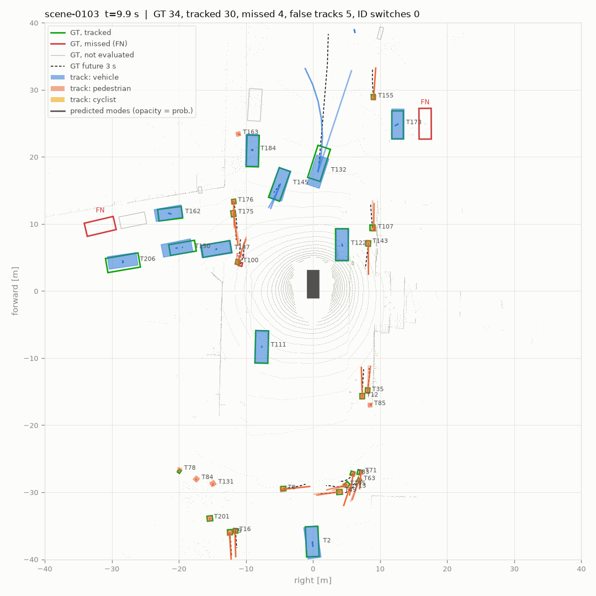
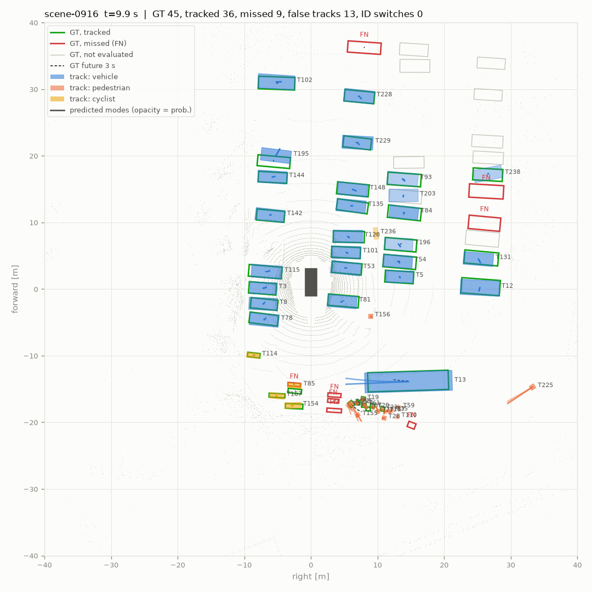

# nuScenes 片段评估与可视化

`tools/dog/nusc_clip_eval.py` 在 nuScenes 的少量场景上跑完整的"检测 → 跟踪 → 预测"，与真值比较。每个场景输出一个 Foxglove 可视化文件（MCAP），最后生成一份指标报告。

用的都是机器狗流水线本身的代码：
- **检测**：同一个检测器封装和过滤器。nuScenes 的 LIDAR_TOP 点云先经 `ModelFrame` 的逆变换转到检测系，所以网络看到的仍是它训练时的坐标系。
- **跟踪**：同一个跟踪器，世界系取 nuScenes 的 global 系。
- **预测**：同一个 IMM 预测器（第一档），也可以加载第二档模型。

真值和检测都合并成 vehicle / pedestrian / cyclist 三类，与狗的输出一致。微调后的狗模型（`--ckpt` 给狗的权重，配置按权重自动识别）也能这样评，用来查微调后在 nuScenes 上掉了多少；只检车辆的模型（`*_veh`）只看 vehicle 一行，行人、骑行者那两行不适用。

---

## 1. 准备数据

只需要元数据表和 LIDAR_TOP，相机图像可选。官方 mini 包有 4.2 GB，可以边下边解压，只留需要的部分（约 3 GB）。使用前需在 nuscenes.org 同意数据使用条款（非商业用途）。

```bash
mkdir -p data/nuscenes_mini && cd data/nuscenes_mini
curl -L https://motional-nuscenes.s3.amazonaws.com/public/v1.0/v1.0-mini.tgz | tar -xzf - --wildcards --no-anchored \
    'v1.0-mini/*.json' 'samples/LIDAR_TOP/*' 'sweeps/LIDAR_TOP/*' 'samples/CAM_*'
```

不依赖 nuscenes-devkit，也不需要地图文件；`dog_perception/nuscenes_clip.py` 直接读取 JSON 表。

**评估要用 val 场景**：预训练权重是在 train 划分上训练的。mini 里只有 `scene-0103` 和 `scene-0916`（即 `mini_val`）属于 val，另外 8 个场景（`mini_train`）训练时见过。有完整的 trainval 数据时，可以用 `--version v1.0-trainval --scenes val --max-scenes N` 抽几段来评估。

## 2. 运行

```bash
python tools/dog/nusc_clip_eval.py --dataroot data/nuscenes_mini --version v1.0-mini \
    --scenes mini_val --ckpt work_dirs/pretrained/nusc_pp.pth --out work_dirs/nusc_eval
```

| 参数 | 默认 | 说明 |
|---|---|---|
| `--scenes` | `mini_val` | 划分名（`mini_val` / `val` / ...），或逗号分隔的场景名 |
| `--hz` | 10 | 10：隔一帧取一个 20 Hz 的 sweep（跟踪器调参时用的就是 10 Hz）；2：只用关键帧，快 5 倍 |
| `--cams` | `CAM_FRONT` | 写入 MCAP 的相机，可写 `all` 或 `none` |
| `--max-frames` / `--max-scenes` | 全部 | 只跑一部分 |
| `--lidar-stride` | 1 | `/lidar` 每 n 个点取 1 个，用来减小文件 |
| `--predictor-model` | 无 | 第二档预测模型（`.pt`）；不给就只评第一档 IMM |
| `--no-mcap` | 关 | 只算指标、不写可视化 |

在 x86 CPU 上，Pillar 网络每帧约 1.8 s（nuScenes 的 ±51.2 m 网格，10 个 sweep）。一个 20 s 的场景在 10 Hz 下约 6 分钟，2 Hz 下约 1.5 分钟。有 GPU 会快得多。

输出目录里有：每个场景的 `<scene>.mcap`、`<scene>_bev.png`（中间关键帧的鸟瞰图），以及 `report.md` 和 `report.json`。

## 3. 可视化内容（Foxglove）

| 话题 | 内容 |
|---|---|
| `/tf` | `map → ego → LIDAR_TOP / CAM_*`。3D 面板的 Follow 设成 `ego`，视角就跟着车走 |
| `/lidar` | 当前 sweep，带 intensity |
| `/gt/boxes` | 真值线框。**绿**：被跟踪到；**红**：漏掉（FN）；灰：不参与评估（无激光点、超出类别距离、或不是三类之一）；细绿：非关键帧上插值出的真值。标签含类别、实例号、速度；速度箭头 |
| `/gt/paths` | 真值过去 2 s（实线）和未来 3 s（白色虚线，也就是预测要对比的目标） |
| `/det/boxes` | 上报的检测，按类别填色，标注分数，带速度箭头；关键帧上的误检加红框并标 "FP" |
| `/det/low_score` | 分数在 0.1 和上报阈值之间、只给跟踪器第二阶段用的检测（淡色线框） |
| `/track/boxes` | 已确认轨迹，线框颜色按轨迹 ID 区分（ID 切换时颜色会变），标签为 `T<id> 类别 分数 速度`；coasting 的轨迹变淡 |
| `/track/history` | 每条轨迹的历史位置（圆点表示那一帧有观测） |
| `/pred/paths` | 预测的各个模态，线宽和透明度表示概率，终点标概率；最可能模态在 3 s 处的 1σ 椭圆；关键帧上用红线连到真值终点，并标 FDE |
| `/events` | 关键帧上的事件："ID SWITCH T3->T9"、"MISSED"、"FALSE TRACK" |
| `/ego` | 自车、速度、走过的路径 |
| `/cam/CAM_FRONT/image`、`/calibration`、`/annotations` | 关键帧相机图像，叠加投影的真值框（绿/红）和轨迹框（轨迹颜色、ID） |
| `/metrics/frame` | 每个关键帧的数值：GT 数、检测 TP/FP/FN、跟踪 TP/FP/FN/IDSW、累计 MOTA、该帧匹配误差、FDE 均值、轨迹数。可在 Plot 面板里画曲线，例如 `/metrics/frame.mota_cum` |
| `/log` | ID 切换的文字记录（Log 面板） |

在 3D 面板里点击任意一个框，可以查看它的全部属性。真值框有类别、属性（moving / parked / standing…）、可见度、激光点数、评估状态、匹配到的轨迹号；轨迹框有分数、命中次数、存活时间、模态概率、位置标准差、匹配到的真值和中心误差、FDE；检测框有分数、速度、尺寸、TP/FP。

推荐的面板布局：
- 左侧一个 3D 面板（Follow `ego`，按需开关上面各个话题）；
- 右上 Image 面板，选 `/cam/CAM_FRONT/image`，叠加 `/cam/CAM_FRONT/annotations`；
- 右下 Plot 面板（`mota_cum`、`trk_fn`、`idsw`）加一个 Log 面板。

## 4. 指标

所有匹配都用 BEV 中心距离。
- **真值筛选**：参与评估的真值要有激光点，并且在类别距离内（vehicle 50 m，pedestrian / cyclist 40 m，与 nuScenes 检测评估一致）。检测和轨迹按同样的距离筛选。
- **检测**：在检测器的全部输出（分数 ≥ 0.1）上计算 0.5 / 1 / 2 / 4 m 的 AP；在 2 m 的真阳性上计算 ATE（中心，m）、ASE（中心和朝向对齐后的 1−IoU）、AOE（朝向，rad）、AVE（速度，m/s）；按 0–20 / 20–30 / 30–50 m 分段统计 AP。另外给出上报阈值下的 precision 和 recall。
- **跟踪**（`dog_perception/tracking/evaluate.py`）：CLEAR MOT，距离阈值 2 m，匹配规则与 py-motmetrics 相同：上一帧的匹配只要还在阈值内就保留，其余用匈牙利算法分配。指标有 MOTA、MOTP、IDF1、ID 切换、断裂次数（FRAG）、MT/ML（被跟踪到 ≥80% / ≤20% 帧的真值轨迹数），以及 recall / precision。评估对象是上报的轨迹（已确认、含 coasting）。
- **预测**：在关键帧上，取与真值匹配、且真值未来 3 s 都有标注的轨迹；预测时刻为 0.5、1.0、…、3.0 s。minADE / minFDE 取最好的模态，ADE1 / FDE1 取概率最大的模态，MR 是所有模态终点都偏差 >2 m 的比例。对比基线 CV 用轨迹当前速度匀速外推。分别统计全部目标、运动目标（3 s 内移动 ≥1.5 m）和各类别的运动目标。

这些是按 nuScenes 定义的简化版本：三类合并、只算中心距离、没有 AMOTA，与官方 10 类 mAP / NDS / AMOTA 不能直接比较。它们的用途是在同一套数据上比较流水线的不同版本。

## 5. mini_val 结果

数据为 `scene-0103`、`scene-0916`：393 帧（10 Hz），81 个关键帧参与评估。检测器是 nuScenes 预训练 Pillar（`nusc_pp.pth`），流水线全部用默认参数（2026-10-12；之后跟踪器加了运动状态和长货车只开一条轨迹，检测和跟踪的数字可能有小的变化）。完整报告见 [nusc_mini_val_report.md](nusc_mini_val_report.md)。





两张图都是场景中间关键帧的鸟瞰图：绿/红框是被跟踪到/漏掉的真值，实心框是上报的轨迹，彩色线是概率最高的两个预测模态，黑色虚线是真值未来 3 s。scene-0103 中正在转弯的车（T132），IMM 给出两个模态：一个沿真值的弯道走，一个直行。scene-0916 是停车场，灰框是没有激光点、不参与评估的车。

**检测**（三类 mAP 0.663）

| 类别 | AP@2m | 0–20 m | 20–30 m | 30–50 m | 上报阈值下 precision / recall |
|---|---|---|---|---|---|
| vehicle | 0.710 | 0.935 | 0.728 | 0.341 | 0.96 / 0.70 |
| pedestrian | 0.801 | 0.866 | 0.775 | 0.545 | 0.80 / 0.80 |
| cyclist | 0.510 | 0.701 | 0.320 | 0.226 | 0.74 / 0.41 |

**跟踪**（MOTA 0.617，IDF1 0.732，MOTP 0.24 m）

| 类别 | MOTA | IDF1 | recall | precision | IDSW | FP | FN |
|---|---|---|---|---|---|---|---|
| vehicle | 0.689 | 0.792 | 0.767 | 0.924 | 29 | 126 | 467 |
| pedestrian | 0.531 | 0.771 | 0.883 | 0.722 | 12 | 360 | 124 |
| cyclist | 0.398 | 0.633 | 0.516 | 0.819 | 1 | 28 | 119 |

**预测**（运动目标，3 s 内移动 ≥1.5 m，554 个样本）

| | minADE | minFDE | FDE1 | MR@2m |
|---|---|---|---|---|
| IMM（第一档） | 0.68 | 1.28 | 1.36 | 0.166 |
| CV 基线 | 0.74 | 1.39 | 1.39 | 0.186 |

行人 478 个样本：IMM minFDE 0.74 m，CV 0.79 m。车辆只有 71 个样本，FDE 约 5 m，主要是 scene-0103 里转弯和起步的车。

**从误差分解（报告中的 "Where the tracking errors come from"）看出的问题：**

1. **行人需要在三类合并后再去重一次。** 不做时（`MERGED_NMS_RADIUS["pedestrian"] = 0`），558 个行人 FP 中有 193 个与同一个行人已有的轨迹相距不到 1 m，是同一个人身上的第二条轨迹；另有 110 个在已被跟踪的行人旁边。det3d 在 task 内只做了 0.42 m 的 NMS，同一个人身上相距 0.45–1.2 m 的第二个峰都留了下来，分数够高就新建一条轨迹。

   在 mini_val 关键帧上把相距 0.42–1.2 m 的成对行人框按真值分成"同一个人"和"两个人"：0.6 m 以内大多是同一个人（182 对比 44 对）；更远时两者都有，但同一个人身上的第二个框分数低得多（低/高分数比中位数 0.42，两个人是 0.80）。所以规则分两档：0.6 m 内总是合并，0.6–1.2 m 内低分框不到高分框 0.6 倍才合并（`circle_nms` 的 `weak_radius` / `weak_ratio`）。和纯半径的对比（网络输出相同，只换这一项）：

   | 行人去重 | 行人 AP | 三类 mAP | 行人 MOTA | IDF1 | IDSW | FP | FN | 重复轨迹 | 总 MOTA |
   |---|---|---|---|---|---|---|---|---|---|
   | 不做（原来） | 0.827 | 0.674 | 0.354 | 0.707 | 20 | 558 | 105 | 193 | 0.560 |
   | 半径 0.5 m | 0.815 | 0.670 | 0.422 | 0.719 | 26 | 473 | 112 | 115 | 0.582 |
   | 半径 0.7 m | 0.783 | 0.660 | 0.506 | 0.761 | 18 | 370 | 134 | 70 | 0.609 |
   | 半径 1.0 m | 0.722 | 0.640 | 0.538 | 0.767 | 14 | 303 | 171 | 14 | 0.619 |
   | 0.5 m + 1.0 m 内比例 ≤ 0.6 | 0.803 | 0.666 | 0.485 | 0.765 | 15 | 411 | 118 | 59 | 0.602 |
   | 0.6 m + 1.0 m 内比例 ≤ 0.7 | 0.785 | 0.660 | 0.530 | 0.769 | 13 | 360 | 124 | 32 | 0.617 |
   | 0.5 m + 1.2 m 内比例 ≤ 0.7 | 0.794 | 0.664 | 0.523 | 0.771 | 16 | 369 | 119 | 55 | 0.614 |
   | **0.6 m + 1.2 m 内比例 ≤ 0.6（默认）** | **0.790** | **0.663** | **0.531** | **0.771** | **12** | **360** | **124** | **39** | **0.617** |
   | 0.7 m + 1.2 m 内比例 ≤ 0.6 | 0.775 | 0.657 | 0.532 | 0.778 | 12 | 345 | 138 | 45 | 0.617 |

   行人 AP 是 0.5/1/2/4 m 四档的平均。默认规则的 MOTA 与 1.0 m 纯半径相当，AP 高 0.07；比 0.7 m 纯半径 AP 略高、MOTA 高 0.025。代价是近处挨得很紧的两个人有时被合成一个：0–20 m 的行人 AP@2m 从 0.912 降到 0.866，0–20 m 的行人 FN 从 20 升到 32。mini_val 只有两个场景，参数在狗的数据有真值后还应复核。

2. **漏检的车大多是远处、点很少的。** 467 个车辆 FN 中，326 个在 30–50 m，440 个少于 10 个激光点，416 个根本没有检出。这是 32 线雷达加预训练模型的远距离极限。狗的有效范围是 40 m，影响较小。
3. **检出了但没跟踪上的**共 145 个（车辆 51、行人 71、骑行者 23），对应轨迹确认需要 2 次命中，以及关联失败。行人从 53 增加到 71，增加的多半是挨着的两个人去重后只剩一个框：另一个人 2 m 内有框，所以算"检出"，但没有自己的轨迹。
4. 车辆 FP 中有 47 个落在"不参与评估的真值"上，多是被遮挡、没有激光点的停放车辆。这类 FP 其实是对的，只是评估规则把它们算作误检。

时间（这台 x86 CPU 上的中位数）：网络 1.3–1.6 s/帧（视 CPU 负载），跟踪 32–37 ms，预测 32 ms，写可视化 150 ms。
